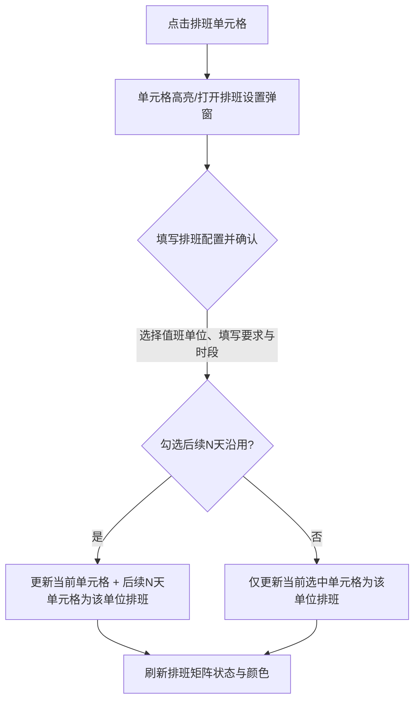

# 源头防控（cq）子页——“排班”模块优化需求文档 (PRD)

## 1. 需求概述

- **需求背景**：蓝鹰一体化系统中，源头防控（cq）定制子页作为超管和值班人员的一体化智控工作台，需要具备强大的警务任务与舆情排班设置能力。
- **用户故事**：作为一个系统超管或值班人员，我希望能够直观地查看各警务事件/任务在一段时间内的值班排班状态，并能够针对特定日期 and 任务快速设置值班单位、任务要求和多个工作反馈时段，同时支持一键批量复制排班到后续多天，从而提升警舆同处和源头防控的值班调度效率。
- **业务价值**：通过可视化的甘特图/日历矩阵，降低排班配置复杂度；支持多时段反馈与快速沿用排班，极大减少重复配置操作。

---

## 2. 界面布局与核心定义

优化后的页面切换至 **“排班”** 页签时，界面分为**控制栏区**和**大日历排班矩阵区**两大主体：

### 2.1 顶部控制与筛选栏
| 字段 / 组件 | 类型 | 描述 / 选项 / 约束 |
| --- | --- | --- |
| **子页签切换** | Tabs | “今日” / “当月” / **“排班”** (当前激活) / “排班统计”。切换至“排班”展示本矩阵。 |
| **任务类型** | Select | 筛选下拉框，包含“全部”、“重大实体事件跟踪”、“安保任务”等。 |
| **值班单位** | Select | 筛选下拉框，包含系统内的各区县/支队值班单位（如“大足区”、“总2_舆情”、“总公司”等）。 |
| **值班日期** | RangePicker | 日期范围选择器，默认展示 16 天范围（如 `2026-07-31` 至 `2026-08-15`）。 |
| **查询** | Button | 蓝色按钮，点击执行筛选并更新排班矩阵。 |
| **状态图例** | Legend | 位于右上角，展示四种状态颜色标识：<br>1. **未完成**（淡红色边框/字体）<br>2. **进行中**（橙黄色边框/字体）<br>3. **未开始**（灰色边框/字体）<br>4. **已完成**（绿色边框/字体） |

---

### 2.2 大日历排班矩阵 (Calendar Matrix)
采用横向时间轴、纵向任务分组的矩阵表格：
1. **左侧任务列（固定悬浮）**：
   - 纵向按**任务类型**进行分组折叠/分类排列（如“重大实体事件跟踪”、“安保任务类型”等）。
   - 各类型下列举所有相关的事件/任务名称（如“渝中宝马撞人事件”、“大足一中”、“大足矫正教育”等）。
2. **右侧日期列（横向滚动）**：
   - 日期表头：显示日期与星期（如 `31 周五`、`1 周六`、`2 周日` ... `15 周六`）。
   - **排班单元格 (Cell)**：
     - **未排班状态**：默认显示为灰色药丸型标签 `未排班`。
     - **悬停状态**：鼠标悬停在 `未排班` 单元格上时，标签变更为蓝色边框与文字的 `点击排班`，提示可交互。
     - **已排班状态**：单元格显示具体的值班单位名称（如 `大足区`、`总2_舆情` 等）。
     - **状态颜色映射**：已排班单元格的边框与文字颜色根据任务的执行状态，与右上角图例（未完成-红、进行中-橙、未开始-灰、已完成-绿）保持联动。
     - **悬停悬浮框 (Tooltip)**：悬停在已排班单元格上时，气泡展示排班详情（值班单位、任务要求、工作情况反馈时段）。

---

### 2.3 排班配置弹窗 (Popover / Modal)
点击矩阵中任意单元格时，该单元格变为**选中激活状态**（背景色转为紫色），并在单元格附近呼出悬浮排班配置弹窗，包含以下表单项：

| 表单字段 | 组件类型 | 校验与必填 | 默认值 / 交互说明 |
| --- | --- | --- | --- |
| **值班单位** | Select | **必填** (红星) | 可选系统所有值班单位，如“大足区”、“总2_舆情”、“总公司”等。支持搜索过滤。 |
| **任务要求** | Textarea | 选填 | 文本域，支持输入具体的排班工作指引或任务备注。 |
| **工作情况反馈时段** | List (Dynamic) | **必填** (红星) | 默认包含 3 个时段行：<br>1. 开始 `09:00` 结束 `11:00`<br>2. 开始 `14:00` 结束 `16:00`<br>3. 开始 `20:00` 结束 `22:00`<br>- 每行右侧带 **删除图标**（点击可移除该时段）。<br>- 尾行右侧带 **添加图标 `(+)`**（点击可新增一行时段，提供时间选择器）。 |
| **值班单位分配形式** | Checkbox + InputNumber | 选填 | 勾选复选框后，启用“后续 [ N ] 天，采用同样排班”；<br>- 数字输入框默认显示最近常用天数（如 `6` 或 `30`），支持微调天数。 |
| **操作按钮区** | Button Group | - | - **关闭**：取消修改，关闭弹窗，取消单元格选中状态。<br>- **确认选择**：保存排班，回刷到排班矩阵中，联动更新对应天数的值班信息，关闭弹窗。 |

---

## 3. 核心交互流与数据联动



### 3.1 核心数据结构示例
```json
{
  "taskId": "task-yuzhong-bmw",
  "taskName": "渝中宝马撞人事件",
  "taskType": "重大实体事件跟踪",
  "schedules": {
    "2026-07-31": {
      "dutyUnit": "总2_舆情",
      "requirements": "重点监控线上负面言论，及时汇报扩散情况。",
      "timeRanges": [
        { "start": "09:00", "end": "11:00" },
        { "start": "14:00", "end": "16:00" },
        { "start": "20:00", "end": "22:00" }
      ],
      "status": "ongoing" // ongoing-进行中, completed-已完成, todo-未开始, overdue-未完成
    }
  }
}
```

---

## 4. 边界异常与验收标准

### 4.1 异常处理与兜底
- **时段重叠校验**：在“工作情况反馈时段”中，新增或编辑时段时，开始时间必须早于结束时间，且各时段区间不得发生交叉重叠。
- **无匹配数据**：在筛选条件（任务类型/值班单位/日期）无结果时，矩阵主体显示 Empty 空白提示。
- **排班冲突提示**：若后续 N 天内已存在其他单位的排班，勾选“采用同样排班”进行覆写确认时，提示“后续天数中已存在排班，确认要覆盖吗？”以防误操作。

### 4.2 验收标准 (Definition of Done)
- **P0级（核心实现）**：
  1. 点击 `未排班` 弹出排班设置框，修改并确认后，矩阵相应单元格成功更新为对应值班单位。
  2. 勾选“后续 N 天，采用同样排班”能够成功将当前配置同步复制到后续第 1 至第 N 天。
  3. 支持删除 and 添加时段行，时段选择器支持正常选择输入。
- **P1级（视觉与体验）**：
  1. 大日历矩阵具备横向滚动条，且最左侧的任务名称栏在横向滚动时保持固定悬浮。
  2. 单元格背景颜色/边框与右上角图例状态对应，图例切换查询生效。
  3. 排班配置弹窗能够自适应定位在选中单元格的上方或下方，不遮挡关键信息。
