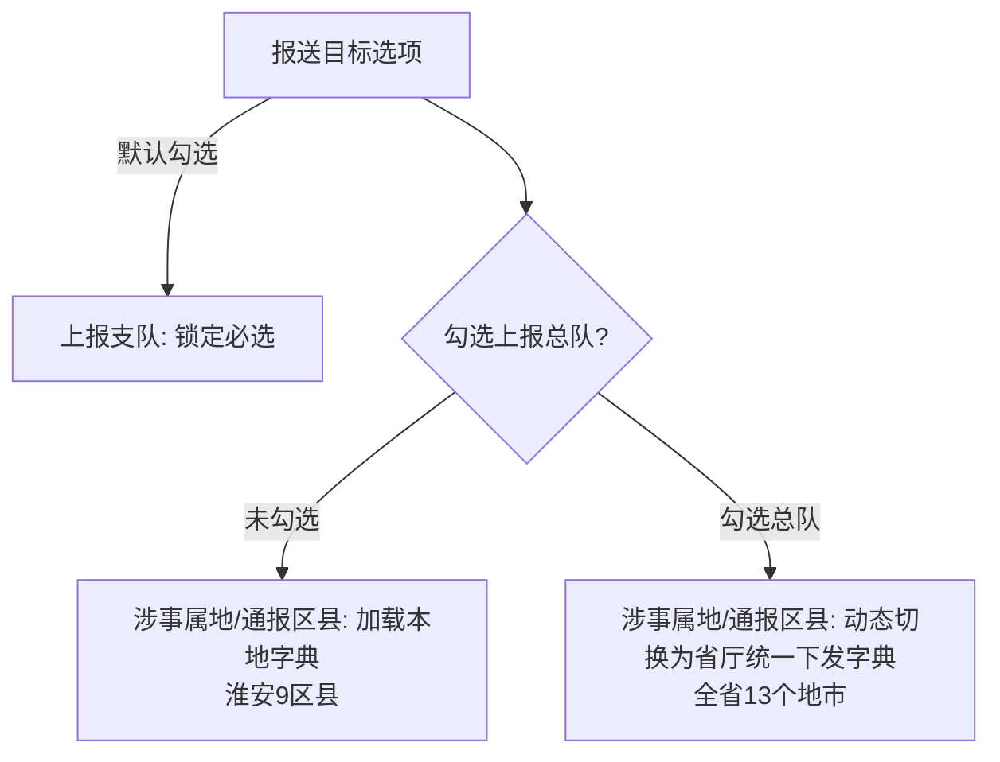
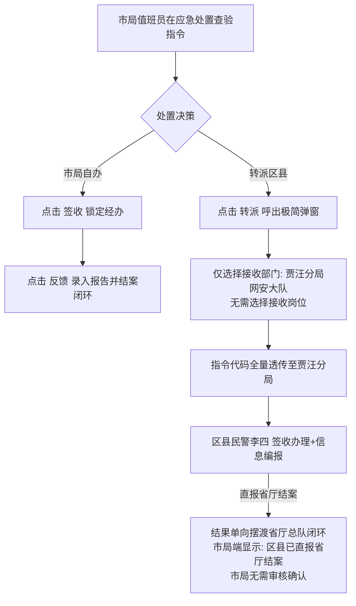

# 蓝鹰一体化系统 · 省厅-总队-基层单位协同流转与功能配置功能细节描述

> **文档性质**：操作手册编撰基准输入文档（系统功能细节规格与实操动线描述）  
> **适用受众**：操作手册编写人员、省厅/市局/区县各级值班与业务民警、系统运维管理员  
> **系统基线**：蓝鹰一体化智控系统（涵盖 SaaS 运维后台与一体化平台业务端）  
> **层级架构**：省厅网安总队（中心汇聚） ↔ 独立采购地市公安局（市局网安支队） ↔ 下辖区县公安分局（区县网安大队）

---

## 一、 系统架构与协同网络总览

蓝鹰一体化系统面向公安网安部门，构建了纵向贯通省厅总队、地市市局、区县基层大队，横向支撑跨地市协作的智控舆情及事件处置体系。

### 1.1 组织层级与角色定位

| 层级机构 | 典型单位 | 核心角色 | 业务职责定位 |
|:---|:---|:---|:---|
| **省厅汇聚中心** | 江苏省公安厅网安总队 (JSga) | 总队值班长 / 研判专家 | 全省网络舆情宏观态势掌控、区县直报线索研判采纳、跨租户/跨单位处置指令发起与联合调度、专网容灾监控。 |
| **地市业务枢纽** | 徐州市公安局 / 淮安市公安局 | 市局网安支队值班员 / 支队审批人 | 市域舆情管控枢纽。支持直报省厅质量把关审核；接收省厅跨租户指令并支持自办或向下转派区县。 |
| **区县基层实战** | 贾汪分局大队 / 清江浦分局大队 | 区县基层网安民警 / 值班民警 | 基层第一现场发现填报、领受市局转派指令、落地核查、制作工作笔录并直接报送省厅总队核销闭环。 |
| **平台管理与运维** | 省/市局系统运维保障中心 | SaaS 运营超管 / 平台管理员 | 客户组织机构管理、跨租户部门映射路由打通、上报总队审批策略配置、专网流转地址配置、岗位权限分配。 |

### 1.2 协同场景总览矩阵

```mermaid
flowchart TD
    subgraph 配置支撑 SC-05
        A1[管理后台: 关联部门映射] --> A2[工具箱: 上报总队审批配置]
        A2 --> A3[工具箱: 专网数据流转配置]
        A3 --> A4[岗位管理: 跨租户/转派接收权限]
    end

    subgraph 上报通道 SC-01 / SC-02
        B1[区县基层手工填报] -->|勾选上报总队| B2{是否开启审批?}
        B2 --未开启免审--> B3[省厅监测预警入库+异地镜像]
        B2 --开启审批--> B4[市局支队待审池拦截]
        B4 --放行--> B3
        B4 --驳回--> B5[退回区县草稿就地修改]
    end

    subgraph 下达与处置通道 SC-03 / SC-04 / SC-06
        C1[省厅AI辅助研判] --> C2[自描述Schema指令下发]
        C2 -->|专网波动失败| C3[推送结果大弹窗+行内重试+时效挂起+待反馈红叹号]
        C2 -->|投递成功| C4[市局支队指令接收岗待办]
        C4 -->|路径A: 市局自办| C5[市局签收+反馈结案]
        C4 -->|路径B: 市局转派| C6[转派区县免选岗位]
        C6 --> C7[区县大队签收办理+信息编报]
        C7 -->|免市局二审| C8[处置结果直报省厅结案]
    end
```



---

## 二、 基础配置功能细节（管理员实操指南）

### 2.1 功能模块：SaaS 管理后台 · 客户管理与关联部门映射 (SC-05)

#### 1. 业务功能目标
解决独立采购地市客户全称（如“徐州市公安局”）与省厅内设部门字典（如“徐州市”）名称字符不一致导致的跨租户指令路由阻断，建立底层确定性映射。

#### 2. 入口与界面路径
- **系统入口**：SaaS 运营管理后台（后台运维端）
- **导航路径**：`全局管理 ➔ 客户管理 ➔ 客户列表`
- **操作按钮**：在目标客户（徐州市公安局）数据行右侧，点击【编辑】操作链接，唤出【编辑客户】弹窗。

#### 3. 字段规则与界面元素

| 字段名称 | 控件类型 | 必填性 | 配置值 / 规则说明 |
|:---|:---|:---:|:---|
| **所属组织机构** | 下拉单选框 | 是 | 选择预设的统一组织机构，如 `江苏省厅网安`。使省厅与地市处于同一协同网络。 |
| **市直单位标签** | Checkbox 复选框 | 否 | 省厅汇聚单位（JSga）勾选为 `true`；独立采购地市（徐州市公安局）**保持不勾选**（`false`）。 |
| **上级客户** | 下拉单选框 | 否/联动 | 当“市直单位”未勾选时动态激活。下拉选择勾选了市直单位的客户，如 **`JSga`**（江苏省公安厅）。 |
| **关联部门** | 下拉单选框 | **是 (核心)** | **联动触发**：选择上级客户 `JSga` 后，系统自动远程异步获取省厅组织架构部门列表。<br/>**选择目标**：在下拉列表中单选对应地市名称 **`徐州市`**。<br/>**约束**：若上级客户清空，本字段联动清空并禁用。 |

#### 4. 提交校验与结果回显
- 点击弹窗右下角【确定】按钮，系统校验必填项完整；
- 列表对应客户条目的【跨租户通道状态】从 `未打通` 变为绿色徽标 `[已就绪 (映射: 徐州市)]`。

---

### 2.2 功能模块：一体化平台 · 工具箱平台定制配置 (源头防控上报审批) (SC-05)

#### 1. 业务功能目标
由地市业务管理员根据本地区管控要求，按需灵活配置区县基层上报总队时是执行“免审直通省厅（场景 1）”还是“市局支队前置把关审批（场景 2）”。

#### 2. 入口与界面路径
- **系统入口**：蓝鹰一体化智控平台（业务前端应用）
- **导航路径**：`主导航 ➔ 工具箱 ➔ 设置 ➔ 一体化工作平台配置`
- **页面视图**：系统采用降噪极简视窗，全屏聚焦【定制化配置】面板，定位至【源头防控】配置区块。

#### 3. 字段规则与界面元素

| 配置项 | 控件类型 | 联动规则与业务口径 |
|:---|:---|:---|
| **排班统计列表隐藏统计标签** | Switch 开关 | 控制源头防控排班大屏标签显示。 |
| **上报总队审批** | Checkbox 复选框 | **[√] 上报总队审批**（核心开关）。<br/>- **未勾选**：全区县执行【场景 1：免审直通省厅】流；<br/>- **勾选**：全区县执行【场景 2：市局前置审核】流。 |
| **审批人** | Select 多选下拉框 | **联动激活**：仅在勾选【上报总队审批】后高亮呈现并支持多选。<br/>**数据来源**：本市网安支队人员账号字典。<br/>**预置项**：可多选指定 `支队-宋洪霖`、`支队-张三` 等。<br/>**校验规则**：勾选后审批人至少选择 1 位，否则点击保存时弹出 Alert 错误拦截。 |

#### 4. 策略生效
- 点击右上角【保存配置】按钮，Toast 弹出 `配置更新成功，策略已实时下发网关`；
- 无需重启服务，所有基层填报端即刻按照新策略路由。

---

### 2.3 功能模块：一体化平台 · 工具箱专网数据流转配置 (SC-05)

#### 1. 业务功能目标
针对公安专网及隔离网闸部署环境，配置省厅下发指令和地市直报上浮的专网接口地址与网络重试参数。

#### 2. 入口与界面路径
- **系统入口**：蓝鹰一体化智控平台
- **导航路径**：`主导航 ➔ 工具箱 ➔ 数据流转配置`（独立一级 Tab，非二级嵌入，权限码：`toolbox:transmission`）
- **公司定位切换**：顶部居中提供单选切换器：`[ 总队单位 ]` | `[ 地市单位 ]`。

#### 3. 界面元素与操作规范

##### (1) 总队单位端视角
- **界面内容**：仅展示【地市流转列表】与【流转路径管理】，不展示无关的连通率统计冗余标签。
- **列表字段**：`｜地市名称｜指令接收地址｜通道状态｜测通时延｜操作｜`。
- **新增/编辑路径弹窗**：
  - **部门选择**：下拉单选，系统部署时已初始化全省 13 个地市（南京市、徐州市、淮安市…）；**界面无需展示部门代码**（由后台静默绑定映射）；
  - **指令接收地址**：单行文本输入框，输入目标地市专网前置机地址（如 `https://ga.xuzhou.internal:8443/api/v1/directive/receive`）；**已彻底移除“备用地址”输入框**，保障单一确定性通道；
  - **操作**：行内提供【连通性测试】按钮，点击后发起 5s 握手探测，成功后显示绿色 Badge `[已连通 (42ms)]`。

##### (2) 地市单位端视角
- **界面内容**：仅呈现单一**上报单位目标地址**（省厅总队指令与上报接收地址，**已去除备用地址**）及**重试范围**。
- **配置项**：
  - `省厅接收网关 URL`：如 `https://ga.js.internal:8443/api/v1/report/ingress`；
  - `请求超时时间`：数字输入框，默认 `5000` ms；
  - `最大重试次数`：数字输入框，默认 `3` 次；
- **快速检测**：点击【快速连通性检测】按钮，即时回显网络往返时延（RTT）及安全签名握手状态。

---

### 2.4 功能模块：一体化平台 · 岗位管理与细粒度权限配置 (SC-05)

#### 1. 业务功能目标
在岗位管理中开通细粒度权限，使市局支队值班员具备认领省厅跨租户指令的能力，区县大队值班民警具备接收同租户转派指令的能力。

#### 2. 入口与界面路径
- **导航路径**：`系统设置 ➔ 岗位管理 ➔ 岗位列表`
- **操作**：在岗位行点击【修改岗位】按钮，唤出岗位权限分配抽屉/弹窗。

#### 3. 权限节点配置规范

| 岗位类型 | 典型岗位名称 | 岗位可用部门设置 | 权限树勾选节点（应急处置分支下） | 赋权效果说明 |
|:---|:---|:---|:---|:---|
| **市局网安支队** | 支队值班岗 | 设为 `市公安局网安支队` 及其内设各科室 | **`[√] 跨租户指令接收权限`** (`directive:cross_tenant:receive`) | 赋予该岗位认领由省厅总队跨租户下达给徐州市局的处置指令。用户值班申领此岗后，待办池自动同步省厅下达指令。 |
| **区县网安大队** | 区县值班岗 | 设为 `贾汪分局网安大队` 或下辖派出所 | **`[√] 下级单位指令接收`** (`directive:sub_unit:receive`) | 赋予该岗位接收市局同租户转派指令的权限。指令代码全量透传免异构字典映射。 |

#### 4. 全链路双向连通性校验（4 节点拓扑）
在配置界面点击【全链路通道校验】，系统动态串联验证：
1. **节点 1**：管理后台客户关联部门映射（徐州市局 ↔ 徐州市）；
2. **节点 2**：一体化平台源头防控审批策略与审批人有效性；
3. **节点 3**：市局支队值班岗跨租户接收权限绑定；
4. **节点 4**：区县大队值班岗转派指令接收与直报省厅闭环。
- 校验通过后，拓扑图高亮呈现全绿色连通线，提示 `[全链路双向通道已连通 100%]`。

---

## 三、 舆情数据上报功能细节（基层与市局实操指南）

### 3.1 场景 1：地市基层手工上报 · 免审直通省厅与跨市通报 (SC-01)

#### 1. 业务背景
基层民警发现跨地市舆情线索（如淮安民警发现涉连云港线索），且市局当前未开启审批时，民警上报可直接跨网摆渡至省厅监测预警库，并自动镜像至目标地市通报台账。

#### 2. 入口路径
- **角色**：地市基层网安民警（如淮安清江浦分局张华）
- **路径**：`主导航 ➔ 源头防控 ➔ 手工上报`

#### 3. 界面表单元素与字典联动切换机制



- **表单填写明细**：
  1. **舆情标题**：单行文本，必填，如《连云港某化工厂发生轻微排污舆情求证帖》；
  2. **线索链接**：单行文本，支持微博、抖音、微信公众号等主流社媒 URL；
  3. **舆情正文**：富文本输入框，输入网帖原文及传播情况；
  4. **报送目标**：
     - `[√] 上报支队`：系统锁定勾选，不可取消；
     - `[ ] 上报总队`：由民警自主勾选；
  5. **字典联动切换交互（核心细节）**：
     - **未勾选【上报总队】**：【涉事属地】与【通报区县】下拉框仅展示淮安本地 9 个区县（清江浦区、淮安区、淮阴区、洪泽区、涟水县、盱眙县、金湖县、开发区、新城区）；
     - **勾选【上报总队】**：界面产生 0.3s 平滑微动过渡，【涉事属地】动态替换为省厅下发的全省 13 地市单选下拉框；【通报地市】切换为全省 13 地市多选列表，民警可勾选目标地市（如 `连云港市`）；
  6. **舆情来源展示**：第一阶段保持系统默认规范显示（如：`来源: 手工上报-淮安市局`）。

#### 4. 提交流转与省市接收
- **提交确认**：点击底栏【确认上报】按钮，系统读取策略 `reportToProvincialAudit === false`，Toast 提示 `免审直通策略生效，数据已成功跨网摆渡至省厅总队`；
- **省厅端接收 (JSga)**：
  - 省厅值班长进入 `监测预警 ➔ 区县上报` Tab；
  - 列表即刻收到该条上报记录，初始状态为绿色胶囊 `[待研判]`；
  - 省厅民警在卡片上点击【下达处置指令】后，状态自动流转更新为 **`[已采纳]`**，系统自动计入淮安市局的舆情考评积分；
- **地市 B 端镜像 (连云港市局)**：
  - 连云港市局值班员进入 `监测预警 ➔ 通报信息` Tab；
  - 查验到跨市通报镜像记录，表格采用轻量化列规范（固定展示通报来源、标题、发帖时间，隐藏处置状态列与多余操作按钮，仅保留【查看详情】链接）。

---

### 3.2 场景 2：市局网安支队审核拦截 · 放行直通与驳回修改 (SC-02)

#### 1. 业务背景
当市局在工具箱开启【上报总队审批】策略时，下辖区县基层民警上报总队的舆情数据被前置物理拦截在市局待审池，需由支队审批人人工审核把关。

#### 2. 区县填报受控拦截动线
- **角色**：常州武进分局网安民警；
- **操作**：在【源头防控 - 手工上报】填报并勾选【上报总队】后点击提交；
- **界面拦截反馈**：
  - 界面弹出受控拦截 Alert 提示窗：*“当前租户已启用市局直报审核策略，您的上报已暂扣在市局待审池，待支队审批通过后自动上报总队”*；
  - 民警在【源头防控 - 我的上报】列表中查验，该条单据流转状态显示为橙色胶囊 **`[待市局审核]`**。

#### 3. 市局网安支队审核判定动线
- **角色**：市局网安支队审批人（宋洪霖、张三）；
- **提醒消息**：登录系统后，右上角消息铃铛弹出浮窗提醒：*“收到 1 条区县直报省厅待审单据，请在 2 小时内核验把关”*；
- **入口路径**：`监测预警 ➔ 上报审核` 专属 Tab（携带橙色待审数量角标，与正式情报列表物理隔离）；
- **操作卡片**：卡片展示区县填报的完整网帖要素、截图证据、涉事属地及报送人；
- **审核裁决分支（双向操作）**：
  - **分支 1：审核通过（放行省厅）**
    1. 点击卡片右下角【审核通过】（或【提交】）按钮；
    2. 弹出确认浮层，确认后系统更新状态为绿色徽标 `[已通过]`；
    3. 触发安全网闸，数据跨网摆渡入库省厅【监测预警 - 区县上报】板块；
  - **分支 2：审核驳回（退回基层）**
    1. 点击卡片右下角【审核驳回】按钮；
    2. 弹出【填写驳回原因】模态窗，输入详细修改要求（如：*“涉事企业名称核查不准确，请补充核实涉事属地及发帖人社交账号”*）；
    3. 点击【确定驳回】，单据终止外发并在本地留存，不推送省厅；
    4. 区县填报民警端【我的上报】列表状态实时刷新为红色胶囊 **`[市局已驳回]`**，附带查看驳回原因链接，并提供【重新编辑】入口。

---

## 四、 指令下达、转派与闭环功能细节（处置实操指南）

### 4.1 场景 3：省厅总队跨租户指令下达 · 自描述载荷与动态插值 (SC-03)

#### 1. 业务功能目标
省厅网安总队在监测预警板块中对重点舆情发起处置指令，使用自描述 Schema 载荷包与动态参数变量，精准定向投递到徐州市局网安支队指令接收岗。

#### 2. 入口与界面路径
- **角色**：省厅网安总队值班长（李警官）
- **路径**：`主导航 ➔ 监测预警 ➔ 预警信息`
- **操作按钮**：在目标舆情卡片底部，点击【AI辅助研判】或【下达处置指令】按钮。

#### 3. 弹窗交互与表单要素

##### (1) AI 辅助研判综合弹窗 (980px 响应式)
- **左侧全息要素区**：
  - 舆情指数仪表盘：热度指数（如 68.5）、敏感度指数（如 84.2）；
  - AI 敏感点挖掘：高亮提取“煽动非法聚集”、“恶意造谣企业停产”等核心实体；
  - 事件聚类图谱：自动聚合微博求证帖、抖音短视频等同源事件关联链；
- **右侧指令快速勾选区**：
  - 常用单位指令：提供【总队落实】、【领导批示】快速选择；
  - 常用执行指令：提供【线下核查】、【属地落实】、【持续监测】多选胶囊。

##### (2) 详细指令发起弹窗 (860px)
- **接收单位**：下拉单选，选择目标地市 **`徐州市公安局网安支队`**；
- **指令清单多选**：勾选具体的处置类型（支持多选 `线下核查` + `属地落实`）；
- **参数化动态变量模板（核心交互）**：
  - 输入框上方提供变量药丸标签：`[+ 单位名称]`、`[+ 指令名称]`、`[+ 处理周期]`；
  - 点击标签可在文本中插入占位符；
  - 模板示例：*“请【单位名称】网安部门立即对上述网帖反映的隐患开展【指令名称】，于【处理周期】前反馈落地查证情况与工作笔录。”*；
  - 系统下发引擎在发送时自动插值替换为：*“请徐州市公安局网安支队网安部门立即对上述网帖反映的隐患开展线下核查，于今日 18:00 前反馈落地查证情况与工作笔录。”*；
- **自描述 Schema v2.4 契约打包**：
  - 系统将指令元数据封装为标准自描述 JSON 契约包（包含 directiveId、clueId、urgencyLevel、deadline、数字防伪签名）；
  - 点击【调阅契约报文】抽屉可实时预览 JSON 报文。

#### 4. 底层寻址与派发回执
- 点击【确认下达】，网关根据接收单位名称“徐州市公安局网安支队”匹配后台客户映射 `relatedDeptName === '徐州市'`，精准投递至徐州市局具有【跨租户指令接收权限】的岗位待办池；
- 界面弹出 Toast：`已成功跨租户派发至徐州市公安局网安支队值班待办池`。

---

### 4.2 场景 4：市局应急处置协同 · 转派基层与自办双轨流转 (SC-04)

#### 1. 业务功能目标
市局值班员在【应急处置】板块查验省厅下达指令，支持由市局本级自办闭环，或直接转派区县大队（极简转派免选岗位）；区县大队承办反馈后**处置结果直接报送省厅总队结案闭环，市局无需审核确认**。

#### 2. 入口与专项筛选
- **角色**：市局网安支队值班民警（张三）
- **路径**：`主导航 ➔ 应急处置`
- **专项检索复选框（核心元素）**：
  - 筛选栏在“处置时间”组件后，新增复选框 **`[ ] 是否省厅下达`**；
  - 勾选该复选框后点击【查询】，列表仅过滤展示涉及跨租户/省厅下达的事件卡片，方便专项清点与督办。

#### 3. 卡片展示规范（日常化统一降噪）
- **彻底隐藏来源标签**：卡片内的指令清单行中，**100% 隐藏“总队下达 / 本单位下达 / 市局交办”等来源标签**，消除层级身份对基层的心理干扰；
- **规范保留要素**：仅保留业务类型胶囊（如 `【线下核查】`）、处置时限倒计时（如 `剩余 03:45:12`）、经办人（未签收显示“待认领”）以及指令正文。

#### 4. 市局双轨制操作动线



##### (1) 路径 A：市局自办闭环
1. 在指令条目右侧点击 **`【签收】`**，经办人自动锁定为当前账号（张三），防并发抢占；
2. 开展研判核查，完成后点击 **`【反馈】`** 按钮；
3. 弹出反馈结果表单，录入处置结论与附件笔录，点击提交，指令直接就地办结。

##### (2) 路径 B：市局转派基层（极简免选岗）
1. 在指令条目右侧点击 **`【转派】`** 按钮；
2. 弹出【指令转派】模态窗：
   - **接收部门**：下拉单选框，选择 `徐州市公安局贾汪分局网安大队`；
   - **特别注意**：**弹窗内严禁出现“接收岗位”选择框**，彻底取消人工选岗步骤；
   - **转派附言**：可选填转派补充说明；
3. 点击【确认转派】，系统将指令代码全量透传，自动推入贾汪分局申领了【下级单位指令接收】权限的值班账号待办池中。

#### 5. 区县基层承办直报省厅闭环（市局免审）
- **角色**：贾汪分局网安大队值班民警（李四）；
- **操作动线**：
  1. 登录一体化平台，进入【应急处置】板块；
  2. 界面仅保留 **`【签收办理】`** 与 **`【信息编报 / 反馈】`** 操作按钮，**无转派权限**；
  3. 点击【签收办理】认领任务；
  4. 线下核查完成后，点击【信息编报/反馈】，在表单中录入《落地核查处置情况报告》并上传佐证截图；
  5. 点击【提交反馈】按钮；
- **直报省厅总队规则（关键红线）**：
  - 处置结果提交后，数据通过单向跨网网闸**直接报送省厅总队终审结案**；
  - **市局端完全免审**：市局无需留意，系统中无市局确认或二审环节；
  - 市局端该事件卡片状态同步刷新为辅助标记 `[区县已直报省厅结案]`。

---

### 4.3 场景 6：跨租户多单位联合处置 · 指令推送失败与容灾补发 (SC-06)

#### 1. 业务背景
在面临重大突发舆情时，省厅总队需向淮安、南京、徐州等多地市/区县联合下派指令。因专网网闸波动导致部分指令投递失败时，系统提供实时拦截、自动挂起对方时效、大弹窗排查重试以及应急处置二级 Tab 强提醒与双向消除闭环。

#### 2. 即时感知与推送有效性判定
- **操作入口**：省厅在【监测预警 - 预警信息】卡片点击【AI辅助研判】➔【下达处置指令】；
- **勾选多目标**：接收部门勾选 `清江浦区`、`南京市`、`徐州市`；
- **提交与判定**：
  - 点击【确认下达】后，界面全屏呈现 Loading 加载遮罩；
  - **全部成功**：若网络畅通全部投递成功，仅右上角弹出轻量提示 `message.success("指令下达成功")`，不弹窗打扰；
  - **部分失败**：若因专网抖动导致徐州市局推送失败（错误码 `ERR_NET_TIMEOUT`），系统立即阻断并呼出【推送结果大弹窗】。

#### 3. 推送结果大弹窗排查与行内重发

```markdown
+--------------------------------------------------------------------------+
| 跨租户指令下发推送结果与排查                                          [X] |
+--------------------------------------------------------------------------+
| 提示: 存在部分单位专网投递失败，已为您自动挂起未送达单位的处置时效。        |
|                                                                          |
| ｜ 指令名称   ｜ 接收部门 ｜ 推送状态                      ｜ 操作       ｜ |
| ｜ 帖文处置   ｜ 南京市   ｜ [√ 推送成功]                  ｜ -          ｜ |
| ｜ 持续关注   ｜ 淮安市   ｜ [√ 推送成功]                  ｜ -          ｜ |
| ｜ 持续关注   ｜ 徐州市   ｜ [× 推送失败: ERR_NET_TIMEOUT] ｜ [重发指令] ｜ |
|                                                                          |
| ℹ️ 建议联系相关地市登录省厅系统分配的账号进行处置，同时将错误码信息截图      |
|    发送给系统工程师协助排查问题。                                        |
+--------------------------------------------------------------------------+
```

- **行内重发**：点击徐州市行右侧的 **`【重发指令】`** 按钮；
  - 系统仅针对徐州市发起单点重新打包投递，已成功的南京、淮安不会被重复下达；
  - 重发成功后，行内状态实时由红变绿 `[√ 推送成功]`。

#### 4. 被指派单位处置时效自动挂起
- **业务机制**：由于专网阻断期间指令尚未进入徐州市局待办池，系统后台自动停止计算徐州市局的处置倒计时；
- **界面回显**：在徐州市局卡片上明确标注 **`【时效已挂起】`** 标签，防止由于网络故障导致地市被考核扣分；
- **自动唤醒**：指令补发成功到达地市后，系统自动恢复计时。

#### 5. 应急处置二级 Tab 规范与红底白字“！”强提醒

##### (1) 二级 Tab 合并平铺规范
- 在【应急处置】板块，取消复杂的深层嵌套 Tab，合并平铺为二级导航结构：  
  `｜待反馈｜待处理｜已处理｜帖文处置｜动态监测｜……｜全部｜`；
- 其中“帖文处置”、“动态监测”等业务类型 Tab 随当前筛选的时间范围动态平铺呈现。

##### (2) 待办指令数呈现规范
- 彻底剥离舆情事件数量，待办指令数统一以普通括号附随在文字后，如 **`待处理(5)`**、**`帖文处置(3)`**；
- 严禁使用容易产生歧义的独立悬浮红点角标。

##### (3) 红底白字“！”强提醒微标
- 当系统中存在跨单位指令推送失败且尚未恢复时，在 **`【待反馈】`** Tab 文字右上角显示红底白字 **`！`** 强提醒微标；
- 提示值班长当前存在卡单风险。

##### (4) 常驻业务备注组件
- Tab 栏最右侧常驻业务规则说明组件，鼠标悬停 Tooltip 或直接展示文案：  
  *“红色感叹号标签代表当前有未成功下达的指令，括号后的数字代表当前该类型有多少条待办指令。”*

##### (5) 卡片行内重试
- 进入应急处置卡片明细，在失败指令行右侧高亮呈现红色警示与 **`【重发指令】`** 按钮，支持就地补发。

#### 6. 消息中心离线兜底与全链路双向自动消除
- **离线兜底写入**：指令下发失败时，系统向顶栏未读【消息中心】写入一条异常通知：`[指令下达异常] 事件#... 下发至徐州市公安局网安支队超时`；
- **全链路双向自动消除**：
  - 无论用户是在“推送结果大弹窗”中点击【重发指令】成功，还是在“应急处置事件卡片”中补发成功；
  - 系统全局事件总线自动触发广播；
  - 应急处置【待反馈】Tab 上的红底白字 **`！`** 标签立即自动消除；
  - 顶栏【消息中心】中对应的未读异常告警自动变更为已消除，未读计数实时递减 1，实现状态双向闭环。

---

## 五、 操作手册编写模板与映射对照表

为方便您快速编写最终的《蓝鹰一体化系统用户操作手册》，特将上述功能细节梳理为如下操作速查手册章节映射结构：

| 拟编操作手册章节 | 对应功能细节章节 | 目标操作用户 | 关键截图与指引建议 |
|:---|:---|:---|:---|
| **第一章：系统概述与多级架构** | 一、系统架构与协同网络总览 | 全体用户 | 放置省厅-市局-区县三级业务流转时序图与角色职责表。 |
| **第二章：系统初始化与跨租户配置** | 二、基础配置功能细节 | 运维超管 / 平台管理员 | 重点截取后台客户管理【关联部门】选择、一体化工作平台配置【上报总队审批】勾选、工具箱【数据流转配置】以及岗位树【跨租户接收权限】配置截图。 |
| **第三章：舆情线索报送（免审与审核）** | 三、舆情数据上报功能细节 | 基层民警 / 市局审批人 | 1. 基层民警：截取未勾选与勾选【上报总队】时的字典切换效果；<br/>2. 市局审批人：截取【上报审核】Tab、放行提交与驳回原因填报弹窗。 |
| **第四章：省厅指令下发与 AI 辅助研判** | 四、4.1 省厅总队跨租户指令下达 | 省厅研判员 / 值班长 | 截取 AI 辅助研判综合弹窗、参数化变量标签插入、自描述 Schema v2.4 报文预览截图。 |
| **第五章：应急处置协同（自办与转派）** | 四、4.2 市局应急处置协同 | 市局值班员 / 区县民警 | 1. 市局值班员：展示【是否省厅下达】复选框筛选、转派基层极简弹窗（免选岗位）；<br/>2. 区县民警：展示签收与信息编报表单，强调反馈提交后直报省厅结案（市局免审）。 |
| **第六章：联合处置与专网推送失败排查** | 四、4.3 联合处置与容灾补发 | 省厅值班长 / 运维民警 | 截取多单位联合下达、推送结果大弹窗（包含错误码与底部提醒）、时效挂起标签、应急处置二级Tab（带红叹号与常驻业务备注）、卡片行内重发与消息中心消除。 |

---
*本文档由蓝鹰一体化系统项目工程规范体系自动校验同步，作为编写官方操作手册的单一事实来源（SSOT）。*
