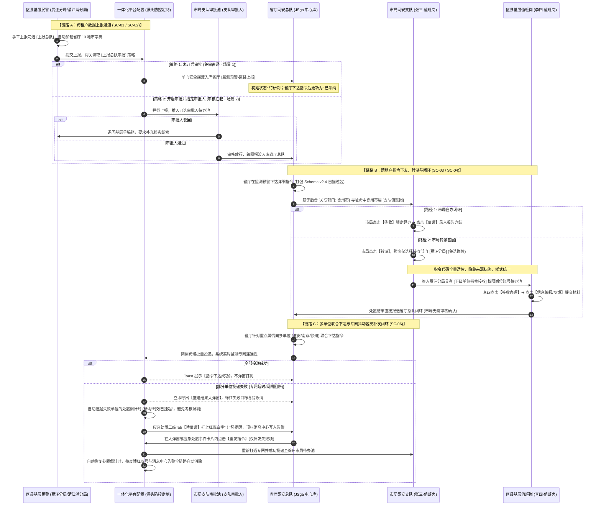

# 蓝鹰一体化智控系统 · 跨租户业务流转全流程需求规格说明书 (PRD)

> **文档面向对象**：研发团队全栈工程师、架构师，以及研发团队自用 AI Agent。  
> **文档核心定位**：作为 AI Agent 实施跨租户数据同步、指令寻址路由、多级审批拦截、岗位权限控制及多单位联合容灾补发代码开发的权威契约与单一事实来源（Single Source of Truth）。  
> **版本**：v1.2 (正式生效版 · 全流程全场景贯通)  
> **基线环境**：江苏省公安厅网安总队（中心汇聚） ↔ 独立采购地市公安局（徐州市局、淮安市局） ↔ 下辖区县分局（贾汪分局、清江浦分局）

---

## 1. 需求背景 (Background & Problem Statement)

### 1.1 系统基础构成与多租户现状
“蓝鹰一体化系统”是面向公安网安部门的一体化智控舆情及事件处置系统，现有系统由两大平台与多级账号权限构成：
1. **SaaS 管理后台（后台运维端）**：
   - **客户管理**：负责划分与开通独立客户公司（如江苏省公安厅、徐州市公安局），层级结构为 `客户 ➔ 登录账号`；
   - **组织机构管理**：通过配置“组织机构”（如“江苏省厅网安”），使多个客户挂载在同一生态圈中；
   - **市直单位与上级客户**：勾选“市直单位”标签标注客户属于上级汇聚中心（如省厅客户 JSga）；未勾选的客户可选择已勾选市直单位的客户作为“上级客户”，形成租户层级树。
2. **一体化智控平台（业务前端应用）**：
   - **部门管理**：由客户管理员登录前端自行配置内部架构（如总队内设各支队部门，支队下归档地市地名；地市系统内设网安支队与各区县大队部门）；
   - **岗位管理**：业务职责细分载体，独立于部门存在。通过设置“岗位可用部门”圈定部门申领范围，用户在值班时申领岗位并继承岗位对应的操作待办；
   - **指令管理**：配置具体业务处置指令明细（类型、步骤、反馈要求、自描述 Schema）；
   - **工具箱**：包含平台个性化配置、一体化工作平台配置及内网专网数据流转配置。

### 1.2 既往痛点与跨租户协同演进诉求
随着公安实战演进，部分具备条件的地市公安局（如徐州市公安局、淮安市公安局）独立采购部署了蓝鹰系统并拥有完全独立的客户账号体系与数据库。这导致了严重的跨租户协同壁垒：
1. **字符不匹配导致的寻址阻断**：省厅内设部门字典通常为“某某市”（如“徐州市”），而独立采购地市客户全称通常为“某某市公安局”或“徐州市局”，中文名称无法完全精准匹配，无法自动建立跨租户路由；
2. **上报直通与市局管控策略难以调和**：部分突发案事件基层需直报省厅（省时效），部分敏感线索市局支队要求前置审核拦截（防差错），底层缺乏统一的业务策略控制中枢；
3. **异构指令字典维护成本极高**：若要求独立地市系统与省厅保持 100% 实时同步全量指令字典，运维成本过高，需依靠载荷自描述机制达成免异构映射；
4. **基层流转与闭环链路冗长**：传统指令下派与转派要求层层选岗，区县办结后又层层审核，基层流转响应严重滞后；
5. **专网跨域多单位联合处置推送失败感知缺失**：省厅在跨地市、跨区县多单位联合派单时，常因各级专网网闸抖动导致部分单位指令丢失，缺乏实时感知、时效保护挂起与闭环补发容灾机制。

### 1.3 核心优化预期
通过本次重构，构建**“路由映射可靠精准、审批策略灵活可配、指令载荷免映射自描述、基层转派极简直报省厅闭环、多单位下达实时容灾补发”**的跨租户协同全链路体系。

---

## 2. 需求范围 (Scope & Boundaries)

### 2.1 涵盖业务范围（场景 1 ～ 场景 6）
本规范覆盖跨租户协同的 6 大核心业务闭环：
- **场景 1：地市基层手工上报 · 免审直通省厅与跨市通报 (SC-01)**：基层端填报勾选【上报总队】自动加载省厅字典，免审单向安全摆渡直通省厅监测预警入库，并自动镜像至异地通报台账；
- **场景 2：市局网安支队审核拦截 · 审核放行与驳回补正 (SC-02)**：当租户开启前置审批时，基层上报被市局拦截，支队审批人审核通过后放行报送省厅，驳回退回基层修改；
- **场景 3：省厅总队跨租户指令下达 · 载荷自描述与参数化插值 (SC-03)**：省厅基于 AI 研判发起详细处置指令，采用自描述 Schema 载荷包与动态参数变量，定向派发至地市网安支队；
- **场景 4：市局应急处置协同 · 转派基层与市局自办双轨流转 (SC-04)**：市局在应急处置板块专项检索省厅指令，支持直接自办闭环或直接转派区县（仅选部门免选岗位）；区县办结后处置结果**直报省厅总队闭环，市局无需审核**；
- **场景 5：管理后台与一体化平台 · 跨租户路由、上报审批、数据流转与岗位权限配置 (SC-05)**：后台建立【关联部门】映射打通路由；工具箱【一体化工作平台配置】中灵活开启【上报总队审批】；工具箱【数据流转配置】配置省市专网接收地址与重试策略；前端岗位树配置【跨租户指令接收权限】与【下级单位指令接收权限】；
- **场景 6：跨租户多单位联合处置 · 指令推送失败排查与全链路容灾补发 (SC-06)**：省厅向多单位（省市县）联合下达指令，遭遇专网抖动导致部分推送失败时，系统实时感知并呼出推送结果大弹窗支持行内补发，自动挂起受阻单位处置时效，并在应急处置二级Tab以红底白字“！”强提醒和常驻业务备注组件提示，结合消息中心兜底消除，保障全链路可靠送达。

### 2.2 不在本次开发范围（明确边界，严禁过度开发）
1. **乐观锁机制复用现有能力**：并发认领、抢占互斥与版本比对沿用蓝鹰系统底层现有成熟逻辑，开发团队无需研发新的锁机制；
2. **舆情来源展示维持既有实现（第一阶段）**：第一阶段跨地市/跨租户上报信息沿用现有默认展示格式（如“来源: 手工上报-淮安市局”或“来源: 淮安市局-张三 2026-10-10 10:41:20上报”），不进行独立的跨域来源重写开发；
3. **取消区县办结后的市局二审环节**：区县反馈后结果直报省厅，严禁在市局端增加“确认”或“审核”前置步骤。

---

## 3. 功能清单 (Functional Feature Matrix)

| 场景编号 | 所属平台/板块 | 功能名称 | 适用角色 | 核心逻辑摘要 | 优先级 |
|:---|:---|:---|:---|:---|:---:|
| **SC-05** | SaaS 管理后台<br/>`客户管理` | 客户关联部门配置 | 运营超管 | 编辑客户弹窗中，选择上级客户后动态激活【关联部门】下拉单选，获取省厅部门字典进行绑定。 | P0 |
| **SC-05** | 一体化平台<br/>`工具箱-定制配置` | 上报总队审批策略配置 | 业务管理员 | 在【一体化工作平台配置 ➔ 源头防控】中提供【上报总队审批】复选框，选中后激活【审批人】多选账号。 | P0 |
| **SC-05** | 一体化平台<br/>`工具箱-数据流转` | 专网数据流转路径配置 | 运维/平台管理 | 独立一级Tab（权限 `toolbox:transmission`），总队端配置地市专网接收地址（去备用地址、免显部门代码），地市端配置上报目标地址与重试范围（默认5000ms/3次）。 | P0 |
| **SC-05** | 一体化平台<br/>`系统设置-岗位管理` | 跨租户指令接收权限 | 业务管理员 | 在岗位权限树中新增细粒度权限点【跨租户指令接收权限】，分配给市局支队值班岗。 | P0 |
| **SC-05** | 一体化平台<br/>`系统设置-岗位管理` | 下级单位指令接收权限 | 业务管理员 | 在岗位权限树中新增细粒度权限点【下级单位指令接收】，分配给区县值班岗，指令代码全量透传免映射。 | P0 |
| **SC-01** | 一体化平台<br/>`源头防控-手工上报` | 属地/通报字典动态切换 | 基层民警 | 未勾选【上报总队】展示本地辖区字典；勾选【上报总队】动态切换为省厅统一下发的 13 地市字典。 | P0 |
| **SC-01** | 一体化平台<br/>`监测预警-区县上报` | 免审直通入库与采纳更新 | 省厅值班长 | 基层上报直通摆渡入库，初始为待研判；省厅点击【下达处置指令】后自动更新为【已采纳】计入考核。 | P0 |
| **SC-01** | 一体化平台<br/>`监测预警-通报信息` | 异地通报协同台账 | 地市B值班员 | 镜像接收外地通报工单，表格字段轻量化对齐（去除处置状态与多余操作），仅保留【查看详情】。 | P1 |
| **SC-02** | 一体化平台<br/>`源头防控-上报审核` | 市局前置审核拦截 | 支队审批人 | 平台开启审批时，基层上报推入支队审批人待办池；支持审核通过放行直通省厅，或驳回修改。 | P0 |
| **SC-03** | 一体化平台<br/>`监测预警-事件卡片` | AI 辅助研判综合弹窗 | 省厅研判员 | 1:1 展示舆情多模态要素（敏感点挖掘、事件聚类相似帖、常用单位/执行指令快速勾选）。 | P1 |
| **SC-03** | 一体化平台<br/>`监测预警-指令下发` | 自描述载荷与动态变量模板 | 省厅值班长 | 详细指令下达弹窗支持多选指令项、插入 `[单位名称]` 等占位变量，打包 Schema v2.4 自描述数据包。 | P0 |
| **SC-04** | 一体化平台<br/>`应急处置-任务列表` | 是否省厅下达专项检索 | 市局值班员 | 筛选栏在处置时间后新增 `[ ] 是否省厅下达` 复选框，勾选后过滤显示跨租户/省厅交办卡片。 | P0 |
| **SC-04** | 一体化平台<br/>`应急处置-事件卡片` | 日常化统一隐藏来源标签 | 市局/区县 | 指令清单条目统一隐藏“总队下达/本单位下达/市局交办”标签，基层与市局展示效果 100% 统一。 | P0 |
| **SC-04** | 一体化平台<br/>`应急处置-操作区` | 市局转派/自办双轨流转 | 市局值班员 | 指令行提供【转派】、【签收】、【反馈】；转派弹窗仅选择目标部门（无需选岗）；亦可自办反馈闭环。 | P0 |
| **SC-04** | 一体化平台<br/>`应急处置-基层承办` | 区县直报省厅闭环 (市局免审) | 区县民警 | 基层仅保留【签收办理】与【信息编报/反馈】；反馈提交后处置结果直接报送省厅闭环，市局免审。 | P0 |
| **SC-06** | 一体化平台<br/>`监测预警-联合下发` | 推送感知与结果大弹窗 | 省厅值班长 | 多单位联合下发指令，全部成功Toast提醒；部分失败呼出大弹窗呈现各目标推送状态与错误码，支持行内【重发指令】。 | P0 |
| **SC-06** | 一体化平台<br/>`应急处置-任务列表` | 二级Tab平铺与红叹号提醒 | 全员/值班员 | 二级Tab合并平铺（待反馈/待处理/已处理/指令类型/全部）；待办数普通括号呈现；失败时待反馈带红叹号；右侧常驻业务备注组件。 | P0 |
| **SC-06** | 一体化平台<br/>`应急处置-时效控制` | 被指派单位时效自动挂起 | 系统/值班员 | 指令推送失败或对方专网未入库期间，系统自动挂起处置倒计时并标注“时效已挂起”，补发成功恢复，杜绝考核误判。 | P0 |
| **SC-06** | 一体化平台<br/>`全局顶栏-消息中心` | 离线告警与全链路双向消除 | 省厅/地市 | 推送失败写入顶栏消息中心作为离线兜底；在任何位置补发成功后，待反馈红叹号与消息中心告警自动联动消除。 | P0 |

---

## 4. 详细设计 (Detailed Technical Design)

### 4.1 全链路端到端数据流与状态机架构



---

### 4.2 核心数据模型契约 (Data Models & Schemas)

#### 1. 客户管理实体扩展 (`Customer`)
```typescript
interface Customer {
  id: string;                      // 客户ID (如 JS001, XZ002)
  name: string;                    // 客户全称 (如 "徐州市公安局")
  displayName: string;             // 系统显示名 (如 "徐州市局")
  orgId: string;                   // 所属组织机构 (如 "江苏省厅网安")
  isCityDirect: boolean;           // 市直单位标签 (true=上级节点/汇聚中心, false=下级客户)
  superiorCustomerId?: string;     // 上级客户ID (引用 isCityDirect=true 的客户，如 JS001)
  
  // 【本次核心新增字段】
  relatedDeptName?: string;        // 关联省厅部门名称 (下拉单选，如 "徐州市")
  relatedDeptId?: string;          // 关联省厅部门ID
  
  status: 'normal' | 'disabled';   // 账号状态
}
```
* **约束校验**：当 `isCityDirect === false` 且 `superiorCustomerId` 有值时，`relatedDeptName` 为必填项；当 `isCityDirect === true` 时，`superiorCustomerId` 与 `relatedDeptName` 自动清空并禁用。

#### 2. 一体化平台定制配置实体 (`PlatformCustomConfig`)
```typescript
interface PlatformCustomConfig {
  tenantId: string;                // 租户ID
  sourceControlConfig: {
    hideScheduleStatisticTags: boolean; // 排班统计列表隐藏统计标签
    
    // 【本次核心新增配置项：手工上报审批开关】
    reportToProvincialAudit: boolean;   // 上报总队审批开关 (true=拦截模式, false=免审直通)
    auditApproverUserIds: string[];     // 支队审批人账号ID列表 (多选，至少 1 人)
    auditApproverNames: string[];       // 支队审批人姓名列表 (如 ["支队-宋洪霖", "支队-张三"])
  };
  emergencyConfig: {
    defaultSortOrder: 'directive_time_desc' | 'create_time_desc' | 'urgency_desc'; // 列表默认排序
  };
  monitorConfig: {
    hideReporter: boolean;              // 不显示报送人
    showIssueDirectiveBtn: boolean;     // 列表显示下达指令按钮
    countyReportSortOrder: 'report_time_desc' | 'report_time_asc'; // 区县上报排序设置
  };
}
```

#### 3. 岗位权限树模型扩展 (`PostPermission`)
```typescript
interface Post {
  id: string;                      // 岗位ID
  name: string;                    // 岗位名称 (如 "支队值班岗", "区县值班岗")
  availableDeptIds: string[];      // 岗位可用部门ID列表 (申领范围)
  description: string;             // 岗位职责说明
  
  // 【本次核心新增两项细粒度权限】
  hasCrossTenantReceive: boolean;  // 跨租户指令接收权限 (接收省厅下达跨租户指令)
  hasSubUnitDispatchReceive: boolean; // 下级单位指令接收权限 (接收市局同租户转派指令)
}
```

#### 4. 跨租户自描述指令数据包契约 (`CrossTenantPayloadSchema_v2_4`)
```json
{
  "$schema": "https://blue-eagle.sec/schema/v2.4/cross-tenant-directive.json",
  "header": {
    "directiveId": "DIR-20261010-0089",
    "originTenant": "JSga",
    "originDept": "总队指挥调度中心",
    "targetDept": "徐州市",
    "issueTimestamp": "2026-10-10T14:30:00+08:00",
    "signature": "SHA256withRSA:e9a78fbc09d1248..."
  },
  "payload": {
    "clueId": "CLUE-2026-08892",
    "title": "关于徐州某工业园区因环保升级改造停产网络谣言线索排查",
    "urgencyLevel": "urgent",
    "deadline": "2026-10-10T18:00:00+08:00",
    "directiveTypes": ["线下核查", "属地落实", "持续监测"],
    "instructionTemplate": "请【单位名称】网安部门立即对上述网帖反映的企业停产及煽动集聚隐患开展【指令名称】，于【处理周期】前反馈落地查证情况与工作笔录。",
    "interpolatedText": "请徐州市公安局网安支队网安部门立即对上述网帖反映的企业停产及煽动集聚隐患开展线下核查，于今日 18:00 前反馈落地查证情况与工作笔录。"
  }
}
```

#### 5. 工具箱数据流转配置契约 (`DataFlowRouteItem` / `DataFlowConfig`)
```typescript
// 1. 总队端地市流转路径条目
interface DataFlowRouteItem {
  key: string;                     // 唯一标识 (如 'xuzhou')
  deptName: string;                // 目标地市部门名称 (13地市字典下拉，如 "徐州市")
  deptCode: string;                // 部门代码 (系统后台自动映射处理，界面无需显式展示)
  primaryEndpoint: string;         // 唯一专网接收地址 (URL，移除备用地址)
  status: 'connected' | 'error';   // 连通状态
  latencyMs: number;               // 测通时延 (毫秒)
}

// 2. 地市端数据流转配置实体
interface CityDataFlowConfig {
  tenantId: string;
  targetEndpoint: string;          // 上报总队专网接收地址 (单一地址，移除备用地址)
  timeoutMs: number;               // 超时时间 (默认 5000ms)
  maxRetries: number;              // 最大重试次数 (默认 3 次)
  status: 'connected' | 'error';   // 快速连通性检测状态
  lastTestedAt: string;            // 最近测通时间戳
}
```

#### 6. 联合处置指令下发与容灾状态契约 (`DirectivePushRecord`)
```typescript
interface DirectivePushRecord {
  directiveId: string;             // 指令流水号
  eventId: string;                 // 关联舆情事件ID
  instructionName: string;         // 指令名称 (如 "帖文处置", "持续关注")
  targetDept: string;              // 接收部门/单位 (如 "徐州市", "清江浦区")
  targetDeptId: string;            // 接收部门ID
  status: 'success' | 'failed';    // 推送状态 (全部成功或推送失败)
  errorCode?: string;              // 失败错误码 (如 "ERR_NET_TIMEOUT", "ERR_GATEWAY_BLOCKED")
  errorMessage?: string;           // 失败详细说明
  timeSuspended: boolean;          // 被指派单位处置时效是否挂起 (true=已挂起)
  retryCount: number;              // 重试次数
  issuedTime: string;              // 下发时间
}
```

---

### 4.3 场景 1 详细设计：地市基层免审直通省厅与跨市通报 (SC-01)
1. **触发入口**：地市 A（淮安市局基层账号张华）进入【源头防控 - 手工上报】；
2. **字典联动切换规则**：
   - 报送目标默认勾选【上报支队（锁定必选）】；
   - **未勾选【上报总队】**：涉事属地与通报区县仅展示淮安本地 9 个辖区字典（清江浦区、淮阴区、涟水县等）；
   - **勾选【上报总队】**：触发 0.3s 平滑微交互，动态切换为省厅 13 地市字典；涉事属地切换为全省 13 地市单选；通报地市切换为全省 13 地市多选列表（由民警自主选择目标地市，如勾选“连云港市”）；
3. **免审单向直通入库**：民警点击【确认上报】，系统检测当前租户配置 `reportToProvincialAudit === false`，绕过审批，单向安全摆渡直通省厅内网中心库；
4. **省厅接收与状态流转**：省厅值班长李警官在【监测预警 - 区县上报】查验该记录，初始状态为【未采纳 / 待研判】；李警官点击【下达处置指令】后，状态自动更新为【已采纳】，计入省厅对淮安市局的考评得分；
5. **地市 B 通报协同台账**：连云港市局在【监测预警 - 通报信息】实时接收异地镜像记录，表格采用轻量化列规范（通报来源固定 120px，隐藏处置状态列，操作列仅保留【查看详情】链接按钮，标题列在宽屏自适应展开、窄屏自动省略防折行）。

---

### 4.4 场景 2 详细设计：市局网安支队审核拦截与闭环 (SC-02)
1. **拦截触发**：当徐州市局租户配置 `reportToProvincialAudit === true` 且配置了审批人（宋洪霖、张三）；
2. **待办池推入**：贾汪分局民警填报勾选【上报总队】点击提交后，数据暂扣于徐州市局，不向省厅摆渡；系统向审批人（宋洪霖、张三）推送待审消息；
3. **支队审核工作台**：
   - 支队审批人登录后，在【源头防控 - 上报审核】查验拦截单据；
   - **路径 A（驳回补正）**：点击【审核驳回】，录入驳回理由（如“涉事企业名称不准确，请补充核实涉事属地及发帖人账号”），单据退回贾汪分局草稿箱；
   - **路径 B（放行直通）**：点击【审核通过】，系统更新审核状态为已通过，单向安全网闸触发摆渡，数据推入省厅【监测预警 - 区县上报】。

---

### 4.5 场景 3 详细设计：省厅总队跨租户指令下达 (SC-03)
1. **触发入口**：省厅研判员在【监测预警 - 预警信息】卡片点击【AI辅助研判】或【下达处置指令】；
2. **AI辅助研判弹窗 (980px 响应式)**：
   - 左侧全息要素：指数矩阵（热度 68.5、敏感度 84.2）、AI 敏感点挖掘（煽动性言论）、事件聚类相似短视频与微博求证帖；
   - 右侧指令配置：常用单位指令（总队落实/领导批示）、常用执行指令（线下核查/属地落实/持续监测）；
3. **详细指令发起弹窗 (860px)**：
   - 接收单位选择：下拉单选【徐州市公安局网安支队】；
   - 参数化变量插值：支持在指令输入框中点击 `[单位名称]`、`[指令名称]`、`[处理周期]` 占位符，下达时引擎自动插值为实际业务文本；
   - 载荷自描述打包：系统封装 Schema v2.4 跨租户自描述包，携带数字签名；
4. **底层路由寻址机制**：下达目标部门名称为“徐州市”，网关查询后台 `Customer` 表中 `relatedDeptName === '徐州市'`，精准命中目标客户 `徐州市公安局`，推入具有 `hasCrossTenantReceive === true` 的岗位待办池。

---

### 4.6 场景 4 详细设计：市局应急处置协同 · 转派与自办双轨流转 (SC-04)
1. **核心页面载体**：市局端与区县端 100% 聚焦于【应急处置】板块页面，卡片呈现标题、AI 研判摘要、舆情指数及指令明细；
2. **专项检索筛选栏**：在处置时间后新增 `[ ] 是否省厅下达` 复选框，勾选点击查询后，仅过滤出涉及跨租户/省厅交办的事件卡片；
3. **指令来源标签全量隐藏**：明细行中**彻底隐藏“总队下达/本单位下达/市局交办”标签**，保留业务类型胶囊（如 `【线下核查】`）、倒计时胶囊、经办人与指令正文；
4. **市局双轨制操作区**：
   - 指令行右侧整齐排布 **`【转派】`** + **`【签收】`** + **`【反馈】`**；
   - **自办路径**：市局值班民警张三点击【签收】锁定经办，点击【反馈】录入报告提交，达成市局本级自办闭环；
   - **转派路径**：点击【转派】呼出极简弹窗，**表单仅保留【接收单位】下拉单选（徐州市公安局贾汪分局网安大队），不设接收岗位选择器**；提交后指令透传至目标部门；
5. **区县基层承办直报省厅闭环（市局免审）**：
   - 贾汪分局网安大队值班民警李四登录【应急处置】，卡片样式完全统一；
   - 基层界面**仅提供【签收办理】与【信息编报 / 反馈】按钮，无转派权限**；
   - 李四完成核查笔录录入与附件上传后点击提交反馈，**处置结果直接单向跨网报送省厅总队结案闭环，市局单位无需留意，系统中无市局确认或审核环节**；市局端状态显示为 `[区县已直报省厅结案]`。

---

### 4.7 场景 5 详细设计：后台配置桥梁与个性化策略中枢 (SC-05)

#### 1. 步骤 1：SaaS 管理后台 · 客户管理与关联部门映射
- **路径**：`后台运营管理系统 ➔ 全局管理 ➔ 客户列表`；
- **操作**：编辑客户【徐州市公安局】；
- **配置项**：
  - `所属组织机构`：下拉单选 `江苏省厅网安`；
  - `上级客户`：下拉选择 `JSga`（前提：JSga 勾选了市直单位）；
  - **`【核心新增】关联部门`**：选择上级客户后动态激活下拉单选，远程获取省厅部门字典，选中 **`徐州市`**；
  - 保存后，系统建立 `省厅部门字典: 徐州市 ↔ 独立客户: 徐州市公安局` 路由映射。

#### 2. 步骤 2：一体化平台 · 工具箱平台定制配置 (源头防控手工上报审批)
- **路径**：`一体化智控平台 ➔ 工具箱 ➔ 设置 ➔ 一体化工作平台配置`；
- **界面降噪**：无嵌套外层深色顶栏，子导航仅保留【一体化工作平台配置】，去除上方 14 个无关表单字段矩阵，全屏聚焦【定制化配置】；
- **配置项（归属于源头防控）**：
  - `排班统计列表隐藏统计标签`：Switch 开关；
  - **`【核心新增】上报总队审批`**：
    - 复选框：`[√] 上报总队审批`；
    - 勾选后动态激活 `审批人:` 多选下拉框；
    - 账号选择：从支队人员列表中选择（预置选择 `支队-宋洪霖`、`支队-张三`）；
    - 校验规则：勾选审批后至少选择 1 位审批人，否则阻止保存；
    - 策略联动：开启时执行场景 2 拦截流，取消勾选时恢复场景 1 免审直通流。

#### 3. 步骤 3：内网-工具箱-数据流转配置 (总队/地市专网寻址)
- **路径**：`一体化智控平台 ➔ 工具箱 ➔ 数据流转配置`（独立一级 Tab，非二级嵌入设置）；
- **独立权限点**：统一为 **`toolbox:transmission`**，拥有该权限即允许在工具箱查看并编辑数据流转配置，无权限则前端自动隐藏；
- **公司定位标签切换**：提供总队单位与地市单位按钮开关切换，动态调整界面展示内容；
- **总队端极简规则**：界面仅保留地市流转列表与流转路径管理两套核心功能，不展示已配地市数和连通率等额外统计标签；新增/编辑弹窗中仅保留【部门选择】（系统部署时已初始化全省13个地市字典列表下拉选择）与【指令接收地址】两个字段，**无需展示部门代码**（系统后台自动映射处理）；**去掉“备用地址”选项**，仅保留唯一专网接收地址，并支持单点测通；
- **地市端核心要素**：界面仅显示单一**上报单位目标地址**（总队接收地址，**去掉“备用地址”选项**）和**重试范围**（默认超时 5000ms、重试 3 次，允许动态配置），提供快速连通性检测并即时回显结果。

#### 4. 步骤 4：一体化平台 · 市局岗位权限配置
- **路径**：`系统设置 ➔ 岗位管理`；
- **操作**：编辑【支队值班岗】，申领范围配置为网安支队及下属大队；
- **权限树配置**：在应急处置分支下勾选 **`[√] 跨租户指令接收权限`**；
- **生效机制**：开启后，用户申领该岗位即可接收省厅下达指令进入个人待办。

#### 5. 步骤 5：一体化平台 · 区县岗位管理与全链路校验
- **路径**：区县端 `系统设置 ➔ 岗位管理`；
- **操作**：编辑【区县值班岗】，申领范围为贾汪分局网安大队；
- **权限树配置**：在应急处置分支下勾选 **`[√] 下级单位指令接收`**；
- **生效机制**：开启后可认领市局转派的指令，指令代码全量透传自解析；
- **全链路连通性验证拓扑（4 节点）**：
  - 节点 1：管理后台路由配置（JSga + 徐州市映射）；
  - 节点 2：平台定制上报策略（源头防控上报审批开启，审批人宋洪霖、张三）；
  - 节点 3：市局支队待办认领（支队值班岗 + 跨租户接收权限）；
  - 节点 4：区县基层落地闭环（区县值班岗 + 下级单位转派接收 + 直报省厅闭环）；
  - 连通性状态显示 `[全链路双向通道已连通 100%]`。

---

### 4.8 场景 6 详细设计：跨租户多单位联合处置 · 指令推送失败排查与全链路容灾补发 (SC-06)

#### 1. 业务背景与触发入口
- **业务场景**：省厅总队在监测预警中研判重大涉稳舆情，需同时向省内多个属地单位（如淮安市局、南京市局、徐州市局等）联合派发协同处置指令。
- **触发入口**：省厅值班长在【监测预警 - 预警信息】卡片点击【AI辅助研判】➔【下达处置指令】，在接收部门中勾选多个地市/区县，并选择指令类型（如“帖文处置”、“持续关注”），点击【确认下达】。

#### 2. 即时感知与推送有效性判定
- **加载遮罩**：点击确认下达后，系统即刻呈现全流程加载遮罩（Loading），模拟执行专网网闸鉴权与跨网摆渡投递。
- **状态分流判定**：
  - **全部成功**：若所有目标单位专网均投递成功，系统仅弹出轻量全局提示 `message.success("指令下达成功")`，不呼出大弹窗打扰用户，保持极简操作体验；
  - **部分失败**：若因专网网闸抖动、目标地市接口超时等导致任一单位推送失败，系统立即阻断并呼出专属【推送结果大弹窗】进行可视化排查。

#### 3. 推送结果大弹窗与行内重发机制
- **弹窗组件排布**：
  - 采用标准表格呈现所有派发目标：`｜指令名称｜接收部门｜推送状态｜操作｜`；
  - **成功条目**：推送状态显示绿色徽标 `[√ 推送成功]`，操作列显示 `-`；
  - **失败条目**：推送状态显示红色警示徽标 `[× 推送失败 - 错误码: ERR_NET_TIMEOUT]` 或 `ERR_GATEWAY_BLOCKED`，操作列提供高亮按钮 **`【重发指令】`**；
  - **底部运维兜底指引**：弹窗底部固定提示小字：*“如出现重发指令失败，建议联系相关地市登录省厅系统分配的账号进行处置，同时将错误码信息截图发送给系统工程师协助排查问题。”*
- **行内精准重试**：点击【重发指令】后，仅针对当前失败单位触发重试投递（已成功的单位严禁重复下发），重发成功后行内实时刷新为 `[√ 推送成功]`。

#### 4. 被指派单位处置时效自动挂起
- **业务痛点**：以往跨域网络故障时，目标单位尚未收到指令，但系统倒计时已开始计算，导致基层超时被扣分。
- **自动挂起机制**：
  - 当指令处于 `failed`（推送失败）状态或尚未成功进入目标单位专网待办池时，系统自动挂起该单位的处置倒计时；
  - 在卡片与详情页中明确标注胶囊标签 **`【时效已挂起】`**；
  - 一旦重发成功指令正式送达，系统自动唤醒并恢复计时，彻底杜绝基层考核误判。

#### 5. 应急处置二级 Tab 规范与红底白字“！”强提醒
- **二级 Tab 合并平铺架构**：
  - 在【应急处置】板块，取消原有多层嵌套 Tab，合并平铺为二级导航：  
    `｜待反馈｜待处理｜已处理｜帖文处置｜动态监测｜……｜全部｜`；
  - 指令类型 Tab 根据当前选择的时间范围动态平铺呈现；
- **待办数量展现规则**：
  - 彻底剥离舆情事件数，待办指令数统一以普通括号附随在标题后（如 `待处理(5)`、`帖文处置(3)`），禁止使用易混淆的独立红点角标；
- **失败强提醒与常驻业务备注**：
  - **红底白字“！”标签**：仅在当前存在跨单位指令推送失败且未恢复时，在【待反馈】Tab 右上角显示醒目的红底白字 **`！`** 强提醒微标；
  - **常驻业务备注组件**：Tab 右侧常驻业务规则说明条，明确告知民警：*“红色感叹号标签代表当前有未成功下达的指令，括号后的数字代表当前该类型有多少条待办指令。”*
- **卡片行内补发**：在应急处置事件卡片内，失败指令行高亮展示红底警示标与【重发指令】按钮，支持值班员就地补发。

#### 6. 消息中心离线兜底与全链路双向自动消除
- **顶栏消息中心告警**：指令推送失败时，系统自动向省厅及相关管理员的全局顶栏【消息中心】写入一条未读异常通知（`[跨域指令投递失败] 事件#... 派发至徐州市局超时`）；
- **全链路双向消除闭环**：
  - 无论用户是在【推送结果大弹窗】、还是在【应急处置事件卡片】内点击【重发指令】成功后；
  - 系统底层状态机自动流转，【待反馈】Tab 上的红底白字“！”标签立即消失；
  - 顶栏【消息中心】中的对应失败提醒自动变更为已消除/已读，未读消息角标实时减 1，达成状态全局一致。

---

## 5. 验收标准清单 (Acceptance Criteria Checklist)

```markdown
- [ ] 1. 管理后台编辑客户弹窗选择上级客户（JSga）后，能够动态拉取省厅部门字典，选择并成功保存【关联部门: 徐州市】。
- [ ] 2. 工具箱【一体化工作平台配置】中，源头防控下提供【上报总队审批】复选框，选中后能够选择多个支队审批人账号并生效。
- [ ] 3. 当未开启上报总队审批时，区县基层手工上报勾选【上报总队】能够免审直达省厅监测预警入库（场景 1）。
- [ ] 4. 当开启上报总队审批时，区县基层手工上报勾选【上报总队】被拦截推入市局支队审批人待办池，审核通过后方可报送省厅（场景 2）。
- [ ] 5. 市局修改岗位弹窗权限树中提供【跨租户指令接收权限】，开启后该岗位账号能认领省厅下派指令。
- [ ] 6. 区县修改岗位弹窗权限树中提供【下级单位指令接收】，开启后该岗位账号能接收市局转派指令。
- [ ] 7. 应急处置页面筛选栏提供【是否省厅下达】复选框，勾选查询后仅过滤展示省厅交办卡片。
- [ ] 8. 应急处置卡片明细彻底隐藏“总队下达/本单位下达/市局交办”标签，展示效果完全统一。
- [ ] 9. 市局转派弹窗仅展示接收部门单选下拉框，不包含岗位选择框，转派后自动推入基层值班岗待办池。
- [ ] 10. 区县签收转派指令并提交核查反馈后，处置结果直接报送省厅总队闭环，市局端无审核或确认环节。
- [ ] 11. 应急处置板块采用合并展示二级Tab：｜待反馈｜待处理｜已处理｜帖文处置｜动态监测｜……｜全部｜，指令类型随过滤时间范围动态平铺；待办指令数统一在标题后以普通括号呈现（如待处理(5)），完全剥离事件卡片数。
- [ ] 12. 仅在跨单位指令下发失败时于【待反馈】后展示红底白字“！”强提醒；Tab最右侧常驻业务备注组件，说明“红色感叹号标签代表当前有未成功下达的指令，括号后的数字代表当前该类型有多少条待办指令”。
- [ ] 13. 工具箱提供一级独立Tab【内网-工具箱-数据流转配置】（权限点: `toolbox:transmission`），支持总队/地市定位切换；总队端只保留地市列表与路径管理（新增/编辑弹窗仅保留“部门选择”系统部署初始化列表下拉与“指令接收地址”，无需展示部门代码，去除备用地址）；地市端仅显示单一上报目标地址（去除备用地址）及重试范围，支持快速连通性检测。
- [ ] 14. 多单位联合下发指令时，若存在目标单位推送失败，系统立即阻断并呼出【推送结果大弹窗】展示各目标状态与错误码，失败项支持行内【重发指令】；被指派单位时效自动挂起显示【时效已挂起】；重发成功后待反馈红叹号与顶栏消息中心告警全链路双向自动消除。
```
