数说蓝鹰-定制采集任务相关功能PRD

# 版本管理

|  |  |  |  |
| --- | --- | --- | --- |
| 版本号 | 提交日期 | 提交人 | 备注 |
| V1.0 | 2026-04-20 | 朱彦博 |  |
|  |  |  |  |

# 需求背景

目前，“蓝鹰舆情”已具备全网泛化监测能力。但在针对特定专题、重点源或单体帖子的**精细化跟踪**方面，仍缺乏**定向任务采集**的快捷操作及配套的综合管理体系。同时，为提升系统资源利用的透明度，亟需建立**额度消耗明细**模块，以实现对各类数据资源消耗路径的闭环审计与留痕。

因此，本次迭代将新增“定向采集任务管理”与“额度明细看板”，并在搜索、全网专题及重点源等核心模块中植入“创建采集任务”功能，构建“发现-追踪-复盘”的闭环链路。

# 相关术语

|  |  |
| --- | --- |
| 术语 | 解释 |
|  |  |

# 功能清单

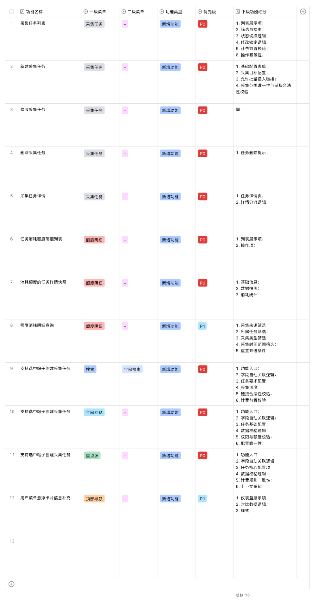

# 详细功能描述

## 采集任务管理

### 采集任务列表

#### 功能概述

用于展示所有已创建的采集任务，并提供状态控制及管理入口。

#### 功能细节

* **列表展示项[P0]**：
  + **基本信息**：任务名称（支持超长溢出省略）、采集类型（互动量更新/评论区采集）。
  + **配置属性**：范围（专题/重点源/链接）、平台（展示对应 Icon 及名称）、更新频率、追踪天数。
  + **实时数据**：采集总量（累计总量 + 近1小时新增量，如：12.6w / +1145）。
  + **生命周期**：任务状态（Toggle 开关）、最近更新时间（YYYY-MM-DD HH:mm:ss）。
  + **操作按钮**：修改｜详情｜删除。
* **筛选与检索 [P0]**：
  + 支持按任务名称进行**模糊查询**。
  + 支持按“任务类型”、“采集范围”、“采集平台”和“任务状态”进行**多选筛选**。
  + 提供重置按钮快速清空所有条件并重置列表展示内容。
* **状态切换逻辑 [P0]**：
  + 开启任务
    - 用户点击开关从“关闭”变为“开启”时，系统立即将任务拉入开启采集状态。
    - 反馈：弹出 Toast 提示“任务已开启”。
  + 关闭任务
    - 用户点击开关从“开启”变为“关闭”时，该任务采集状态立即关闭。
    - 反馈：弹出toast提示“任务已关闭”。
* **修改锁定逻辑 [P0]**：
  + **逻辑**：当任务已有数据采集时，禁止修改任务配置细节。
  + **表现**：任意采集任务在开启后并有获取到数据时，不允许修改任务，避免调整后影响系统采集逻辑，修改按钮禁用，鼠标悬停到修改按钮后，提示“任务已开启，不可修改”。

#### 输入与输出

* **输入**：搜索关键词、筛选条件选择、开关点击、排序点击。
* **输出**：过滤后的任务列表、排序后的数据集、操作反馈 Toast。

#### 注意事项

|  |  |  |
| --- | --- | --- |
| **名称** | **优先级** | **描述** |
| **计费前置校验** | P0 | 执行任务开启操作时，后端进行“余额预判”，若账户数据包<0，开启失败并提示“额度不足，请联系管理员充值后开启”。 |
| **操作幂等性** | P0 | 在列表页快速点击开启/关闭时，前端需做防抖处理，避免后端产生并发死锁或重复扣费。 |
| **最近更新时间定义** | P0 | 该时间指“最近一次收到平台有效相应的时间”。 |
| **异步执行** | P0 | 任务开启/关闭相应如有操作延迟，前端需有明显的 Loading 状态。 |
| **异常回显** | P0 | 由于存在平台风控或链接失效等多种原因导致无法采集到有效数据，但每次调用执行后**无论结果成功与否都需要进行计费并扣除相应额度，**在有采集异常的情况下，最近1次采集显示的内容可以为0，在数据库中需要能获取到对应的错误码，以便后续验证数据时能够找到异常记录。 |

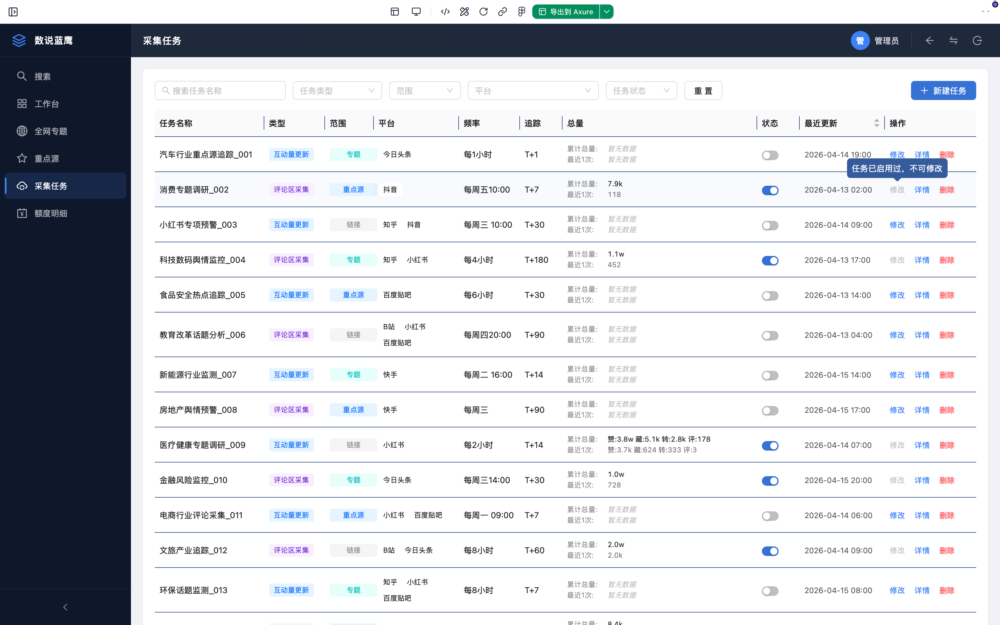

### 新建采集任务

#### 功能概述

提供引导式表单，供用户定义采集的目标、频率及维度。

#### 功能细节

* **基础配置表单 [P0]**：
  + **任务名称**：文本输入，限 50 字符。
  + **采集类型**：Radio 切换（互动量更新 / 评论区采集）。
  + **更新频率**：标签切换（每X小时｜每天｜每周）+ 定时器组件（如：每 2 小时、每天 10:00 、每周一、二、四08:00等）。
  + **追踪天数**：数字输入，限 1天及以上（结合后台配置限制，可能仅允许用户追踪30天以内的，那么这里需要限制为1～30）。

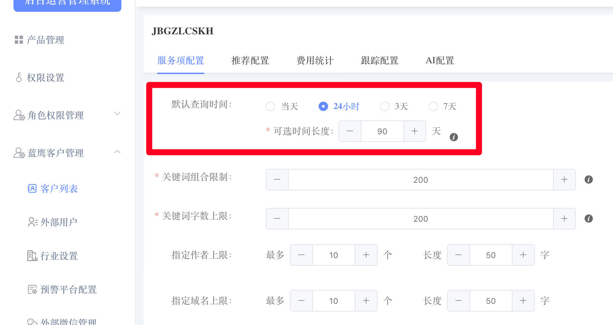

* + **结束时间[P2]**：显示日期选择组件，在选择日期的23:59分时关闭任务。
* **采集目标配置（联动控制）[P0]**：
  + **选择 [全网专题] 或 [重点源]**：下方动态加载下拉选择框，数据源为系统内已有的专题名称或重点源组。
  + **选择 [链接]**：
    - **单次｜目标平台**（必填）：可获取到的所有平台如小红书、抖音、微博……
    - **多次｜输入链接**（必填）：校验 URL 格式及平台前缀（小红书/抖音等）。
    - **多次｜补充标题**（选填）：限 200 字符。
    - **多次｜信息主题**（选填）：限 2500 字符，支持多行输入。
    - **单次｜采集页数**（必填）：采集前N页。（允许采集的页数是否有对应限制）
  + **允许快速插入多个链接：[P2]**
    - 点击后弹窗显示“批量添加链接”组件，列表中自动填充5条记录，允许自定义添加或删除链接；

#### 输入与输出

* **输入**：任务参数字段、上传的 URL。
* **输出**：成功创建任务记录、操作反馈toast、保存后隐藏浮窗。

#### 注意事项

1. **唯一性限制**：一个任务内仅允许配置一个专题、一个重点源或一个自定义链接，严禁多选。
2. **链接校验**：针对“其他”输入的链接，前端需进行正则表达式校验，确保符合各大平台（小红书、抖音、微博等）的合法 URL 格式。

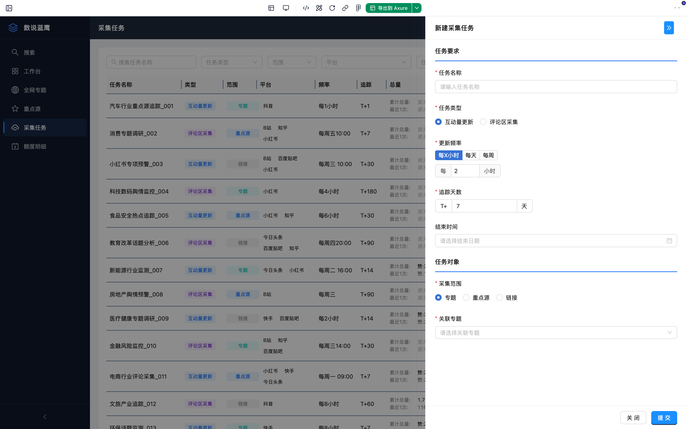

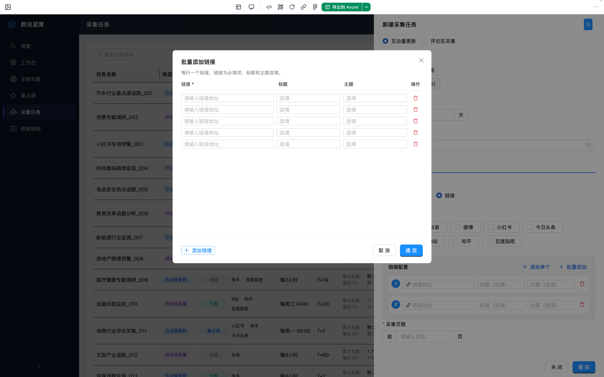

### 修改采集任务

#### 功能概述

提供引导式表单，供用户修改采集的目标、频率及维度。

#### 功能细节

* 字段类型与新增功能保持一致；

#### 输入与输出

* **输入**：任务参数字段、上传的 URL。
* **输出**：成功修改任务记录、操作反馈toast、保存后隐藏浮窗。

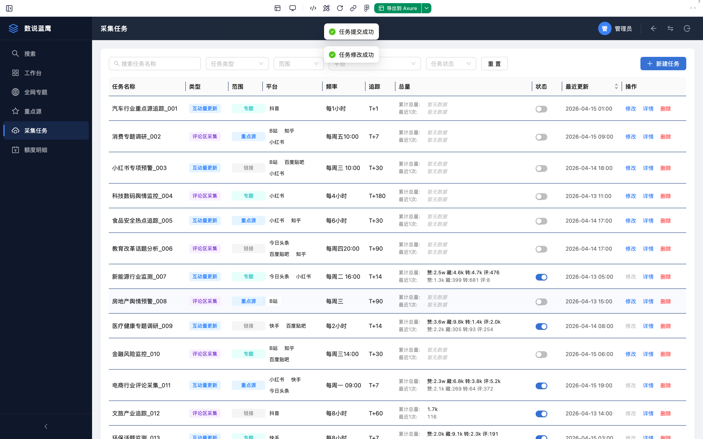

### 删除采集任务

#### 功能描述

支持删除已创建的任务。

#### 功能细节

* 点击后下拉框显示提示，提示内容“如需停止采集，建议关闭任务，已采集到的数据在任务删除后将无法查看，请知悉。”提供“删除｜取消”两个功能按钮。
* 再次点击“删除”后提交删除请求。

#### 输入与输出

* **输入：**任务ID，删除请求；
* **输出：**成功删除任务记录，操作反馈toast；

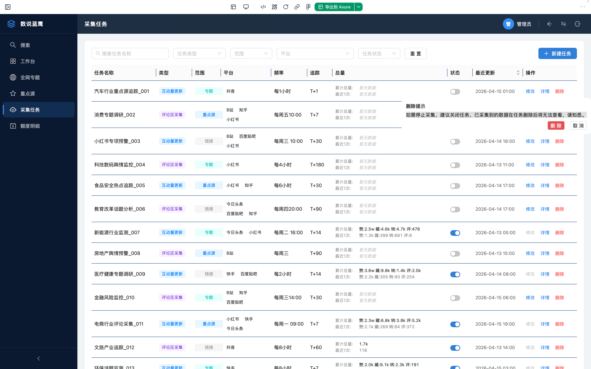

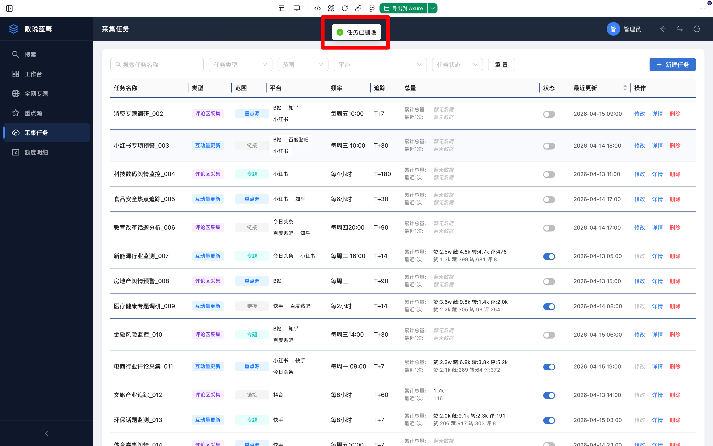

### 采集任务详情

#### 功能描述

全维度展示任务的配置信息及初步采集成果。

#### 功能细节

* **任务情况模块 [P0]**：
  + 以看板形式展示任务的所有配置元数据。
  + 采集到的结果简报。
* **采集详情模块（分流逻辑）[P0]**：
  + **场景 A（专题/重点源）**：由于此类任务数据量巨大且涉及复杂看板，页面中间显示“数据详情请前往 [业务板块名称] 查看”的提示，并附带超链接。
  + **场景 B（自定义链接）**：
    - **评论区采集**：展示一个简易列表，列举最近采集到的“有效非评中评”文本摘要、用户 ID、发布时间（样式请参考目前系统中已实现的相似平铺展示评论样式即可）。
    - **互动量更新**：展示数据趋势简图（点赞、转发、收藏随时间的波动），及当前最新数值。

### 输入与输出

* **输入**：任务 ID（通过路径参数传递）。
* **输出**：任务配置视图、关联业务板块的跳转链接、自定义链接的采集快照。

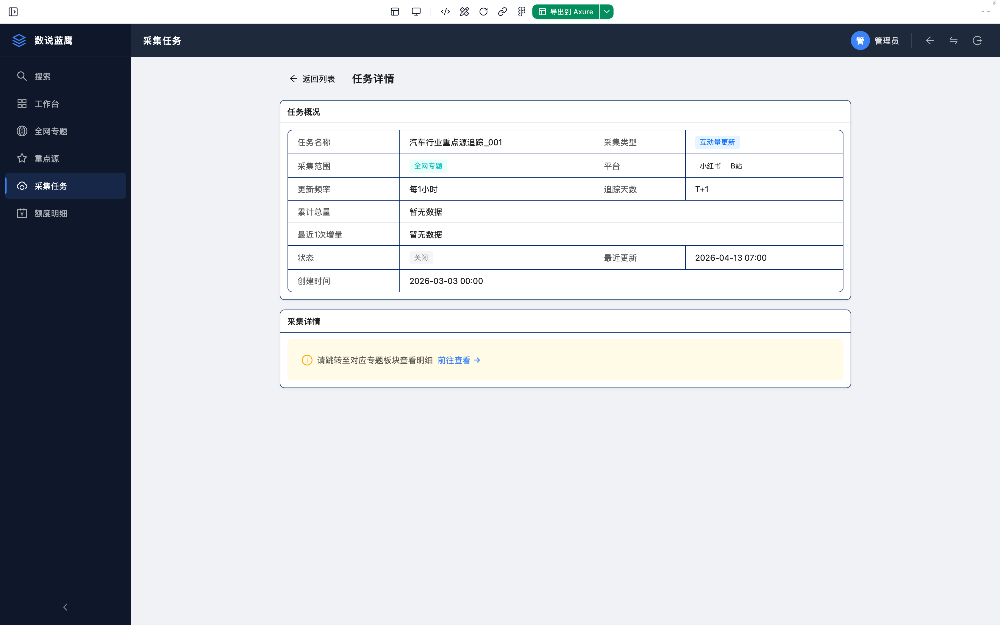

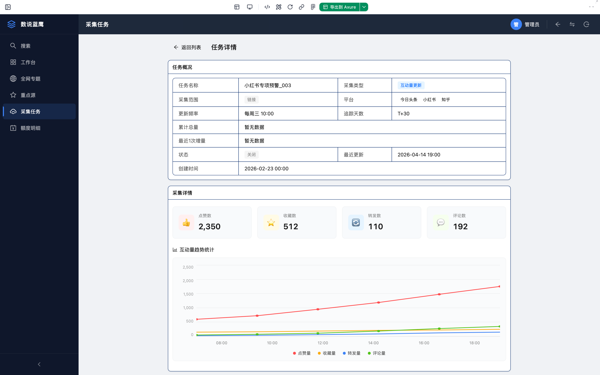

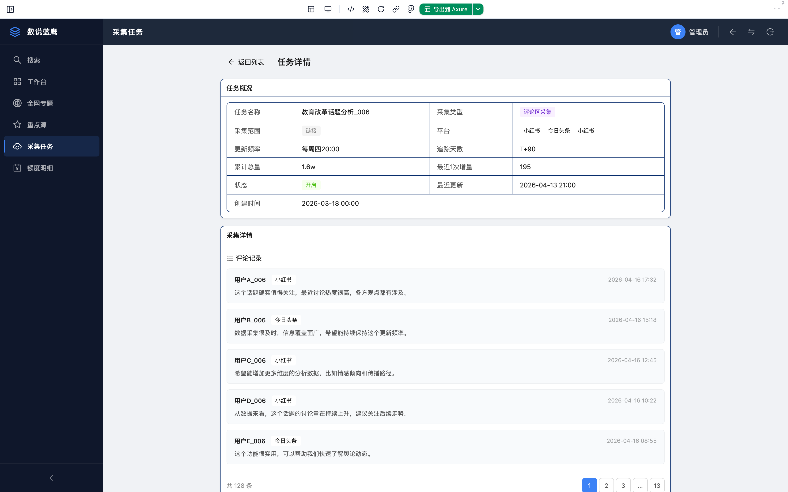

## 额度明细列表

### 任务消耗额度明细列表

#### 功能概述

展示系统内所有采集任务执行产生的额度消耗流水，使用户能够直观追踪每项“数据资产”去向 。

#### 功能细节

* **列表展示项 [P0]**：
  + **采集时间**：精确到秒（YYYY-MM-DD HH:mm:ss），指该笔消耗发生的具体时间点。
  + **所属任务**：显示创建时定义的任务名称 。
  + **采集范围**：以标签形式区分 **全网专题**、**重点源** 或 **链接** 。
  + **采集来源**：展示对应的平台 Icon 及名称（如：今日头条、小红书、抖音、微博等） 。
  + **采集类型**：区分 **互动量刷新** 或 **评论区采集** 。
  + **帖子 ID/标题**：展示具体受监测帖子的唯一标识及标题，支持点击“复制”图标。
  + **消耗额度**：该次采集动作扣除的具体数据次数。
* **操作项 [P0]**：
  + **查看详情**：点击后唤起右侧抽屉，展示该笔消耗的详细快照信息。

#### 输入与输出

* **输入**：系统自动生成的采集流水数据。
* **输出**：格式化的额度消耗明细列表。

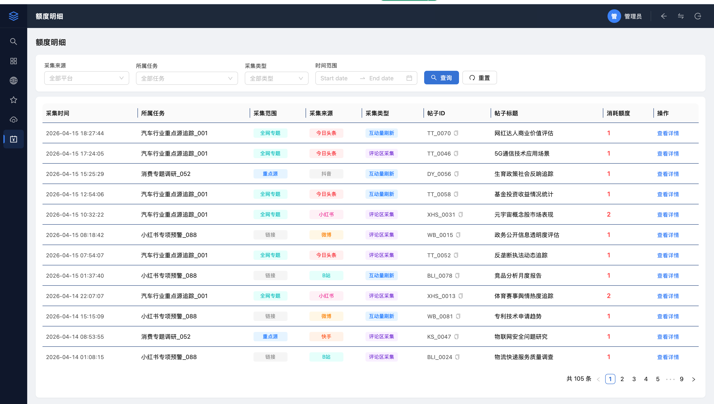

### ‌消耗额度的任务详情快照

#### 功能概述

当用户点击“查看详情”时，系统以抽屉或弹窗形式展示该次特定采集行为的原始属性与数据产出快照 。

#### 功能细节

* **基础信息模块 [P0]**：
  + 完整展示该条记录的元数据，包括采集时间、所属任务、范围、来源、类型、帖子 ID 及标题。
* **数据快照模块 [P0]**：
  + **场景 A（互动量刷新）**：以卡片形式展示该次采集抓取到的瞬时数值，包括 **点赞数、收藏数、转发数、评论数**。
  + **场景 B（评论区采集）**：展示采集到的 **评论内容摘要**。快照应保留采集当时的 Top 评论或最新评论记录，用于验证采集的有效性。
* **消耗统计 [P0]**：
  + 显著标识本次操作最终结算的消耗额度。

#### 输入与输出

* **输入**：点击列表行的“查看详情”指令。
* **输出**：右侧详情抽屉，包含基础信息、数据成果快照及消耗总额。

#### 注意事项

* 目前蓝鹰中已经有其他评论聚合展示样式，参考现有样式即可，无需额外开发新的效果。

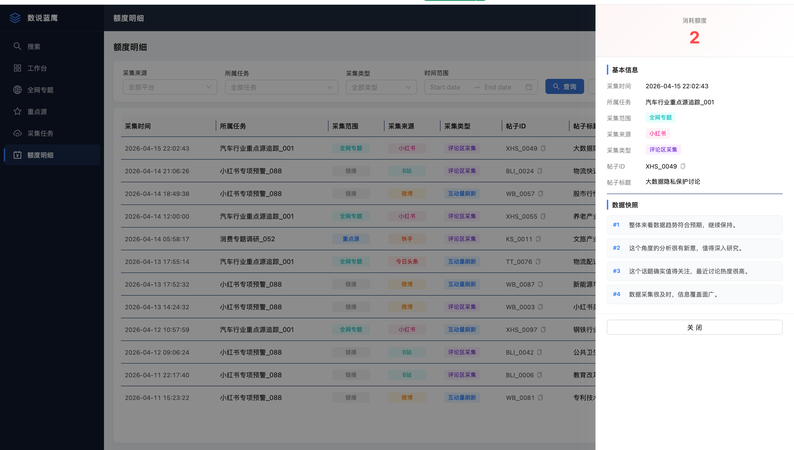

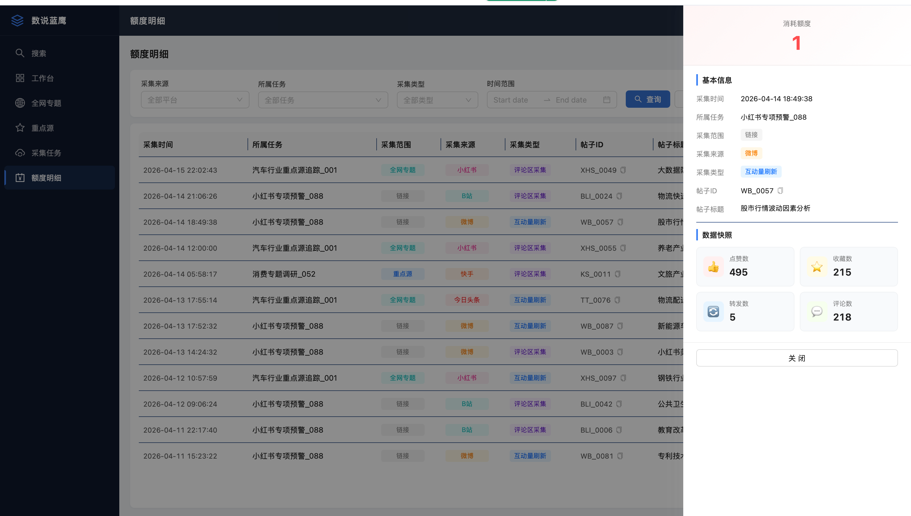

### 额度消耗明细查询

#### 功能概述

提供多维度的筛选工具，支持管理人员快速定位特定时间段或特定任务的资源消耗情况 。

#### 功能细节 [P1]

* **采集来源筛选**：下拉选择框，支持按小红书、抖音、微博、今日头条、快手、B站等平台进行过滤。
* **所属任务筛选**：支持模糊搜索或下拉选择特定的采集任务名称。
* **采集类型筛选**：下拉选择“互动量刷新”或“评论区采集”。
* **时间范围选择**：日期时间选择组件，支持自定义开始与结束日期。
* **操作按钮**：
  + **查询**：执行过滤逻辑，刷新下方列表数据集。
  + **重置**：清空所有已选条件，恢复列表默认展示。

#### 输入与输出

* **输入**：组合筛选条件、点击查询/重置。
* **输出**：符合筛选条件的过滤后数据集。

#### 注意事项

* **计费一致性**：即使采集过程中出现平台风控导致数据为 0，只要执行了调用动作，该快照仍需记录并显示对应的消耗额度 。
  + **数据时效性**：详情快照应为“采集时刻”的数据记录，不随后续任务更新而改变，以确保审计的准确性。

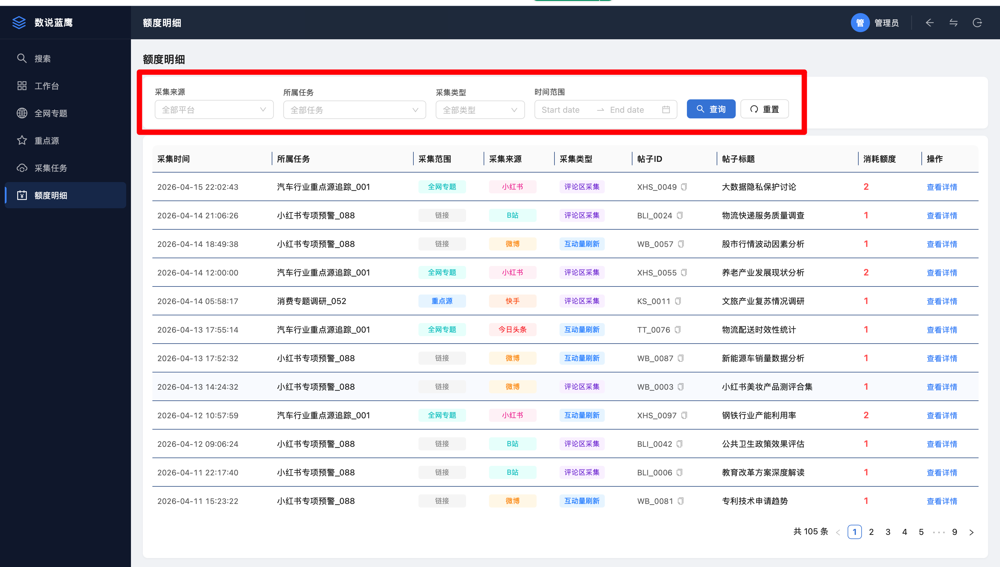

## 搜索

### ‌支持选中帖子创建采集任务

#### 功能概述

在搜索结果列表中，用户可以针对特定帖子点击“创建采集任务” 。系统将自动提取该帖子的链接、标题及平台属性，预填充至任务配置表单中，实现快捷定向采集。

#### 功能细节

* **功能入口 [P0]**:
* 在搜索结果列表的每个帖子卡片右上角，新增“**创建采集任务**”按钮 。
* **字段自动关联逻辑 [P0]**:
  + **采集范围**: 默认选中为“**链接**”模式 。
  + **目标平台**: 系统根据原帖所属平台（如微博、今日头条、小红书等）自动勾选对应的目标平台 。
  + **链接配置**: 自动抓取并填充原帖的 URL 链接 。
  + **任务名称/标题补充**: 默认将原帖标题（或正文前 50 字）填充为任务配置中的“补充标题”，用户可二次修改 。
* **任务要求配置 [P0]**:
  + **任务类型**: 提供单选切换，包括“**互动量更新**”和“**评论区采集**” 。
  + **更新频率**: 支持设置“每 X 小时”、“每天”或“每周”及具体时间点 。
  + **追踪天数**: 手动输入追踪时长（例如 T+7 天），系统需校验是否在允许的 1~30 天范围内 。
* **采集深度 [P0]**:
  + **采集页数**: 用户需指定采集该链接的前 N 页评论或数据 。

#### 输入与输出

* **输入**:
  + 点击搜索结果中的“创建采集任务”按钮。
  + 在右侧弹出的浮窗中完善更新频率、追踪天数、采集页数等参数 。
* **输出**:
  + **成功反馈**: 弹出 Toast 提示“任务提交成功” 。
  + **数据流向**: 自动在“采集任务列表”中生成一条状态为“开启”的新记录（若额度充足） 。

#### 注意事项

* **链接合法性校验**: 虽然由系统自动填充，但提交前仍需通过正则表达式校验 URL 格式是否符合目标平台（如小红书、抖音、微博）的合法规范 。
* **计费前置校验**: 在点击“提交”开启任务时，后端需预判账户余额。若额度不足（数据包 < 0），则开启失败并提示充值 。
* **任务唯一性**: 一个快捷创建动作仅对应一个自定义链接，严禁在此时混选专题或重点源 。

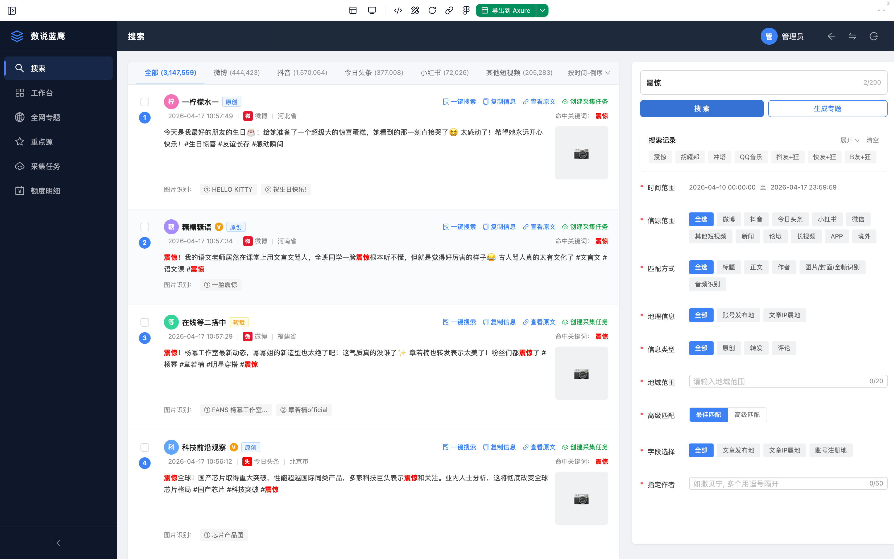

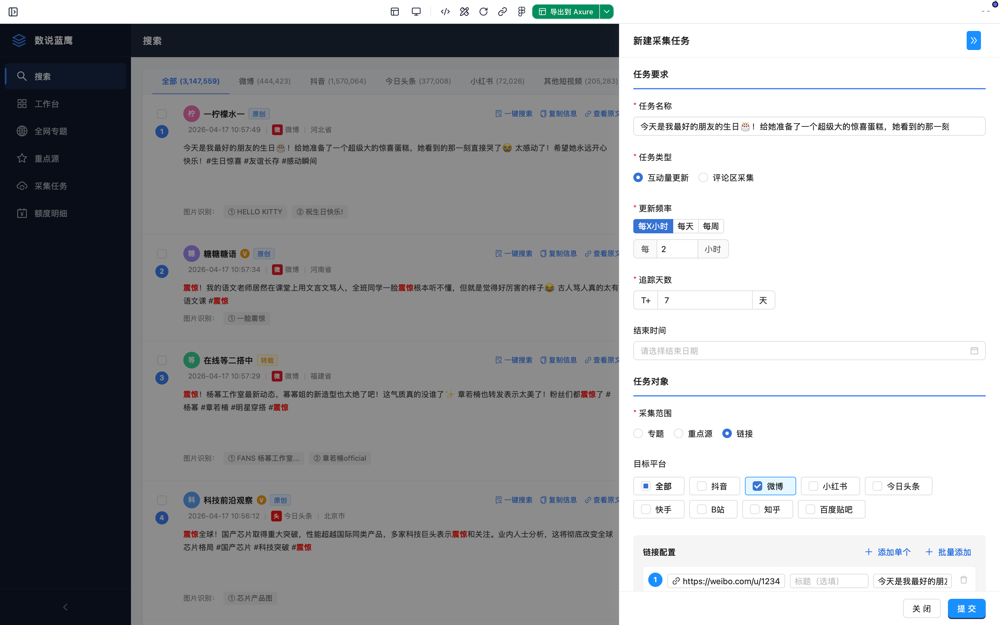

## 全网专题

### ‌支持选中帖子创建采集任务

#### 功能概述

在全网专题的内容列表页，用户可针对专题内的特定帖子一键发起采集任务。系统将自动识别当前专题上下文，并预填关联信息，实现“**发现专题热点-定向精细追踪**”的闭环操作 。

#### 功能细节

* **功能入口 [P0]**：
  + 在全网专题的文章列表项右上角，新增“**创建采集任务**”功能按钮 。
  + 点击按钮后，从页面右侧滑出“新建采集任务”配置抽屉 。
* **字段自动关联逻辑 [P0]**：
  + **采集范围**：系统默认自动选中“**专题**” 。
  + **关联专题**：系统自动获取当前页面所属的专题名称（如“李雨桐实名举报薛之谦重婚罪”），并自动填充至关联专题下拉框中，无需用户手动寻找 。
* **任务基础配置项 [P0]**：
  + **任务名称**：由用户自定义输入，建议限制为50字符以内 。
  + **任务类型**：提供“**互动量更新**”与“**评论区采集**”两种模式供用户选择 。
  + **更新频率**：支持按“每X小时”、“每天”或“每周”设置定时采集节点 。
  + **追踪天数**：支持数字输入，通常限制在1~30天范围内，确定该任务的生命周期 。
  + **结束时间 [P2]**：提供日期选择组件，任务将在选中日期的 23:59 分自动停止采集 。
* **数据校验逻辑 [P1]**：
  + **防重机制**：若该重点源下已存在针对该特定帖子的相同类型（如同为评论采集）且正在运行的任务，系统应在提交时提示：“该任务已存在，请勿重复创建”。

#### 输入与输出

* **输入**：
  + 用户在专题列表页点击“创建采集任务”指令。
  + 在抽屉表单中补充任务名称、频率、追踪天数等参数 。
* **输出**：
  + **操作反馈**：提交成功后弹出 Toast 提示“任务提交成功” 。
  + **任务留痕**：在“采集任务”列表页新增一条关联该专题的定向采集记录 。

### 注意事项

* **权限与额度校验 [P0]**：提交任务前，后端需实时检索用户当前的剩余数据包额度。若额度不足，则禁止提交并提示“额度不足，请联系管理员充值” 。
* **配置唯一性 [P0]**：虽然是从单体帖子发起的入口，但由于采集范围选定为“专题”，系统将依据专题整体更新逻辑执行，严禁在一个任务中同时混选多个专题或其他链接 。
* **操作防抖 [P0]**：在点击提交按钮时需做防抖处理，避免因网络波动导致的并发重复扣费或生成冗余任务 。

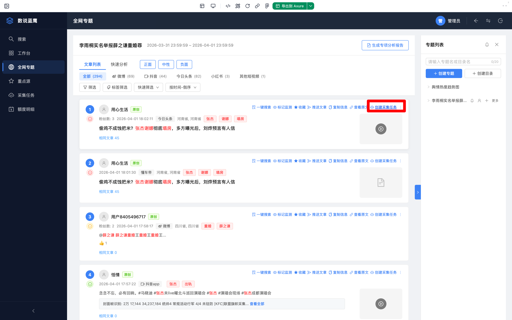

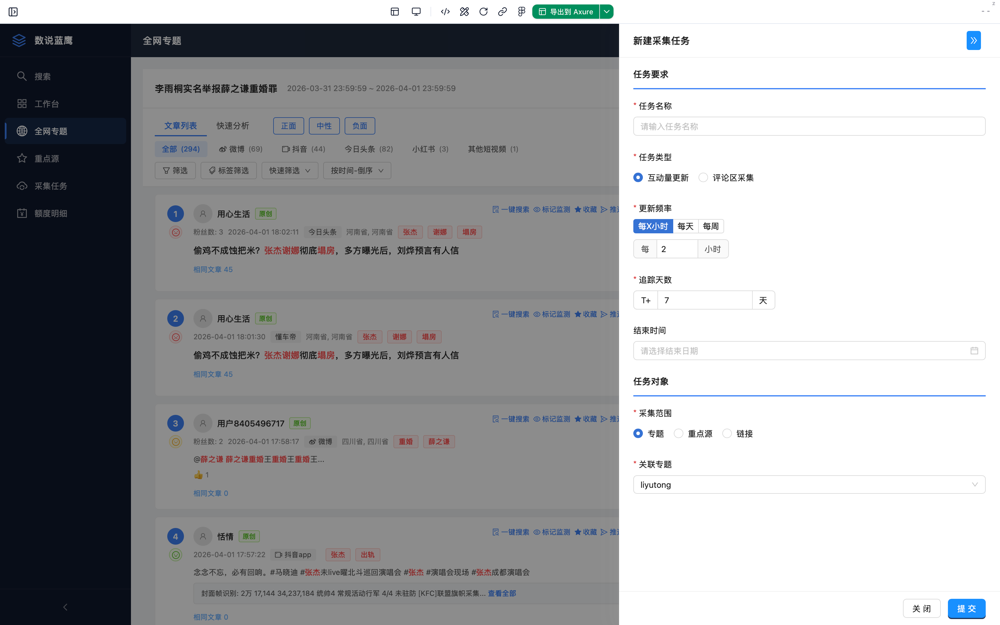

## 重点源

### ‌支持选中帖子创建采集任务

#### 功能概述

在重点源监控的帖子列表页，用户可对特定重点源账号发布的帖子一键发起采集任务。系统将自动识别当前帖子的所属重点源属性并预填至配置表单，实现“**监控账号动态-锁定高价值贴-定向高频采集**”的高效闭环。

#### 功能细节

* **功能入口 [P0]**：
  + 在重点源列表的文章卡片右上角功能操作区，新增“**创建采集任务**”按钮（图标样式与搜索、专题板块保持一致）。
  + 点击后，页面右侧弹出“新建采集任务”配置抽屉。
* **字段自动关联逻辑 [P0]**：
  + **采集范围**：系统默认自动选中“**重点源**”。
  + **关联重点源**：系统自动读取该帖子所属的重点源名称（例如：“环球网”、“央视新闻”或自定义的重点账号组），并自动填充至下拉框，用户无需手动检索或选择。
* **任务核心配置项 [P0]**：
  + **任务名称**：默认留空或由用户根据帖子标题简述自行定义，必填项。
  + **采集类型**：提供“**互动量更新**”与“**评论区采集**”的单选切换。
  + **更新频率**：支持自定义频率，如“每1小时、每6小时、每天”等。
  + **追踪时效**：
    - **追踪天数**：输入追踪的总时长（T+N天）。
    - **结束时间**：提供日历控件，设定任务自动关停的具体日期。
* **数据校验逻辑 [P1]**：
  + **防重机制**：若该重点源下已存在针对该特定帖子的相同类型（如同为评论采集）且正在运行的任务，系统应在提交时提示：“该任务已存在，请勿重复创建”。

#### 输入与输出

* **输入**：
  + 用户在重点源帖子列表点击“创建采集任务”。
  + 在抽屉内完成频率、天数及任务名称的输入。
* **输出**：
  + **前端反馈**：提交成功后，弹出成功 Toast 并关闭抽屉。
  + **后台流向**：在后台“采集任务列表”中生成一条新的重点源定向任务，并根据设置的频率立即排队进入初次采集流程。

#### 注意事项

* **计费规则一致性 [P0]**：重点源任务通常涉及增量数据较大，需在用户点击“提交”时，实时校验其账户下的\*\*“数据包额度”\*\*。若额度不足，则禁止提交并提示“额度不足，请联系管理员充值” 。
* **上下文感知 [P1]**：如果用户是从某个特定的“重点源组”进入的，系统应优先关联该组下的具体账号。

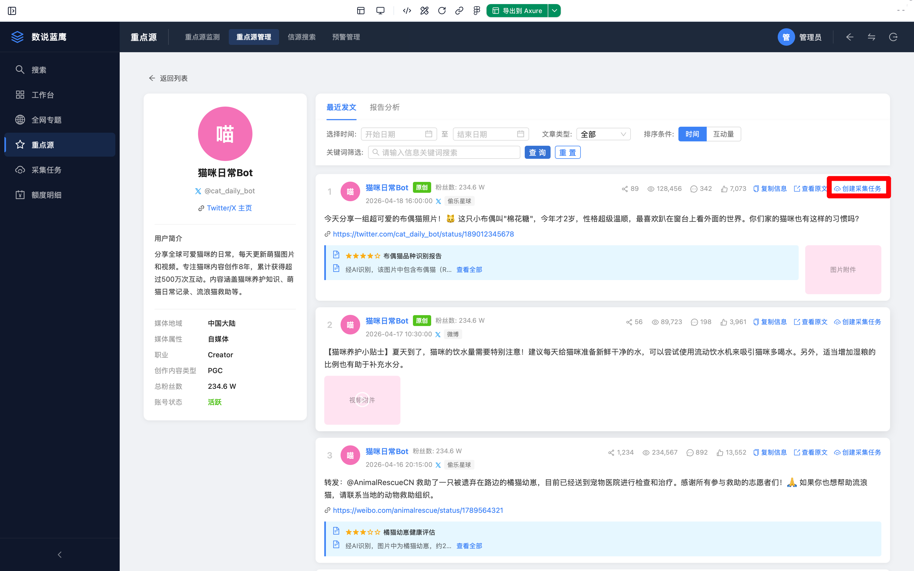

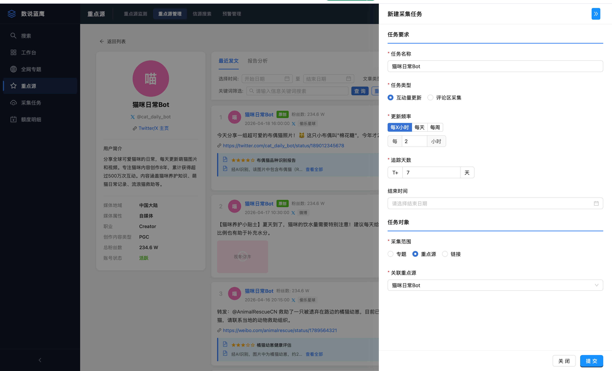

## 顶部导航

### ‌用户菜单悬浮卡片信息补充

#### 功能概述

在顶部导航栏的用户头像悬浮卡片中新增“任务消耗”仪表盘模块 。该模块实时展示当前账户的额度余额及不同周期下的消耗数据，并提供同比/环比的波动趋势，方便管理人员快速复盘资源利用率 。

#### 功能细节

* **仪表盘展示项 [P1]**：
  + **账户余额**：以显著字号展示当前账户剩余的总采集额度（条），作为采集任务开启的前置判定依据 。
  + **当日累计消耗**：统计从今日 **00:00** 至今产生的累计采集次数 。
  + **本月累计消耗**：统计从本月 **1日 00:00** 至今产生的累计采集次数 。
* **对比数据逻辑 [P1]**：
  + **日环比对比**：在当日消耗下方展示较昨日同一时段的增减量（如：较昨天增加 120 次）。增加以红色向上箭头表示，减少以绿色向下箭头表示。
  + **月同比对比**：在本月消耗下方展示较上一个月全月消耗的增减情况（如：较上个月减少 1,200 次）。
* **视觉样式**：
  + 采用卡片式布局，背景使用浅色色块区分（如浅蓝、浅绿、浅橙），保持科技商务感，符合舆情看板特性。

#### 输入与输出

* **输入**：用户点击或悬停顶部导航栏头像。
* **输出**：弹出包含“任务消耗”仪表盘的悬浮卡片，实时渲染最新的额度流水汇总数据。

### 注意事项

* **数据实时性**：由于涉及计费审计，该卡片内的数据需在用户每次打开浮窗时从后端计费系统（Billing System）实时拉取，确保与“额度明细”列表中的数据一致 。
* **额度预警联动**：当账户余额低于系统设定的预警阈值时，建议在该模块增加颜色警示（如余额变红），配合计费前置校验逻辑，提醒用户及时充值以防采集任务中断 。

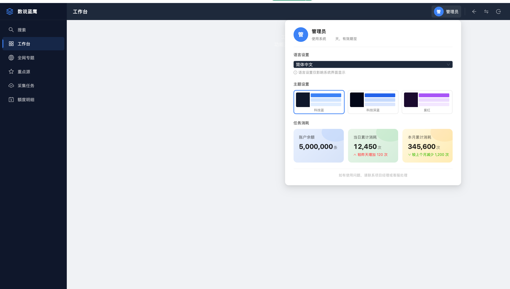

# 附件

-