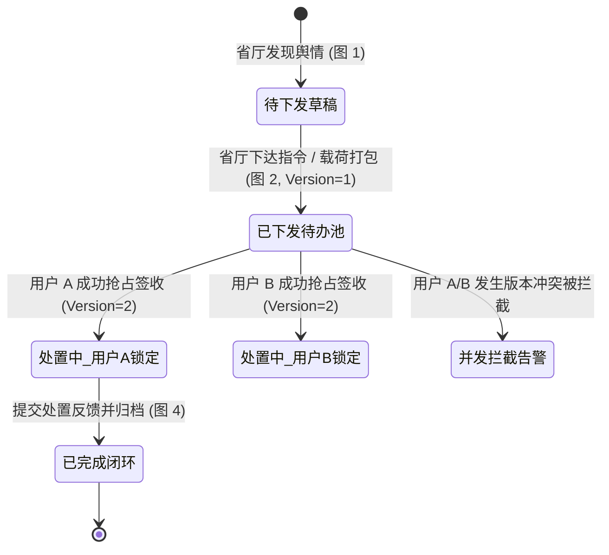
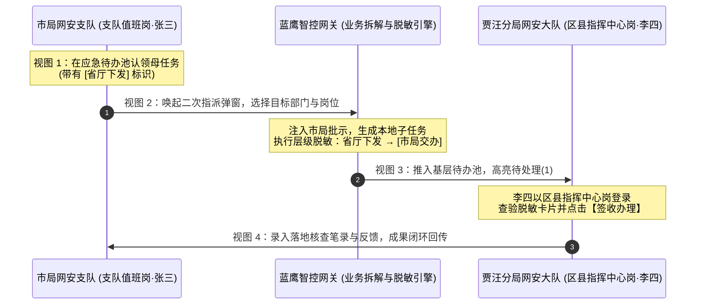

# 今日值班表原型规格说明 (spec.md)

今日值班表是“蓝鹰一体化系统”中用于展示市局舆情总队及各区县、其他单位值班安排的核心组件。本组件支持多视角查看、人员快捷呼叫以及值班人员的动态维护。

---

## 1. 视图模式与窗口规范

- **平铺全屏大屏模式**: 弹窗默认采用 `100vw × 100vh` 全屏平铺布局，最大化利用屏幕可视区域，适合值班室大屏实时监控及指挥人员全面纵览。
- 组件右上角提供模式切换控件（基于 `Segmented` 组件），支持两种视图模式：
  1. **看板模式 (board)**:
     - 默认选中。
     - 采用深色科技风格设计，左侧为总队在岗情况，右侧为各区县/单位在岗情况，顶部标题栏集成值班领导板块。
  2. **列表模式 (list)**:
     - 采用经典明亮风格的表格形式，适合快速纵览和打印。
     - 结构化列出总队各岗位和区县单位值班人员。

---

## 2. 布局与信息密度优化规范

### 2.1 整体分栏与顶线齐平
- 看板模式下，左右两栏按 **1:3** 黄金分栏比划分：
  - **左侧栏 (占 1/4 栅格，6/24)**: 展示总队在岗岗位与具体人员。
  - **右侧栏 (占 3/4 栅格，18/24)**: 展示区县及其他单位值班情况，支持输入框关键字检索。
- **板块顶线齐平**: 因值班领导已合并至弹窗顶部 Header 中，左侧“总队”面板与右侧“区县及其他单位”面板起始垂直位置完全对齐齐平，消除了原先左侧因包含独立领导板块导致的总队列表下沉问题。

### 2.2 值班领导板块 (紧随值班大屏标签右侧)
- **位置**: 放置在弹窗顶部 Header 左侧区域，紧随“今日值班表”标题与“值班大屏”日期标签右侧依次紧凑排布。
- **信息展示**:
  - “今日值班领导”标签与皇冠图标。
  - 当前值班领导所属单位标签、姓名、联系电话（支持点击呼叫并复制）。
- **交互功能**:
  - **更换领导**: 提供下拉菜单（Select），可从已有领导库中选择并切换，切换后全局数据同步更新。
  - **新增领导**: 右侧提供“新增领导”按钮。点击弹窗（Modal + Form）录入领导姓名、警号、联系方式，并以级联选择器（Cascader）选择所属部门。录入成功后自动追加至领导库并可立即被指派值班。

### 2.3 高辨识度分体式人员卡片规范 (High-Contrast Split Badge Card)
为了满足实战中海量在岗人员陈列的极高辨识度与零空间浪费需求，值班人员与领导信息展示统一采用**分体式胶囊卡片 (`staff-split-card`)** 结构：
- **设计特征与视觉层级**：
  - **左侧名称/岗位块 (`split-name-box`)**：采用高对比度鲜明亮蓝纯色背景（`#1875f0`），加粗纯白文字，视觉层级最高，快速聚焦人员身份与部门职务。
  - **右侧联系电话块 (`split-phone-box`)**：采用深邃暗蓝底色（`#081d3d`），搭配高亮天蓝图标（`📞`）与等宽数字编码（`#85b8ff`），居中对齐，清晰易读。
  - **分体式单卡容器**：高度设为极紧凑的 `28px`，外层包裹 `1px solid #1677ff` 微发光边框，圆角 `4px`，鼠标悬浮时边框高亮（`#60a5fa`）并伴随 `0 0 10px rgba(22, 119, 255, 0.45)` 科技微发光阴影。
- **总队在岗岗位卡片 (`post-group-card`)**：
  - 岗位标题栏左右排布：左侧为岗位名称（`post-name-title`，白色加粗），右侧为该岗在岗总人数（`post-count-badge`，如 `2 人`）。
  - 岗位内人员卡片 100% 满宽纵向堆叠，左侧名称块支持容纳完整单位+姓名（如 `总2_舆情 王小虎`）。
- **区县单位人员卡片 (`district-split-card`)**：
  - 区县卡片内人员列表同样采用 100% 满宽纵向堆叠，左侧姓名块紧凑统一（宽 `74px`），右侧等宽排布电话。
- **今日值班领导标签 (`leader-split-card`)**：
  - 顶部导航栏内同样采用分体式卡片规范呈现，左侧为领导姓名，右侧为呼叫电话，形成系统统一的视觉语言。

### 2.4 区县及其他单位网格
- 按部门（区县）卡片形式聚合，在 3/4 宽度大屏下采用 `auto-fill` 弹性响应式 Grid 布局（每张卡片最小 215px，自适应 4~6 列），最大化释放全屏水平空间，确保 40+ 区县在单屏内一目了然、极低滚动深度。

---

## 3. 快捷联系与复制

- 在任何视图模式下，点击任何值班人员或值班领导卡片，系统均应模拟警务通强连呼叫并复制联系人方式：
  - 弹窗提示：`“已成功复制联系方式：[姓名] ([电话])，已发起警务通强连，正在呼叫...”`。

---

# 复盘总结 - 人员上报采纳统计模块规格说明

## 1. 模块定位与容器规范
- **插入层级**：位于【上报/编报量统计】区域下方、【指令类型统计】卡片上方，横向宽度 100% 占满容器。
- **容器风格**：白色卡片容器（圆角 8px，内边距 16px，柔和阴影），与页面整体风格保持一致。

## 2. 卡片头部与筛选工具栏规范
- **卡片头部（Card Header）**：
  - **左侧标题**：「人员上报采纳统计」，左侧带有系统统一的 4px 蓝色竖条标识。
    - 标题右侧携带 Tooltip 提示图标，悬停显示业务口径：“统计周期内，上报信息被下达指令视为被采纳。被采纳率 = 被采纳数 / 上报数 × 100%”。
  - **右侧操作**：次级轻量按钮「导出 Excel」，前置 `DownloadOutlined` 图标，点击触发导出反馈提示。
- **筛选工具栏（Filter Bar）**：位于 Card 内部、Table 正上方：
  - **时间范围选择器 (`RangePicker`)**：默认选中「最近1周」（当天往前推 7 天到当天），预设快捷选项包括「最近7天」、「最近30天」、「本月」。
  - **部门下拉框 (`Select`)**：Placeholder:「选择部门」，支持 `allowClear`，内置辖区机构选项（全部部门、清溪分局、虎门大队、麻涌所、长安分局、东城中队、万江分局等）。
  - **姓名搜索框 (`Input.Search`)**：Placeholder:「请输入姓名搜索」，支持 `allowClear`、回车或点击放大镜搜索。
  - **查询与重置按钮**：主按钮「查询」与默认按钮「重置」。
  - **交互与性能规避机制**：仅在组件初始挂载、点击「查询」或点击「重置」时执行数据过滤与重排，避免输入过程中无序频繁重绘。

## 3. 表格字段与排序规范
基于 Ant Design `Table` 组件开发，提供 6 列核心指标：
1. **序号 (`rank`)**：居中展示，根据当前列表排序动态生成 1、2、3...。前三名采用专属高亮徽章样式（金、银、铜色阶区分）。
2. **姓名 (`userName`)**：文本居左展示，加深字重。
3. **部门 (`deptName`)**：文本居左展示，次级辅助文本色。
4. **上报数 (`reportCount`)**：数值居右对齐，支持客户端数值排序 (`sorter`)。表头右侧附带 `InfoCircleOutlined` 图标，悬停提示：“所选时间范围内，该账号主动上报的信息总量”。
5. **被采纳数 (`adoptedCount`)**：数值居右对齐，绿色高亮区分，支持客户端数值排序 (`sorter`)。表头右侧附带 `InfoCircleOutlined` 图标，悬停提示：“所选时间范围内，该账号上报且已下达指令的独立信息数量（单条信息被多次下达指令去重计为1次）”。
6. **被采纳率 (`adoptionRate`)**：数值居右对齐，蓝色高亮加粗，保留两位小数（如 `85.71%`，为 0 时展示 `0.00%`）。表头右侧附带 `InfoCircleOutlined` 图标，悬停提示：“计算公式：被采纳数 / 上报数 × 100%。上报数为 0 时展示 0.00%”。
   - **默认排序**：设为表格默认降序排列（`defaultSortOrder: 'descend'`）。
   - **排序逻辑**：支持自定义数字比较函数排序。

## 4. 分页控制规范
- 默认每页展示 10 条（`defaultPageSize: 10`）。
- 开启分页大小切换器（`showSizeChanger: true`），选项支持 `[10, 20, 50]` 条。
- 展示总条数文案（`showTotal: (total) => 共 ${total} 条`）。
- 筛选、排序与翻页联动保证序号按展示顺序动态连贯计数，执行查询或切换排序时自动回到第 1 页。

---

# 源头防控（重庆定制）- 客户端舆情处置台账快捷录入与固证规格说明 (spec.md)

## 1. 业务背景与定位
政务单位值班人员及舆情专班工作人员通过配套的专用**蓝鹰客户端**执行境内外涉事敏感帖文的采集与固证（用于劝删处置与存证上报）。由于部分舆情超出系统自动化巡检范围，需要由工作人员在客户端完成内容提取后快速回传台账。
本组件为“源头防控（重庆定制）- 任务详情 - 处置台账”模块的核心配套桌面端窗口组件，用于处理一体化系统与客户端的快捷联动，实现批量敏感帖文链接的高效录入、合规管控、在线就地核对、重复自动覆盖及一键入库同步。

## 2. 核心规则与约束规范
1. **单次数量上限管控（严格 <= 30 条）**：
   - 单次批量录入上限严格限制在 **30 条** 以内（满足网络固证链路吞吐与政务合规审计）。
   - 右下角实时动态计算仪表盘：“已识别：X / 30 条”。
   - 当 $X \le 30$ 时为安全蓝/绿状态；当 $X > 30$ 时，输入框触发红色警示边框，展示 `Alert (错误警告)` 并强制禁用【开始解析采集与固证】按钮，同时提供一键【保留前30条并清空其余】处理机制。
2. **入库覆盖规则 (Overwrite)**：
   - 同一专项任务内若存在重复链接，系统自动比对并标记为橙色 Tag【将覆盖历史记录】。
   - 提交入库时直接覆盖更新旧台账数据，保留唯一链接最新取证快照与互动量，避免脏数据堆叠。
3. **处置状态二元化**：
   - 针对向上级汇报帖文总量与状态的特定政务诉求，台账状态简化收敛为两种：`未处置` (`pending`，橙色标识) 与 `已处置` (`disposed`，绿色标识)。
4. **单人单机与专项上下文锁定**：
   - 优先读取宿主父页面传入 Props 或 URL Query 参数中的 `taskId` 与 `taskName`。
   - 展示深蓝政务胶囊标识“归档任务：【{taskName}】 (ID: {taskId})”并锁定锁头，明确提示覆盖规则。

## 3. 极简视窗与美学规范 (Minimalist Design System)

遵循“**界面元素极简、剔除冗余说教文案、通透大方**”的核心设计原则，整体重构聚焦高信噪比与现代政务专业桌面质感：

### 3.1 单行极简视窗顶栏 (Single-Row Chrome Header)
- **尺寸与阴影**：固定宽度 **960px**，自包含弹性高度，外层包裹 `0 20px 48px rgba(0, 0, 0, 0.25)` 桌面级重阴影与圆角 `12px`。
- **单行聚合排布**：
  - 左侧：红黄绿拟真微圆形交通灯控制点 + 纯白高字重标题「政务舆情客户端 · 快捷录入与固证」+ 专项蓝色标签（如 `归档专项：某突发事件应对`）。
  - 右侧：VPN 专线状态胶囊（极简绿灯 + `VPN 正常`）+ 操作员账号信息 + 悬浮微动效关闭图标。
  - **彻底摒弃**：删去原有第二行深色背景副栏，不再出现大段规则解释横幅，将信息收敛于单行平铺。

### 3.2 极简三步工作流向导 (Minimal Steps)
- 采用 Ant Design `Steps` 组件，单行水平陈列：
  - `1. 批量录入` $\to$ `2. 智能解析` $\to$ `3. 核对入库`。
- 剔除步骤下方的任何冗长描述型副文本，保留清晰明了的当前步骤焦点指示。

### 3.3 第一阶段：极简录入与智能管控
- **单行通道切换**：采用 `Segmented` 分段控制器切换「直接粘贴文本 / URL」与「导入 Excel」，消除冗余 Tab 边框与留白浪费。
- **快捷填充辅助**：右侧平铺纯净按钮组（`3条`、`28条(含重复)`、`32条(超限测试)`、`清空`），方便演示与测试。
- **动态胶囊计数**：文本域右下角浮动显示单行药丸胶囊 `已识别：X / 30 条`（未超限时为清爽深蓝，超限时为警示鲜红）。
- **去繁复告警**：超限时仅弹出紧凑的单行 `Alert` 提示，右侧直配【保留前30条】一键按钮；底栏仅保留一处微灰色提示文字说明重复链接将自动覆盖，杜绝繁复说教。

### 3.4 第二阶段：黑曜石沉浸解析终端 (Obsidian Console)
- 纯净深色控制台容器（深黑背景 `#0d1117`），内嵌平滑平顺的动态进度条（0% $\to$ 100%）。
- 逐行打印格式规范、绿色等宽字体的微型日志（抓取、4K固证、SHA-256存证封签、去重命中），给用户直观的自动化信赖感，无任何额外说教说明。

### 3.5 第三阶段：结构化就地核对表与存证预览
- 表格列名干练清晰，去除括号内冗长解释：`序号`、`平台`、`帖文标题与来源`、`发布时间`、`快照`、`入库模式`、`处置状态`、`操作`。
- **直觉交互**：
  - 平台采用社媒经典辨识度徽章（微博红、抖音黑白、小红书红等）；
  - 点击快照缩略图直达大图固证 Modal（包含授时水印与 SHA-256 防伪指纹）；
  - 处置状态为二元下拉选择（`未处置` / `已处置`）；
- **底栏极简收尾**：仅保留【返回修改】次级按钮与【确认同步至台账 (X 条)】主行动按钮。

### 3.6 纯自包含与零样式依赖实现
- 组件样式采用**内联样式 + 局部作用域样式注入**方案，彻底消除对外部 Tailwind CSS 构建插件的依赖，杜绝在不同打包环境下类名失效、样式崩塌或产生多层白边弹窗外壳的问题。

---

## 4. 蓝鹰客户端工作台原型 (V2 布局方案) 规格说明

### 4.1 原型外壳与多场景导航 (Prototype Chrome & Scenarios)
- **外层背景**：深蓝黑科技底色 (`#141e2b`)，顶部陈列 `PROTOTYPE · V2 布局方案` 标签、工作台原型说明与窗口规格参数（`窗口 1280 × 800`、`状态条 40px · 上报侧栏 400px`、`目标平台 Windows 7+ / Electron`）。
- **场景切换 Tabs**：
  1. `01 登录`：模拟 Electron 客户端账号/警号与密码独立登录弹窗；
  2. `02 工作台 · 有 VPN 权限`（默认选中）：呈现完整登录态、40px 状态栏与功能矩阵；
  3. `03 工作台 · 无 VPN 权限`：呈现 VPN 未连接警示与重连入口；
  4. `04 信息提取 · VPN 断线`：模拟内嵌浏览器访问境外站点受阻界面；
  5. `05 信息提取 · 上报侧栏`：呈现内嵌浏览器配合 400px 快捷信息上报侧栏。

### 4.2 客户端视窗主体架构 (1280 × 800)
- **32px Windows 标题栏**：左侧展示蓝鹰 Logo 与名称，右侧提供拟真最小化、最大化与关闭控制按钮。
- **40px 状态条**：
  - 左侧：VPN 连接状态胶囊（绿色呼吸灯 + `VPN 已连接 02:14:37`，标注 1 号点）；
  - 右侧：操作员头像徽章（`张`）与下拉菜单（`张明 ▾`，支持查看个人信息、系统设置与退出登录）。
- **用户信息卡 (User Profile Card)**：
  - 陈列姓名（张明）、`VPN` 与 `信息上报` 权限标识、部门角色（数据分析部 / 高级分析师）、邮箱及上次登录时间，右侧配置【退出登录】按钮（标注 2 号点）。
- **VPN 状态卡 (VPN Status Card)**：
  - 动态显示专线连接时长，右侧提供红色【断开连接】/ 蓝色【连接专线】操作按钮（标注 3 号点）。

### 4.3 核心功能卡片矩阵 (Feature Cards Grid)
1. **信息提取 (Card 4)**：
   - 定位：在客户端内打开境内外站点，提取正文、图片、视频与互动数据，回传蓝鹰上报。
   - 交互：点击可直达信息提取与 400px 上报侧栏视图。
2. **访问系统 (Card 5)**：
   - 定位：在系统默认浏览器中打开蓝鹰一体化系统（eagle.example.com）。
   - 交互：点击直接模拟浏览器外跳或切换至系统主控台。
3. **台账录入（新增核心入口）**：
   - **视觉设计**：采用**高饱和度红色边框 (`2px solid #ef4444`) 与浮动角标【新增功能入口 · 源头防控联动】**，精准呼应用户实战标注。
   - **业务定位**：在客户端内批量录入链接，提取链接标题、发布时间、平台并回传一体化处置台账。
   - **交互闭环**：
     - 点击卡片直接进入客户端全屏内嵌的【台账录入与固证】模块；
     - 视窗左上方提供【← 返回工作台】快捷导航；
     - 支持**选择目标源头防控专项任务**（从 CQ 专项任务库中下拉选择）；
     - 支持**手动添加链接**或**通过 xlsx 模版拖拽导入**；
     - 点击**【提取并上报】**，后台自动调用客户端能力并发抓取并生成防伪存证；
     - 核对后点击【确认同步至台账】，成功后支持一键【前往查看该专项处置台账】或【继续录入新批次】。

### 4.4 重庆源头防控子页 (`TaskDetailCQ.tsx`) 协同同步机制
- **快捷调用入口**：在重庆定制子页的【处置台账】选项卡中，点击【客户端快捷录入】唤起 960px 视窗；
- **专项上下文自动锁定**：自动锁定当前所在子任务 (`isTaskLocked={true}`)，禁止误切其它专项；
- **实时数据流回传**：点击【提取并上报】并在确认同步后，台账数据实时追加/覆盖刷新至宿主页面的处置台账表格中，达成系统与客户端的无缝端到端闭环。

---

# 场景一：区县手工上报（免审直通省厅动线）规格说明 (spec.md)

## 1. 业务目标与场景定位
演示在未开启市局审核（或区县具备免审白名单权限）的前提下，区县基层网安民警在互联网端填报舆情，通过勾选【上报总队】实现表单字段的动态级联（属地字典无缝切换为全省标准），提交后经模拟跨网安全前置机单向摆渡直接落库省厅内网一体化平台的完整流转闭环。

---

## 2. 角色与运行环境视图
- **视图 A（填报端）**：
  - **角色**：区县网安大队民警（徐州市公安局贾汪分局网安大队 · 王建明警官）。
  - **环境**：互联网端基层填报环境（轻明警务蓝主题，路由/标识：`/county/monitor/manual-report`）。
- **视图 B（接收端）**：
  - **角色**：省厅网安总队值班长（江苏省公安厅网安总队指挥研判大厅 · 李警官）。
  - **环境**：公安内网环境（警务深蓝高权威科技主题，路由/标识：`/provincial/monitor/county-reports`）。

---

## 3. 视觉规范与增量改造高亮要求
1. **严格继承既有 UI 规范**：公安蓝（`#1677FF`）主色、Ant Design 栅格与排版字阶，严禁新建风格。
2. **增量改造视觉指示**：
   - 本次新增/变动控件外轮廓施加 **1px 蓝色呼吸光晕**（`animation: blueBreathing 2.4s ease-in-out infinite`）；
   - 右上角附带微缩黄色 **`【改】`** 字角标（`incremental-badge`）。

---

## 4. 详细交互流转与跨地市通报三方联动设计

### 4.1 视图 A：地市 A (常州) 区县填报端（路由：`/city-a/county/report`）
1. **表单级联与字典纯净替换逻辑**：
   - **未勾选【上报总队】（仅上报支队）**：
     - “涉事属地”：仅展示地市 A（常州）本地辖区字典（武进区、天宁区、钟楼区、新北区、金坛区、溧阳市）；
     - “通报地市”：置灰不可选（仅限本地市常州）。
   - **勾选【上报总队】**：
     - 字段字典直接**纯净替换**为省厅统一下发标准字典，原常州市局字典选项完全清空不作合并；
     - “涉事属地”下拉树：纯净替换为省厅下发的全省 13 个地市及全部下属区县；
     - “通报地市”下拉框：激活为全省 13 个地市多选下拉框，选定【徐州市】。
2. **预置测试数据**：
   - 舆情标题：关于徐州某工业园区网络谣言线索协查；
   - 报送目标：`[√] 上报支队  [√] 上报总队`；
   - 涉事属地：江苏省 / 徐州市 / 贾汪区；
   - 通报地市：徐州市；
   - 采集单位：常州市公安局武进分局网安大队。
3. **提交动作与回执跳转**：
   - 底部操作栏重构为标准 Ant Design 布局：灰色线框【重置表单】居次位，公安蓝（#1677FF）高亮【确认上报】居主位，靠右对齐；
   - 当勾选【上报总队】时，表单顶部展示轻量蓝色胶囊提示：`[已激活直通省厅通道]`，主按钮保持标准文字【确认上报】（移除开发解释性后缀与“改”字标记）；
   - 点击【确认上报】弹出 Toast：“上报成功，已同步至省厅并镜像推送至徐州市公安局”，表单数据落库；
   - 自动跳转至【我的上报列表】，记录展示 `[已报总队]`（绿）与 `[已报支队]`（蓝）徽标，流转状态标为 `[已同步省厅并推送徐州]`。

### 4.2 视图 B：省厅总队内网端（路由：`/provincial/monitor/county-reports`）
1. **界面架构与导航对齐（1:1 复刻系统原生研判工作台）**：
   - **顶部检索与视图切换栏**：
     * 字段包含：内容搜索（预填“徐州某工业园区”）、发布时间、精确接收时间范围；
     * 视图切换按钮组：【详细视图】|【研判视图（默认激活）】|【简要视图】。
   - **模块二级 Tab 栏**：
     * 平铺原生 Tab 矩阵：全部（AI）、研判建议、智能预警（AI）、重点账号（AI）、专项巡查、本地舆情、重点源、待认领舆情、**【区县上报（高亮激活，带待办角标 Badge ①）】**、通报信息；
     * 右上角提供【总队研判派发】快捷指令入口。

2. **单条舆情卡片原生还原与业务挂载（Card-Stream View）**：
   - **卡片头部行（Header）**：
     * 复选框 Checkbox、序列编号“1”；
     * 状态徽标：未采纳时显示浅蓝 `[未采纳 / 待研判]` 与浅绿 `[免审直通 · 总队已接报]`，下达指令后即时流转为绿色 `[已采纳 (已下达总队处置)]`；
     * 标签包含：`[初研意见]`（深蓝胶囊）、`[处置]`、`[非热敏]`，右侧金黄色星级评分（`★ ★ ★ ☆ ☆ 3.0星`）。
   - **元数据信息行（Meta Info）**：
     * 呈现：采集人/账号【常州武进分局·王建明】| ID `3766282728521547` | 上报来源【常州市公安局武进分局网安大队】| 涉事属地【江苏省/徐州市/贾汪区】| 平台渠道【抖音短视频平台】| 接收时间【刚刚】。
   - **主标题与正文（Content）**：
     * 加粗加深呈现话题正文：“#关于徐州某工业园区网络谣言线索协查。监测发现网民在短视频平台发布涉及徐州某重点工业园区涉污及用工争议信息，跟帖评论已出现跨地市煽动聚集苗头。常州武进网安大队完成初研后，按跨地市通报机制免审直推省厅总队，并提请抄送徐州市局协查处置。”
   - **AI 摘要与研判分析双色块 + 右侧大号指数卡片**：
     * 浅绿色背景框【AI 摘要】：提炼徐州工业园区涉污非访言论及跨地市关联，属地已固定证据并提请省厅统筹处置；
     * 浅橙色背景框【初研研判 / 总队研判】：呈现常州大队初研处置建议，建议总队下达指令并由徐州属地落地人；
     * 右侧独立卡片【舆情指数】：大号紫色数值框显示 `72.00 / 舆情指数`。
   - **底部标签池**：
     * 呈现：`[来源: 常州直通]`、`[直报总队]`、`[跨地市协查]`、`[徐州市]`、`[贾汪区]`、`[涉稳线索]`。
   - **底部操作栏（核心采纳闭环）**：
     * 次要操作：【查看跨网流水详情】、【AI深度研判】、【一键复制】；
     * 核心采纳操作（挂载 AxHub 图钉批注 3）：未采纳时突出呈现蓝色主按钮【下达处置指令 (更新采纳)】；点击弹出指令派单弹窗，确认后更新为绿色已采纳标签并计入总队考核分子；同时提供一键前往徐州通报查验按钮。

### 4.3 视图 C（新增）：地市 B (徐州) 接收端（路由：`/city-b/monitor/notice-info`）
1. **界面路径**：【监测预警】模块 -> 专属【通报信息】Tab。
2. **列表呈现与标识**：
   - 【通报信息】Tab 徽标携带未读红点（数字 +1）；
   - 列表第 1 行展示常州市局镜像推送过来的通报数据；
   - 显著标识：带有醒目的橙色 `[异地通报]` 标签；
   - 字段呈现：
     - 舆情标题：关于徐州某工业园区网络谣言线索协查；
     - 通报来源：常州市公安局（地市 A 来源脱敏/上报单位）；
     - 涉事属地：徐州市 / 贾汪区；
     - 通报时间：刚刚；
     - 处置状态：初始为 `[待处理]`。
3. **闭环操作列**：
   - 【查看详情】：抽屉展示异地通报流水与协查说明；
   - 【转处置】：弹窗录入向贾汪分局的派单处置指令，确认后状态变为 `[已处置]`；
   - 【加入本地关注】：快捷收录至本地重点舆情清单。

---

## 5. 侧边栏场景导航与三步三视角自由拖拽流程描述球规范

### 5.1 侧边栏排版与标签空间约束
- **文案精简与适配**：核心场景菜单项标题精简为标准 6 字（如 `免审直通省厅`），右侧携带紧凑胶囊标签 `[场景 1]`；
- **自适应弹性布局**：子元素采用 `flex: 1; min-width: 0;` 分栏排版，彻底解决在 180px 窄边框下文字折行与标签被侧边栏边缘裁切截断的问题。

### 5.2 悬浮演示控制台“轻量化与高质感” Glassmorphism 规范重构

1. **外层容器与材质（Container）**：
   - 尺寸与定位：固定宽度 `320px`，初始右侧定位 `right: 24px`，顶部定位 `top: 84px`，层级 `z-index: 999`。
   - 材质与透明度：
     * 背景色：`background: rgba(255, 255, 255, 0.88)`（88% 通透磨砂白，消除原先实色压抑感）；
     * 模糊滤镜：`backdrop-filter: blur(16px)`，`-webkit-backdrop-filter: blur(16px)`；
     * 极细边框：`1px solid rgba(22, 119, 255, 0.12)`（微透公安蓝轮廓）；
     * 柔和圆角：`border-radius: 14px`；
     * 弥散投影：`box-shadow: 0 16px 36px -6px rgba(15, 23, 42, 0.08), 0 4px 12px -2px rgba(15, 23, 42, 0.04)`。

2. **极简通透头部（Header）**：
   - 舍弃原先纯蓝实底，改为通透极简布局：
     * 背景：`transparent`，底部微细分割线 `border-bottom: 1px solid rgba(0, 0, 0, 0.05)`；
     * 标题：字号 `14px`，中粗体 `font-semibold`，色值 `#1F2937`；
     * 场景标记：左侧胶囊徽标，渐变蓝底白字 `场景 1`（字号 `11px`，圆角 `999px`）；
     * 折叠控件：右上角极简线性箭头收起按钮（悬浮态微底色），一键收起为微缩悬浮球。

3. **横向三等分胶囊进度条（Pill Progress Bar）**：
   - 舍弃原先实色大圆圈 Steps，采用紧凑现代的胶囊条设计：
     * 三等分横向条，高度 `4px`，圆角 `999px`；
     * 激活步骤为渐变品牌蓝（`linear-gradient(90deg, #1677FF 0%, #38BDF8 100%)`）；
     * 未激活步骤为极淡灰色（`#E5E7EB`）；
     * 进度条下方精简排布节点文字：`1. 填报`、`2. 省厅查验`、`3. 跨市流转`，当前项高亮加粗（`#1F2937`），其余次级淡灰（`#9CA3AF`）。

4. **步骤指引卡片与主行动按钮**：
   - 步骤指引置于微透淡蓝底色卡片中：`background: rgba(22, 119, 255, 0.04)`，边框 `1px solid rgba(22, 119, 255, 0.08)`，圆角 `8px`；
   - 移除 Emoji 表情，搭配精准精细线性图标（`InfoCircleOutlined`）与专业业务引导文案；
   - 主行动按钮：高度 `32px`，圆角 `6px`，品牌纯蓝 `#1677FF`，文字 `13px`，右侧携带轻盈小箭头引导点击；
   - 辅助操作提供虚线边框次级按钮（`guide-btn-sub`），如一键模拟勾选省厅字典、模拟下达处置指令等。

5. **视角分段控制器（Segmented Control）**：
   - 面板底部提供 iOS / Ant Design 质感的视角平滑切换栏：
     * 底槽浅灰背景：`rgba(0, 0, 0, 0.04)`，内边距 `3px`，圆角 `8px`；
     * 当前激活项为纯白滑块卡片，带有微投影 `box-shadow: 0 1px 3px rgba(0, 0, 0, 0.1)`；
     * 三项平铺：`[地市A填报] | [省厅接收] | [地市B通报]`，字号 `12px`，单触即切。

6. **统一右上角平滑收纳、静默半透明与安全展开机制**：
   - **统一停靠右上角**：收纳（折叠）状态下的悬浮球统一平滑过渡并锚定在界面右上角（`top: 84px; right: 24px;`），彻底消除此前由于拖拽坐标导致展开后部分内容被屏幕右边缘截断的问题；
   - **静默态半透明**：折叠球在静默无交互时平滑降级为半透明状态（`opacity: 0.52; animation: ballIdleFade 2.2s forwards`），最大限度降低对业务界面的遮挡与视觉干扰；
   - **悬停态平滑唤醒**：鼠标悬停在悬浮球上时立即恢复 100% 不透明度（`opacity: 1 !important`），伴随柔和的公安蓝光晕扩散与微缩放（`scale(1.08)`），交互反馈即时明晰；
   - **右上角安全展开与平滑形变**：点击悬浮球后，以右上角为基点（`transform-origin: top right`）由 `48px` 圆球平滑膨胀为 `320px` 宽度的控制台面板（`transition: width/height/border-radius cubic-bezier(0.34, 1.2, 0.64, 1)`），面板右侧紧贴 `right: 24px` 自然向左铺开，在任何分辨率下均 100% 完整呈现在视口内，杜绝内容出界溢出；
   - **展开态自由微调与收起平滑回靠**：展开态下仍支持按住标题栏拖拽以临时避让页面元素；一旦点击右上角折叠按钮，或从悬浮球重新展开，系统自动重置自定义位移，平滑飞回右上角安全停靠位。

---

## 6. AxHub 图钉批注（元件说明）挂载规范
1. **Pin 1 · 报送目标复选框**：
   - 属性：`data-note="默认勾选上报支队。勾选上报总队时触发跨租户字典拉取，将本地属地树动态替换为省厅统一下发的全省属地字典标准。"`
   - 标签：`[跨租户字典]`
2. **Pin 2 · 确认上报按钮**：
   - 属性：`data-note="免审直通逻辑：系统检测当前租户未开启市局审核开关，数据落库本地后立即异步调用跨网前置机服务摆渡入省厅内网库。"`
   - 标签：`[跨网同步]`
3. **Pin 3 · 省厅列表采纳状态标签**：
   - 属性：`data-note="指标统计源点：初始为未采纳，后续若总队以此记录发起处置指令，状态将更新为已采纳，计入采纳率考核分子。"`
   - 标签：`[考核口径]`
4. **Pin 4 · 通报地市字段**：
   - 属性：`data-note="字典完全替换为省厅下发标准；若通报地市包含非本市辖区，系统后台自动触发跨地市异步推送至目标地市数据库。"`
   - 标签：`[跨地市协同]`
5. **Pin 5 · 地市 B【通报信息】Tab**：
   - 属性：`data-note="异地通报专属板块：展示外市推送的涉本市舆情镜像数据，独立于本地上报数据，支持本地闭环处置。"`
   - 标签：`[数据隔离与镜像]`

---

# 场景二：区县手工上报与市局审核拦截（质量管控全流程）规格说明 (spec.md)

## 1. 业务目标与场景定位
演示在一体化系统后台开启“区县直报经市局审核”后，区县网安民警在互联网填报并勾选【上报总队】提交的数据，被市局前置审核网关受控拦截并暂扣在市局待审池；经市局用户人工质量把关审核通过后才触发跨网同步推向省厅。同时完整支持演示市局审核驳回分支，数据终止跨网推送并就地留存闭环，填报端支持查验驳回原因与重新编辑。

---

## 2. 角色与运行环境视图
1. **视图 A（填报端）**：
   - **角色**：区县网安大队民警（常州市公安局武进分局网安大队 · 王建明警官）。
   - **环境**：互联网端基层填报环境（轻明警务蓝主题，路由/标识：`/county/monitor/manual-report-audit`）。
2. **视图 B（审核端）**：
   - **角色**：市局网安支队审核员（常州市公安局网安支队审核科 · 张警官）。
   - **环境**：互联网端市局审核中心（深蓝稳重警务主题，路由/标识：`/city/monitor/report-audit`）。
3. **视图 C1（通过分支 - 接收端）**：
   - **角色**：省厅网安总队值班长（江苏省公安厅指挥研判大厅 · 李警官）。
   - **环境**：公安内网环境（警务深蓝高权威科技主题，路由/标识：`/provincial/monitor/county-reports-audit`）。
4. **视图 C2（驳回分支 - 回显端）**：
   - **角色**：区县网安大队民警（常州市公安局武进分局网安大队 · 王建明警官）。
   - **环境**：互联网端回显查验环境（轻明警务蓝主题，路由/标识：`/county/monitor/report-list-rejected`）。

---

## 3. 详细交互流转设计

### 3.1 视图 A：区县端填报并触发拦截（路由：`/county/monitor/manual-report-audit`）
1. **表单输入与增量高亮**：
   - **报送目标**：`[√] 上报支队`（默认锁定不可取消）、`[√] 上报总队`（默认勾选，带有 `incremental-highlight` 呼吸光晕与 `【改】` 角标）；
   - **涉事属地**：加载省厅全省统一标准字典，默认选项：`['江苏省', '常州市', '武进区']`；
   - **预置测试数据**：标题录入《某区重点企事业单位涉稳舆情线索排查》，风险等级 3 级（较大），来源为微信公众号/论坛网帖；
   - **管控策略告示**：表单顶部呈现黄色警示横幅，提示当前租户已开启直报审核机制。
2. **提交动作与拦截反馈**：
   - 点击底栏【确认上报（受控拦截提请市局审核）】按钮（挂载 AxHub 图钉批注 1）；
   - 审核网关校验拦截：系统检测到当前租户开启了审核策略且本单位无直报免审权；
   - 弹出 Toast 轻提示：“上报成功，当前已开启市局审核机制，请等待市局支队审核放行”；
   - 界面自动切换至【我的上报列表】，该条记录状态徽标高亮展示为黄色：`[待市局审核]`。

### 3.2 视图 B：市局端工作台审核中心（路由：`/city/monitor/report-audit`）
1. **右上角待审通知浮窗（Notification Modal / Glassmorphism）**：
   - **组件形态**：右上角全局通知浮窗（尺寸 `360px × 110px`，具备 Glassmorphism 毛玻璃通透质感，自适应右上角位置避免遮挡悬浮控制台）；
   - **内容元素**：
     * 标题行：带有盾牌图标与“【直报省厅预审提醒】”红标，右上角带有关闭图标；
     * 正文：清晰提示“常州市贾汪网安大队上报了《关于某工业园区网络谣言线索协查》，请在 2 小时内完成审核放行。”；
     * 状态与时效：左下角标明“时效：剩余 01小时58分”；
     * 操作按钮：次按钮【稍后处理】（自动平滑收起）、主按钮【立即审核】（公安蓝小胶囊按钮）；
   - **交互动线**：点击【立即审核】后，页面自动激活切换至【上报审核】Tab，并在右侧直接滑出该舆情的【审核判定抽屉】，展示原文并提供审核意见录入。

2. **模块二级 Tab 栏排布重构（物理区隔审批与正式情报）**：
   - **Tab 栏完整排布**：
     `[全部]` | `[研判建议]` | `[智能预警]` | `[本地舆情]` | `[本地上报]` | **【上报审核 (1)】(高亮增量)** | `[通报信息]`；
   - **样式规范**：
     * 【本地上报】：回归普通本地正式情报列表，彻底剥离待审数据，展示属地已办结入库的日常情报，形成物理边界；
     * 【上报审核】：带有红色数字角标 Badge（如：①），当有待审数据时显示微弱呼吸动效（`audit-tab-badge-pulse`）；
     * 点击【上报审核】进入独立的审核工作台，列表仅展示当前租户下辖区县报送且“待市局审核”的数据流。

3. **独立【上报审核】工作台卡片流展示（Card-Stream View）**：
   - **页面表头说明**：
     顶部展示浅蓝底色说明栏：“本区域承载区县单位拟上报省厅的预审舆情。审核通过后将跨网报送至省厅总队，驳回后留存本地闭环。”，右侧挂载【预审数据独立隔离】标签。
   - **卡片头部行（Header）**：
     * 左侧：复选框 Checkbox、序列编号“1”；
     * 核心状态徽标：统一定义为黄色高亮标签【待市局审核】（带呼吸光晕），审核后即时流转为绿色【已通过/已报省厅】或红色【市局驳回】；
     * 业务标签：保留【初研意见】（深蓝胶囊）、【处置】、【非热敏】（浅蓝描边）；
     * 右侧星级：保留金黄色星级评分（`★ ★ ★ ☆ ☆ 3.0星`）。
   - **元数据信息行（Meta Info）**：
     * 采集人/账号【常州武进分局·王建明】| ID `3766282728521547` | 报送来源【常州市公安局武进分局网安大队】 | 涉事属地【江苏省/常州市/武进区】 | 平台渠道【抖音短视频】 | 上报时间【2026-10-09 08:59:22】。
   - **主标题与正文（Content）**：
     * 加粗加深呈现话题标签：“#某工业园区重点工程涉污言论与非访聚集苗头排查。某短视频账号在外市发布涉及我市重点园区虚假信息，煽动跨市集聚维权，并扬言在省行政中心集聚上访，视频已有一定点赞和扩散，存在跨区域衍生发酵与涉稳风险。”
   - **AI / 区县初研分析双色块 + 右侧大号指数卡片**：
     * 浅绿色背景框【AI 摘要】：展示核心事实提炼；
     * 浅橙色背景框【初研研判】：展示风险定性与处置建议；
     * 右侧独立卡片【舆情指数】：大号紫色数值框（`68.00 / 舆情指数`）。
   - **底部操作栏标准化**：
     * 次要操作：
       - **【查看上报全文】**（灰色链接，挂载 Pin 4）：点击滑出完整审核单抽屉，查阅全文；
       - **【初研记录】**（蓝色链接）：点击弹出气泡卡片，查验初研意见与大队处置建议历史记录；
     * 核心决策操作：
       - **【审核驳回】（灰红线框按钮，挂载 AxHub 图钉批注 3）**：点击右侧滑出轻量抽屉（460px Drawer），录入驳回理由及指导建议，点击【确认驳回】后 Toast 提示“已驳回该上报，数据终止推送省厅，保留在本地”，卡片状态切换为红色【市局驳回】；
       - **【审核通过】（公安蓝 #1677FF 实底主按钮，挂载 AxHub 图钉批注 2）**：点击弹出标准化确认浮层：“确认放行并跨网报送至省厅总队？”，点击【确定放行】后 Toast 提示“审核通过，数据已进入跨网摆渡队列，同步推向省厅”，卡片状态切换为绿色【已通过/已报省厅】。
   - **底部工具条**：
     * 左侧支持【导出数据】，右侧提供原生紧凑分页器。

### 3.3 视图 C1：审核通过 -> 省厅内网接收（路由：`/provincial/monitor/county-reports-audit`）
1. **界面路径**：省厅统筹平台内网端 ->【监测预警】->【区县上报】Tab。
2. **列表回显与审核背书**：
   - 列表首行成功接收该条数据；
   - 上报来源明确显示：`常州市公安局审核转报（原填报单位：武进分局网安大队）`；
   - 标签显示：`[区县上报]` `[市局已审]`（绿色高亮）；
   - 操作列提供【查看审核轨迹】抽屉（展示市局审核民警张警官的通过意见与单向网闸流水号 `GW-JS20261008-091`）以及【下达指令】闭环采纳操作。

### 3.4 视图 C2：审核驳回 -> 区县端状态回显（路由：`/county/monitor/report-list-rejected`）
1. **界面路径**：区县端一体化平台 ->【我的上报列表】。
2. **列表回显与就地闭环**：
   - 列表首行该记录状态标签更新为红色：`[市局驳回]`；
   - 呈现驳回原因摘要：“该舆情属于常规诉求，未达到省厅上报标准，建议本地留存关注”；
   - 操作列提供：
     - **【查看驳回原因】**：点击弹出 Popover（气泡卡片），详细展示审核单位、审核人、驳回时间与指导建议；
     - **【重新编辑】**：点击重新载入表单草稿，便于修改补充后再次提报。

---

## 4. 悬浮演示控制台（Glassmorphism 毛玻璃质感）扩展规范

1. **头部与标识**：
   - 左侧徽标胶囊：`场景 2`；
   - 标题文本：`市局审核拦截全流程`；
   - 右上角极简线性收起按钮，支持一键折叠为 48×48 微缩悬浮球并保留自由拖拽。
2. **横向三等分胶囊进度条**：
   - 节点 1：`1. 受控拦截`（区县提交端激活）；
   - 节点 2：`2. 市局把关`（市局审核端激活）；
   - 节点 3：`3. 结果分流`（省厅接收端或区县回显端激活）。
3. **步骤指引与分支快捷控制器**：
   - 极淡蓝底色卡片 + 线性图标（`InfoCircleOutlined`），剔除 Emoji；
   - 在步骤 2 市局审核视图提供：
     * **【模拟接收新上报通知】**：一键在右上角唤起 360px×110px Glassmorphism 待审通知浮窗，体验“收到通知 -> 点击立即审核 -> 自动切入审核专属 Tab 并滑出审核单”的全动线；
     * **【模拟审核通过 (推向省厅)】**：一键执行通过并平滑引导至视图 C1（省厅接收）；
     * **【模拟审核驳回 (就地留存)】**：一键执行驳回并平滑引导至视图 C2（区县回显）。
4. **分段控制器（Segmented Control）**：
   - 紧凑 4 视角切换：`[区县提交] | [市局审核] | [省厅接收] | [区县查验]`，单触即切。

---

## 5. AxHub 图钉批注（元件说明）挂载规范
1. **Pin 1 · 区县端确认上报按钮**：
   - 序号：`pin={1}`
   - 标题：`审核网关校验与前置拦截`
   - 正文：`系统在落库前校验当前租户审核策略配置。若开启市局审核且本单位无直报白名单，阻断向跨网前置机投递事件，写入市局待审池，状态置为【待市局审核】。`
   - 标签：`[审核网关校验]`
2. **Pin 2 · 市局端【审核通过并同步省厅】按钮**：
   - 序号：`pin={2}`
   - 标题：`市局审核放行与跨网任务触发点`
   - 正文：`市局网安支队审核通过后，调用跨网摆渡任务生成接口，将数据推入单向网闸通道进入省厅内网，状态变更为【已通过 / 已报省厅】。`
   - 标签：`[跨网触发点]`
3. **Pin 3 · 市局端【驳回该上报】按钮**：
   - 序号：`pin={3}`
   - 标题：`审核驳回与就地闭环终止点`
   - 正文：`审核驳回不向省厅发出任何网络包，数据传输就地终止闭环，并将驳回原因回写至区县填报端供民警查验与重编。`
   - 标签：`[闭环终止点]`
4. **Pin 4 · 市局端列表操作列【查看并审核】按钮**：
   - 序号：`pin={4}`
   - 标题：`市局待审池人工审核入口`
   - 正文：`展示下辖区县直报省厅的舆情待审列表，点击打开审核把关抽屉，提供完整的舆情研判信息与双分支决策操作。`
   - 标签：`[待审池把关]`
5. **Pin 5 · 省厅端操作列【查看审核轨迹】按钮**：
   - 序号：`pin={5}`
   - 标题：`省厅端全链路审核数字背书`
   - 正文：`省厅内网成功接收后，明确展示【市局审核转报】来源，并支持调阅市局审核人的电子签名、审核意见与单向网闸摆渡流水号。`
   - 标签：`[全链路背书]`
6. **Pin 6 · 区县驳回端操作列【查看驳回原因】按钮**：
   - 序号：`pin={6}`
   - 标题：`区县端驳回状态回写与指导闭环`
   - 正文：`区县端状态更新为醒目的【市局驳回】，点击可查看市局支队下达的具体意见，并支持一键重新编辑载入草稿。`
   - 标签：`[驳回闭环]`

---

# 场景三：省厅跨租户指令下发与市局多人待办抢占（全链路闭环）规格说明

## 1. 业务背景与场景目标

在公安网安跨层级协同中，省厅网安总队在研判突发网络舆情时，往往需要跨越传统地市租户边界，直接向特定地市（如徐州市公安局）下达紧急落地核查与应对指令。
由于不同地市之间租户系统独立、字典与软件版本存在差异，且市局值班室通常存在多位具备跨租户指令接收权（Cross-tenant Instruction Receiver）的民警同时在岗，必须解决两大核心工程挑战：
1. **载荷自描述机制（Payload Self-description）**：省厅下达指令时，自动将业务指令、Schema 契约、溯源封签与处置时效打包为自包含的规范数据包，确保异构地市接收端能够零依赖自解析并平稳落地。
2. **乐观并发防重机制（Optimistic Locking）**：指令推入目标地市待办池后，多位值班民警（如民警 A 与民警 B）均能实时查阅该指令。基于数据版本号进行防重抢占控制：首个签收民警成功锁定经办人，后续并发请求版本比对失效并触发友好拦截，杜绝重复办理或权责不清。

---

## 2. 系统设计与技术规范

### 2.1 状态流转模型

### 2.2 乐观并发控制算法（Optimistic Locking）
1. 指令生成时初始化 `version = 1`，`claimOperator = "待认领"`。
2. 用户发起【签收办理】时，客户端将 `current_version = 1` 提交至网关原子比对：
   - 若 `database_version == current_version`：
     - 执行原子 CAS（Compare-And-Swap）：`version = version + 1`（变为 2）；
     - `claimOperator = "当前用户 (警号 320302)"`；
     - 状态转为 `处置中`，操作区更新为【二次指派区县】与【提交反馈】。
   - 若 `database_version != current_version`：
     - 说明该指令已在毫秒前被同事（如张警官）先行抢占；
     - 网关拒绝签收请求并返回 HTTP 409 Conflict；
     - 前端弹出 Warning Toast 提示：`“手慢了一步！该指令已由同事 张警官 签收办理中”`；
     - 界面即时刷新，经办人回显为 `张警官`，操作按钮置灰禁用，杜绝二次办理。

---

## 3. 四级视图 1:1 对照真实系统实现规范

### 3.1 视图 1：省厅端监测预警（1:1 参考图 1）
- **路由路径**：`/provincial/monitor/warning-list`
- **页面框架与对齐**：
  * 顶部检索工具栏：支持输入框搜索、发布时间、上报时间，右侧挂载【详细视图】|【研判视图（默认激活）】|【简要视图】切换器。
  * 模块二级 Tab 栏：全部、研判建议、智能预警、重点账号、专项巡查、本地舆情、重点源、待认领舆情、本地上报、通报信息。
- **单条舆情卡片（Card-Stream View）结构**：
  * **头部行**：舆情标题《徐州某工业园区网络谣言线索排查》、涉事属地标签（`江苏省 > 徐州市 > 贾汪区`）、来源平台（`微博`）、发帖时间（`2026-10-09 09:12`）。
  * **AI 摘要/研判双色块**：
    - 绿色摘要块（`#f6ffed`，绿色边框）：`【AI 智能摘要】网民反映工业园区存在违规排污与安全隐患，已引发 1200+ 转发评论，存在失真谣言扩散风险。`
    - 橙色研判块（`#fffbe6`，橙色边框）：`【AI 处置建议】建议立即跨租户指派徐州市公安局网安支队开展线下落地核查，防止线上舆情倒灌线下集聚。`
  * **舆情指数仪表盘卡片**：右侧展示独立紫色背景方块，清晰呈现舆情综合热度指数 `45.00`。
  * **核心操作区**：提供【AI研判】与【下达指令】主按钮，点击唤起视图 2 跨租户指令大弹窗。

### 3.2 视图 2：跨租户指令下发大弹窗（1:1 参考图 2 改造）
- **尺寸与布局**：宽 `1000px`，居中弹窗，左右黄金比例分栏（左 1.1 栏，右 1 栏）。
- **左侧：舆情概述与原发热度**：
  * 舆情基本信息：标题、首发时间、所属属地、涉事账号、原文内容摘要；
  * 原发热度指标卡：展示互动总量、评论走势图与情感极性分布。
- **右侧：分析研判与指令下发表单**：
  * 任务分类复选框：`[√] 落地核查`、`[√] 应急处置`、`[ ] 约谈训诫`、`[ ] 联动辟谣`；
  * 指令级别与处置时效：选择【紧急】与【限 4 小时内反馈】；
  * **【执行单位】跨租户选择器**：下拉选择【徐州市公安局】（标识跨租户靶向穿透）；
  * **【Payload Self-description 载荷自描述包卡片】**：
    - 带有蓝色极细边框与自描述封签标识；
    - 提示：`已自动注入标准数据契约 (Schema v2.4)、统一属地字典与跨域数字水印，保障异构租户平稳解析`；
    - 右侧提供【调阅底层 JSON 数据契约】超链接，点击唤起侧边抽屉查验底层 JSON 结构。
  * **提交操作**：点击【下达指令】主按钮，系统打包数据包并通过跨租户安全通道推送至徐州市局待办池。

### 3.3 视图 3：市局端应急处置待办池与乐观并发控制（1:1 参考图 3 改造）
- **路由路径**：`/city-xuzhou/emergency/task-list`
- **页面框架与分类 Tab**：
  * 顶部全要素检索：任务编号、指令来源、时效要求检索；
  * 分类二级 Tab：`全部 (3)`、`【待处理 (1)】（高亮带红点 Badge）`、`处理中 (2)`、`已完成 (5)`、`已退回 (0)`。
- **真实任务卡片条（`.emergency-task-strip`）排布**：
  * **来源与类型标识**：左侧展示显著的 `[省厅下发]` 亮蓝角标、绿色 `落地核查` 任务类型胶囊；
  * **倒计时时效胶囊**：红色呼吸光晕胶囊 `剩余 03小时58分`，警示时效紧迫；
  * **指令核心要素**：关联舆情标题、派发人（`省厅网安总队 值班员`）、下达时间、任务说明要求；
  * **经办人状态标识**：
    - 待认领状态：展示灰色 `待认领` 徽章；
    - 锁定状态：展示蓝色 `经办人：民警 (警号 320302)` 或 `经办人：张警官 (警号 320308)`。
  * **操作控制区与乐观并发控制**：
    - 废除“抢占”、“乐观锁版本”等技术开发字眼，采用严谨警务业务文案；
    - 初始状态提供【认领签收】（公安蓝 #1677FF 实底按钮）；
    - 提供【查看指令规程】轻量链接，查验跨网标准下发规范；
    - 民警签收成功后，卡片状态变更为 `处置中`，右下角按钮动态演进为：
      * **【二次指派区县】**（公安蓝主按钮，支持一键直达场景四二次转派流转）；
      * **【办理反馈】**（线框次按钮，唤起信息编报反馈弹窗）；
    - 悬浮控制台内提供【模拟用户 B 先行签收 (触发冲突)】快捷测试，演示并发冲突拦截与友好提示（“已被其他民警签收办理”）。

### 3.4 视图 4：市局端指令办理与信息编报反馈弹窗（1:1 参考图 4 改造）
- **尺寸与布局**：宽 `800px` 居中弹窗，还原系统原生【信息编报 / 处置反馈】表单。
- **表单要素规范**：
  * 反馈标题：预置 `【反馈】关于徐州某工业园区网络谣言线索排查处置报告`；
  * 指令类型：展示关联指令信息（落地核查）；
  * 办理成果富文本：支持输入落地核查详细经过、约谈结果与当事人删帖态度，右侧附带【AI 辅助编报】按钮；
  * 佐证附件上传：卡片形式呈现《核查笔录_王某.pdf》、《现场照片.jpg》，支持在线预览与删除；
  * 工作请示岗位：下拉选择【舆情应对处置岗】。
- **提交与闭环**：
  * 点击【提交省厅闭环】主按钮，系统校验必填项并上报至省厅端；
  * 任务状态变更为 `已完成` / `反馈已归档`，完成省厅-市局双向跨租户闭环。

---

## 4. 悬浮演示控制台（Glassmorphism 毛玻璃质感）与全链路导引

1. **外观质感与右上角自适应**：
   - 严格继承 Glassmorphism 毛玻璃风格（`background: rgba(255,255,255,0.88)`，`backdrop-filter: blur(16px)`，圆角 `14px`）；
   - 收起后自动过渡至右上角 `48×48` 微缩悬浮球，支持静默半透明、悬停唤醒；
   - 展开时智能计算屏幕宽度，靠右上角对齐，杜绝溢出屏幕。
2. **四步全链路导引**：
   - 节点 1：`1. 省厅研判`（省厅监测预警视图激活）；
   - 节点 2：`2. 跨租户指令`（省厅下发大弹窗激活）；
   - 节点 3：`3. 市局抢占`（徐州市局待办池视图激活）；
   - 节点 4：`4. 办理反馈`（市局信息编报反馈激活）。
3. **内置乐观锁双分支一键模拟**：
   - 【分支 A：模拟用户 A 正常签收】：执行 CAS 成功，锁定经办人并流转至反馈；
   - 【分支 B：模拟用户 B 先行签收 (触发冲突)】：修改底层版本号至 2 并锁定经办人为张警官，用户 A 再点击签收时弹出冲突拦截警告。

---

## 5. AxHub 图钉批注（元件说明）挂载规范

1. **Pin 1 · 省厅【执行单位】下拉框与下达指令**：
   - 序号：`pin={1}`
   - 标题：`跨租户路由寻址规则 (Cross-tenant Routing)`
   - 正文：`省厅总队在分析研判时，选择非直属的跨租户地市（如徐州市公安局），网关依据租户唯一编码进行跨域路由寻址，实现指令穿透与靶向投递。`
   - 标签：`[跨租户路由寻址]`
2. **Pin 2 · 载荷自描述卡片与调阅底层封签**：
   - 序号：`pin={2}`
   - 标题：`载荷自描述机制 (Payload Self-description)`
   - 正文：`由于跨租户系统字典与版本可能不一致，跨域数据包必须携带 Schema 定义、业务上下文、防篡改签名与统一元数据，确保接收端内网环境能够自解析并平稳落地。`
   - 标签：`[载荷自描述]`
3. **Pin 3 · 市局待办卡片【签收办理】按钮**：
   - 序号：`pin={3}`
   - 标题：`乐观锁并发防重机制 (Optimistic Locking)`
   - 正文：`多位值班民警同时查阅同一指令时，基于数据版本号进行防重抢占控制。首个签收请求提交时版本号匹配成功并加锁，后续并发请求版本比对失效，触发冲突拦截并警示，彻底杜绝重复办理。`
   - 标签：`[乐观并发防重]`

---

# 场景四：市局二次转派至区县大队（基于岗位流转与层级脱敏）规格说明

## 1. 业务背景与场景目标

在公安网安实战指挥中，当市局网安支队接收到省厅总队下达的跨租户指令（如场景三中徐州市局认领的落地核查任务）后，往往需要根据涉案线索的具体属地管辖，向本地基层区县（如贾汪分局网安大队）进行**本地二次转派**。
为了实现指令的高效贯通与合规穿透，场景四重点解决两大核心工程与管理诉求：
1. **岗位驱动流转（Role/Post Driven Workflow）**：通过“人岗分离”的架构理念，市局由具备【跨租户指令接收】权限的“支队值班岗”统一认领，二次转派时精确靶向基层“区县指挥中心岗”，消除指派给个人导致的非在岗延误。
2. **层级敏感标识脱敏（Hierarchical Desensitization）**：为避免基层民警产生“越级指挥”的困惑或恐慌，系统在母任务拆解为本地子任务并下发至基层时，主动屏蔽省厅、总队等高级别来源字样，统一中立展示为“市局交办”或“徐州市公安局网安支队下发”，符合层级指挥管理规范。

---

## 2. 状态流转与双重视角架构

---

## 3. 四级视图 1:1 对照真实系统实现规范

### 3.1 视图 1：市局端 - 岗位登录与待办认领（1:1 参考图 1 改造）
- **路由路径**：`/city-xuzhou/emergency/task-list`
- **顶部 Header 用户状态**：
  * 右上角排布：`欢迎 张三！ | 修改密码 | 值班表 | 岗位：支队值班岗（跨租户指令接收）`；
  * **AxHub Pin 1 挂载**：在岗位胶囊处挂载【中介网关岗位】批注说明。
- **检索与分类 Tab**：
  * 报送信息全文搜、指令下发时间、处置时间、刊号、编号检索栏；
  * 二级 Tab：`待处理 (1)`（红点 Badge）、`处理中 (2)`、`信息编报 (9)`、`已下发子任务 (1)`、`全部`。
- **任务卡片排布**：
  * 标题：`#徐州某工业园区网络谣言线索排查`，带有蓝色 `[省厅下发]` 标签；
  * AI 摘要与研判条：呈现工业园区谣言与落地核查建议；
  * 任务状态胶囊：绿色 `落地核查` 胶囊，红色 `剩余 03小时45分` 倒计时呼吸胶囊；
  * 责任信息：`经办人：张三 (支队值班岗) | 签收时间：2026-10-09 09:30:15 | 处置中（已签收）`；
  * **主操作区**：高亮提供蓝色主按钮 **【二次指派区县】**，点击唤起视图 2 弹窗。

### 3.2 视图 2：市局端 - 本地二次指派极简弹窗（精简独立表单）
- **尺寸与布局**：宽 `720px` 独立【指令二次指派】弹窗（剥离双栏与无关研判 Tab，聚焦高效业务指派）。
- **转派四要素表单设计（AxHub Pin 2 挂载）**：
  1. **目标单位选择**：选择本地下辖区县，单选【徐州市公安局贾汪分局网安大队】；
  2. **接收岗位选择**：选择基层承办岗位，支持【区县指挥中心岗】、【落地核查岗】（默认选中【区县指挥中心岗】）；
  3. **处置时效胶囊**：提供单选胶囊组，包含 `[4小时内]`、`[今日17:00前 (默认)]`、`[24小时内]`；
  4. **市局批示内容**：多行文本域，预置实战批示：“请贾汪分局立即核查网民线下动向，查清煽动集聚意图，要求今日 17:00 前提交核查笔录反馈。”。
- **提交与流转**：
  * 底栏右侧提供【取消】与【确认二次转派】（公安蓝 #1677FF 实底主按钮）；
  * 点击后系统校验必填项，弹出 Toast：“已转派至 [徐州市公安局贾汪分局网安大队 - 区县指挥中心岗]”，关闭弹窗并就地生成区县承办子任务推至基层待办池。

### 3.3 视图 3：区县端 - 切换基层岗位与待办接收（1:1 参考图 1 改造）
- **路由路径**：`/county-jiawang/emergency/task-list`
- **顶部 Header 用户状态**：
  * 右上角切换为：`欢迎 李四！ | 修改密码 | 值班表 | 岗位：区县指挥中心岗`。
- **任务列表呈现与层级脱敏（核心规范）**：
  * 分类 Tab：`待处理 (1)` 高亮带红点 Badge；
  * 标题：`#徐州某工业园区网络谣言线索排查`；
  * **层级脱敏规范（AxHub Pin 3 挂载）**：
    - 严禁出现“省厅下发”、“总队交办”等字样；
    - 统一展示为中立蓝色标签：`[市局交办]`（盾牌图标）与 `[上级网安部门下发]`；
    - 来源清晰标示：“徐州市公安局网安支队”；
    - 子任务编号生成规则：`202610090018-SUB01`；
  * 市局批示高亮框：清晰展示市局下发的具体指示与 17:00 截稿要求；
  * 状态胶囊：绿色 `人员落查`、绿色 `信息编报`，倒计时 `剩余 02小时15分`；
  * **操作列按钮（1:1 还原图 1）**：提供蓝色【签收办理】与绿色【信息编报/反馈】按钮。

### 3.4 视图 4：区县端 - 任务详情与信息编报反馈
- **任务详情抽屉（Drawer）**：
  * 上级批示指示专区、已脱敏任务要素、原始涉事线索摘录、落地指引建议；
- **信息编报反馈弹窗（Modal）**：
  * 录入反馈标题、线下走访核查成果富文本（支持 AI 辅助润色）；
  * 上传核查佐证附件（《走访核查笔录_王某.pdf》、《悔过删除承诺书.jpg》）；
  * 提交后成果沿原链路回传至市局网安支队，实现全流程闭环。

---

## 4. 悬浮演示控制台（Glassmorphism 毛玻璃质感）扩展规范

1. **外观质感与右上角自适应**：
   - 继承通透毛玻璃风格（`background: rgba(255,255,255,0.88)`，`backdrop-filter: blur(16px)`，圆角 `14px`）；
   - 收纳状态自动平滑过渡至右上角 `48×48` 微缩悬浮球，支持静默半透明（0.45 不透明度）、悬停唤醒；
   - 展开时根据视窗尺寸自动对齐右上角，杜绝溢出屏幕。
2. **三段胶囊进度条**：
   - 节点 1：`1. 市局待办`（市局张三认领母任务）；
   - 节点 2：`2. 二次指派`（调出指派弹窗配置部门与岗位）；
   - 节点 3：`3. 区县脱敏`（区县李四接收中立子任务与反馈）。
3. **快捷角色切换（Segmented Control）**：
   - `[市局 (支队值班岗)] | [区县 (指挥中心岗)]`，一键瞬时切换不同登录角色与工作台视图。
4. **演示引导与快捷动作**：
   - 包含【唤起二次指派区县弹窗】、【查看基层任务详情抽屉】与【重置演练状态】。

---

## 5. AxHub 图钉批注（元件说明）挂载规范

1. **Pin 1 · 市局端顶部【岗位：支队值班岗】**：
   - 序号：`pin={1}`
   - 标题：`中介网关岗位`
   - 正文：`该岗位勾选了【跨租户指令接收岗】权限，固定作为市局租户接收省厅跨系统指令的唯一寻址入口，实现人岗解耦。`
   - 标签：`[中介网关岗位]`
2. **Pin 2 · 二次指派弹窗【接收部门与岗位选择】**：
   - 序号：`pin={2}`
   - 标题：`本地组织架构路由`
   - 正文：`二次指派彻底回归地市本地组织与岗位字典，将母任务拆解为本地子任务并精准路由至基层值班人员。`
   - 标签：`[本地组织路由]`
3. **Pin 3 · 区县端卡片【市局交办】标签**：
   - 序号：`pin={3}`
   - 标题：`层级敏感标识脱敏`
## 6. 全场景右上角悬浮引导控制台（统一交互与视觉标准规范）

为了确保系统在场景 1、2、3、4 之间切换时视觉稳定、不产生抖动或偏移，控制台严格执行以下标准化基线：

### 6.1 尺寸、定位与收纳动效标准
- **面板统一尺寸**：宽度固定为 `326px`，外层圆角 `14px`，磨砂毛玻璃背景（`background: rgba(255, 255, 255, 0.88)`，`backdrop-filter: blur(16px)`）。
- **默认位置基准**：固定在视窗右上角 `top: 84px; right: 24px;`，全场景零像素偏差。
- **自由拖拽与安全边界**：支持拖拽，计算边界基于 `window.innerWidth - 350` 与 `window.innerHeight`，点击收纳时自动平滑复位至右上角，展开时杜绝任何内容被挤出视窗。
- **微缩悬浮球标准**：收纳后统一为 `48×48px` 正圆悬浮球，居中罗盘图标（`CompassOutlined`）与步骤角标（如 `1/3`、`2/3`、`3/3 ✓`），静默 2.2s 后自动过渡至 `0.52` 半透明；鼠标悬停时放大至 `1.08` 倍并恢复 `1.0` 不透明度。

### 6.2 头部行（Header）元素对齐规范
- **元素排列**：
  `[拖拽把手 HolderOutlined] + [场景 X 蓝渐变徽标] + [场景业务标题 (单行省略)] + [折叠收起 UpOutlined 按钮]`
- **防挤压折行规范**：
  * 场景徽标 `.guide-badge-pill` 强制声明 `white-space: nowrap !important; flex-shrink: 0 !important;`，统一采用公安蓝渐变（`#1677ff` -> `#0958d9`），严禁拆行变形；
  * 场景标题统一挂载 `.guide-header-title-text`，字符长度严格收敛在 9~11 字以内：
    - 场景 1：`跨地市通报三方联动`（9 字）
    - 场景 2：`市局审核拦截全流程`（9 字）
    - 场景 3：`跨租户指令与多人待办`（10 字）
    - 场景 4：`市局二次转派与基层承接`（11 字）
  * 折叠按钮统一为 24×24px 极简箭头按钮 `<UpOutlined />`，禁止使用混杂的关闭（X）图标。

### 6.3 进度条、指引卡片与视角分段器统一
- **胶囊进度条**：
  统一由 4px 高度圆角胶囊构成（激活态渐变高亮），下方紧随 `.guide-step-labels` 步骤文字：
  * 场景 1（3 步）：`1. 区县填报` | `2. 省厅查验` | `3. 跨市流转`
  * 场景 2（3 步）：`1. 受控拦截` | `2. 市局把关` | `3. 结果分流`
  * 场景 3（4 步）：`1. 省厅研判` | `2. 市局待办` | `3. 认领签收` | `4. 反馈闭环`
  * 场景 4（3 步）：`1. 市局待办` | `2. 二次指派` | `3. 基层承接`
- **步骤卡片与操作按钮**：
  * 卡片：`.guide-step-card-light`（极淡蓝背景 + 浅蓝细边框 + `InfoCircleOutlined` 图标）；
  * 次要操作：`.guide-btn-sub`（细虚线边框，公安蓝字）；
  * 主行动按钮：`.guide-btn-primary`（公安蓝 #1677FF 实底）；
  * 重置演示：统一浅灰线框按钮带 `<ReloadOutlined />`。
- **底部视角分段控制器（Segmented Switcher）**：
  * 统一使用 `.guide-segmented-wrapper.no-drag`，内部项目采用 `.guide-segmented-item`；
  * 激活项统一为白色阴影卡片、公安蓝高亮加粗文字。

