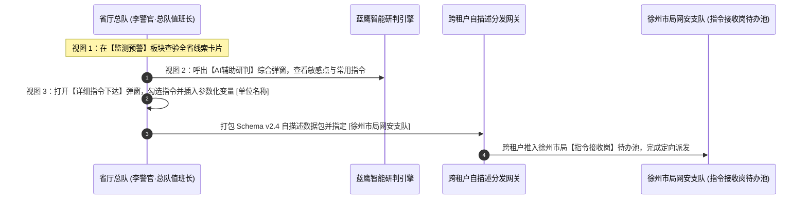
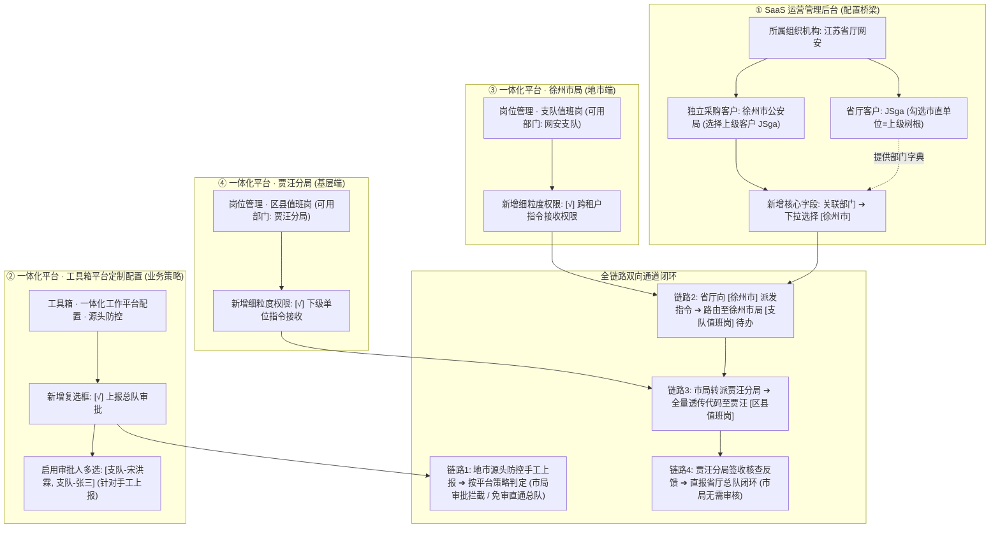
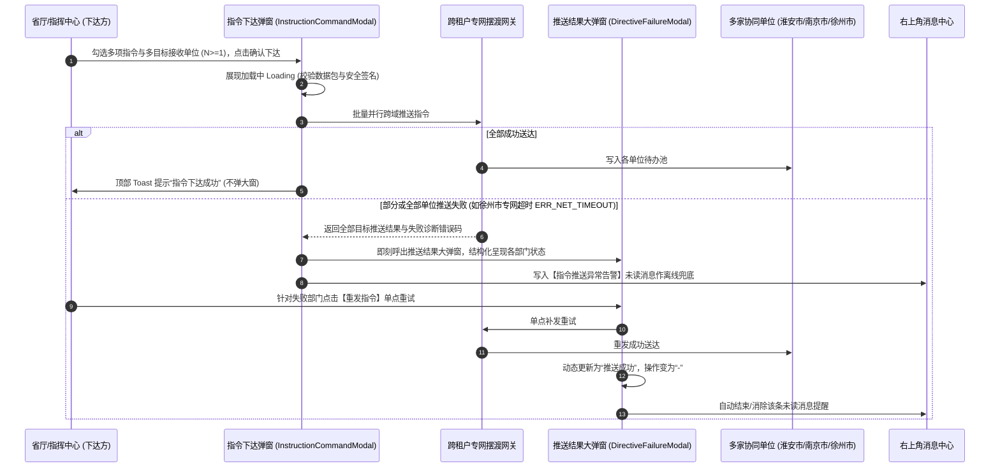

# 今日值班表原型规格说明 (spec.md)

今日值班表是“蓝鹰一体化系统”中用于展示市局舆情总队及各区县、其他单位值班安排的核心组件。本组件支持多视角查看、人员快捷呼叫以及值班人员的动态维护。

---

## 1. 视图模式与窗口规范

- **平铺全屏大屏模式**: 弹窗默认采用 `100vw × 100vh` 全屏平铺布局，最大化利用屏幕可视区域，适合值班室大屏实时监控及指挥人员全面纵览。
- 组件右上角提供模式切换控件（基于 `Segmented` 组件），支持两种视图模式：
  1. **看板模式 (board)**:
     - 默认选中。
     - 采用深色科技风格设计，左侧为总队在岗情况，右侧为各区县/单位在岗情况，顶部标题栏集成值班领导板块。
  2. **列表模式 (list)**:
     - 采用经典明亮风格的表格形式，适合快速纵览和打印。
     - 结构化列出总队各岗位和区县单位值班人员。

---

## 2. 布局与信息密度优化规范

### 2.1 整体分栏与顶线齐平
- 看板模式下，左右两栏按 **1:3** 黄金分栏比划分：
  - **左侧栏 (占 1/4 栅格，6/24)**: 展示总队在岗岗位与具体人员。
  - **右侧栏 (占 3/4 栅格，18/24)**: 展示区县及其他单位值班情况，支持输入框关键字检索。
- **板块顶线齐平**: 因值班领导已合并至弹窗顶部 Header 中，左侧“总队”面板与右侧“区县及其他单位”面板起始垂直位置完全对齐齐平，消除了原先左侧因包含独立领导板块导致的总队列表下沉问题。

### 2.2 值班领导板块 (紧随值班大屏标签右侧)
- **位置**: 放置在弹窗顶部 Header 左侧区域，紧随“今日值班表”标题与“值班大屏”日期标签右侧依次紧凑排布。
- **信息展示**:
  - “今日值班领导”标签与皇冠图标。
  - 当前值班领导所属单位标签、姓名、联系电话（支持点击呼叫并复制）。
- **交互功能**:
  - **更换领导**: 提供下拉菜单（Select），可从已有领导库中选择并切换，切换后全局数据同步更新。
  - **新增领导**: 右侧提供“新增领导”按钮。点击弹窗（Modal + Form）录入领导姓名、警号、联系方式，并以级联选择器（Cascader）选择所属部门。录入成功后自动追加至领导库并可立即被指派值班。

### 2.3 高辨识度分体式人员卡片规范 (High-Contrast Split Badge Card)
为了满足实战中海量在岗人员陈列的极高辨识度与零空间浪费需求，值班人员与领导信息展示统一采用**分体式胶囊卡片 (`staff-split-card`)** 结构：
- **设计特征与视觉层级**：
  - **左侧名称/岗位块 (`split-name-box`)**：采用高对比度鲜明亮蓝纯色背景（`#1875f0`），加粗纯白文字，视觉层级最高，快速聚焦人员身份与部门职务。
  - **右侧联系电话块 (`split-phone-box`)**：采用深邃暗蓝底色（`#081d3d`），搭配高亮天蓝图标（`📞`）与等宽数字编码（`#85b8ff`），居中对齐，清晰易读。
  - **分体式单卡容器**：高度设为极紧凑的 `28px`，外层包裹 `1px solid #1677ff` 微发光边框，圆角 `4px`，鼠标悬浮时边框高亮（`#60a5fa`）并伴随 `0 0 10px rgba(22, 119, 255, 0.45)` 科技微发光阴影。
- **总队在岗岗位卡片 (`post-group-card`)**：
  - 岗位标题栏左右排布：左侧为岗位名称（`post-name-title`，白色加粗），右侧为该岗在岗总人数（`post-count-badge`，如 `2 人`）。
  - 岗位内人员卡片 100% 满宽纵向堆叠，左侧名称块支持容纳完整单位+姓名（如 `总2_舆情 王小虎`）。
- **区县单位人员卡片 (`district-split-card`)**：
  - 区县卡片内人员列表同样采用 100% 满宽纵向堆叠，左侧姓名块紧凑统一（宽 `74px`），右侧等宽排布电话。
- **今日值班领导标签 (`leader-split-card`)**：
  - 顶部导航栏内同样采用分体式卡片规范呈现，左侧为领导姓名，右侧为呼叫电话，形成系统统一的视觉语言。

### 2.4 区县及其他单位网格
- 按部门（区县）卡片形式聚合，在 3/4 宽度大屏下采用 `auto-fill` 弹性响应式 Grid 布局（每张卡片最小 215px，自适应 4~6 列），最大化释放全屏水平空间，确保 40+ 区县在单屏内一目了然、极低滚动深度。

---

## 3. 快捷联系与复制

- 在任何视图模式下，点击任何值班人员或值班领导卡片，系统均应模拟警务通强连呼叫并复制联系人方式：
  - 弹窗提示：`“已成功复制联系方式：[姓名] ([电话])，已发起警务通强连，正在呼叫...”`。

---

# 复盘总结 - 人员上报采纳统计模块规格说明

## 1. 模块定位与容器规范
- **插入层级**：位于【上报/编报量统计】区域下方、【指令类型统计】卡片上方，横向宽度 100% 占满容器。
- **容器风格**：白色卡片容器（圆角 8px，内边距 16px，柔和阴影），与页面整体风格保持一致。

## 2. 卡片头部与筛选工具栏规范
- **卡片头部（Card Header）**：
  - **左侧标题**：「人员上报采纳统计」，左侧带有系统统一的 4px 蓝色竖条标识。
    - 标题右侧携带 Tooltip 提示图标，悬停显示业务口径：“统计周期内，上报信息被下达指令视为被采纳。被采纳率 = 被采纳数 / 上报数 × 100%”。
  - **右侧操作**：次级轻量按钮「导出 Excel」，前置 `DownloadOutlined` 图标，点击触发导出反馈提示。
- **筛选工具栏（Filter Bar）**：位于 Card 内部、Table 正上方：
  - **时间范围选择器 (`RangePicker`)**：默认选中「最近1周」（当天往前推 7 天到当天），预设快捷选项包括「最近7天」、「最近30天」、「本月」。
  - **部门下拉框 (`Select`)**：Placeholder:「选择部门」，支持 `allowClear`，内置辖区机构选项（全部部门、清溪分局、虎门大队、麻涌所、长安分局、东城中队、万江分局等）。
  - **姓名搜索框 (`Input.Search`)**：Placeholder:「请输入姓名搜索」，支持 `allowClear`、回车或点击放大镜搜索。
  - **查询与重置按钮**：主按钮「查询」与默认按钮「重置」。
  - **交互与性能规避机制**：仅在组件初始挂载、点击「查询」或点击「重置」时执行数据过滤与重排，避免输入过程中无序频繁重绘。

## 3. 表格字段与排序规范
基于 Ant Design `Table` 组件开发，提供 6 列核心指标：
1. **序号 (`rank`)**：居中展示，根据当前列表排序动态生成 1、2、3...。前三名采用专属高亮徽章样式（金、银、铜色阶区分）。
2. **姓名 (`userName`)**：文本居左展示，加深字重。
3. **部门 (`deptName`)**：文本居左展示，次级辅助文本色。
4. **上报数 (`reportCount`)**：数值居右对齐，支持客户端数值排序 (`sorter`)。表头右侧附带 `InfoCircleOutlined` 图标，悬停提示：“所选时间范围内，该账号主动上报的信息总量”。
5. **被采纳数 (`adoptedCount`)**：数值居右对齐，绿色高亮区分，支持客户端数值排序 (`sorter`)。表头右侧附带 `InfoCircleOutlined` 图标，悬停提示：“所选时间范围内，该账号上报且已下达指令的独立信息数量（单条信息被多次下达指令去重计为1次）”。
6. **被采纳率 (`adoptionRate`)**：数值居右对齐，蓝色高亮加粗，保留两位小数（如 `85.71%`，为 0 时展示 `0.00%`）。表头右侧附带 `InfoCircleOutlined` 图标，悬停提示：“计算公式：被采纳数 / 上报数 × 100%。上报数为 0 时展示 0.00%”。
   - **默认排序**：设为表格默认降序排列（`defaultSortOrder: 'descend'`）。
   - **排序逻辑**：支持自定义数字比较函数排序。

## 4. 分页控制规范
- 默认每页展示 10 条（`defaultPageSize: 10`）。
- 开启分页大小切换器（`showSizeChanger: true`），选项支持 `[10, 20, 50]` 条。
- 展示总条数文案（`showTotal: (total) => 共 ${total} 条`）。
- 筛选、排序与翻页联动保证序号按展示顺序动态连贯计数，执行查询或切换排序时自动回到第 1 页。

---

# 源头防控（重庆定制）- 客户端舆情处置台账快捷录入与固证规格说明 (spec.md)

## 1. 业务背景与定位
政务单位值班人员及舆情专班工作人员通过配套的专用**蓝鹰客户端**执行境内外涉事敏感帖文的采集与固证（用于劝删处置与存证上报）。由于部分舆情超出系统自动化巡检范围，需要由工作人员在客户端完成内容提取后快速回传台账。
本组件为“源头防控（重庆定制）- 任务详情 - 处置台账”模块的核心配套桌面端窗口组件，用于处理一体化系统与客户端的快捷联动，实现批量敏感帖文链接的高效录入、合规管控、在线就地核对、重复自动覆盖及一键入库同步。

## 2. 核心规则与约束规范
1. **单次数量上限管控（严格 <= 30 条）**：
   - 单次批量录入上限严格限制在 **30 条** 以内（满足网络固证链路吞吐与政务合规审计）。
   - 右下角实时动态计算仪表盘：“已识别：X / 30 条”。
   - 当 $X \le 30$ 时为安全蓝/绿状态；当 $X > 30$ 时，输入框触发红色警示边框，展示 `Alert (错误警告)` 并强制禁用【开始解析采集与固证】按钮，同时提供一键【保留前30条并清空其余】处理机制。
2. **入库覆盖规则 (Overwrite)**：
   - 同一专项任务内若存在重复链接，系统自动比对并标记为橙色 Tag【将覆盖历史记录】。
   - 提交入库时直接覆盖更新旧台账数据，保留唯一链接最新取证快照与互动量，避免脏数据堆叠。
3. **处置状态二元化**：
   - 针对向上级汇报帖文总量与状态的特定政务诉求，台账状态简化收敛为两种：`未处置` (`pending`，橙色标识) 与 `已处置` (`disposed`，绿色标识)。
4. **单人单机与专项上下文锁定**：
   - 优先读取宿主父页面传入 Props 或 URL Query 参数中的 `taskId` 与 `taskName`。
   - 展示深蓝政务胶囊标识“归档任务：【{taskName}】 (ID: {taskId})”并锁定锁头，明确提示覆盖规则。

## 3. 极简视窗与美学规范 (Minimalist Design System)

遵循“**界面元素极简、剔除冗余说教文案、通透大方**”的核心设计原则，整体重构聚焦高信噪比与现代政务专业桌面质感：

### 3.1 单行极简视窗顶栏 (Single-Row Chrome Header)
- **尺寸与阴影**：固定宽度 **960px**，自包含弹性高度，外层包裹 `0 20px 48px rgba(0, 0, 0, 0.25)` 桌面级重阴影与圆角 `12px`。
- **单行聚合排布**：
  - 左侧：红黄绿拟真微圆形交通灯控制点 + 纯白高字重标题「政务舆情客户端 · 快捷录入与固证」+ 专项蓝色标签（如 `归档专项：某突发事件应对`）。
  - 右侧：VPN 专线状态胶囊（极简绿灯 + `VPN 正常`）+ 操作员账号信息 + 悬浮微动效关闭图标。
  - **彻底摒弃**：删去原有第二行深色背景副栏，不再出现大段规则解释横幅，将信息收敛于单行平铺。

### 3.2 极简三步工作流向导 (Minimal Steps)
- 采用 Ant Design `Steps` 组件，单行水平陈列：
  - `1. 批量录入` $\to$ `2. 智能解析` $\to$ `3. 核对入库`。
- 剔除步骤下方的任何冗长描述型副文本，保留清晰明了的当前步骤焦点指示。

### 3.3 第一阶段：极简录入与智能管控
- **单行通道切换**：采用 `Segmented` 分段控制器切换「直接粘贴文本 / URL」与「导入 Excel」，消除冗余 Tab 边框与留白浪费。
- **快捷填充辅助**：右侧平铺纯净按钮组（`3条`、`28条(含重复)`、`32条(超限测试)`、`清空`），方便演示与测试。
- **动态胶囊计数**：文本域右下角浮动显示单行药丸胶囊 `已识别：X / 30 条`（未超限时为清爽深蓝，超限时为警示鲜红）。
- **去繁复告警**：超限时仅弹出紧凑的单行 `Alert` 提示，右侧直配【保留前30条】一键按钮；底栏仅保留一处微灰色提示文字说明重复链接将自动覆盖，杜绝繁复说教。

### 3.4 第二阶段：黑曜石沉浸解析终端 (Obsidian Console)
- 纯净深色控制台容器（深黑背景 `#0d1117`），内嵌平滑平顺的动态进度条（0% $\to$ 100%）。
- 逐行打印格式规范、绿色等宽字体的微型日志（抓取、4K固证、SHA-256存证封签、去重命中），给用户直观的自动化信赖感，无任何额外说教说明。

### 3.5 第三阶段：结构化就地核对表与存证预览
- 表格列名干练清晰，去除括号内冗长解释：`序号`、`平台`、`帖文标题与来源`、`发布时间`、`快照`、`入库模式`、`处置状态`、`操作`。
- **直觉交互**：
  - 平台采用社媒经典辨识度徽章（微博红、抖音黑白、小红书红等）；
  - 点击快照缩略图直达大图固证 Modal（包含授时水印与 SHA-256 防伪指纹）；
  - 处置状态为二元下拉选择（`未处置` / `已处置`）；
- **底栏极简收尾**：仅保留【返回修改】次级按钮与【确认同步至台账 (X 条)】主行动按钮。

### 3.6 纯自包含与零样式依赖实现
- 组件样式采用**内联样式 + 局部作用域样式注入**方案，彻底消除对外部 Tailwind CSS 构建插件的依赖，杜绝在不同打包环境下类名失效、样式崩塌或产生多层白边弹窗外壳的问题。

---

## 4. 蓝鹰客户端工作台原型 (V2 布局方案) 规格说明

### 4.1 原型外壳与多场景导航 (Prototype Chrome & Scenarios)
- **外层背景**：深蓝黑科技底色 (`#141e2b`)，顶部陈列 `PROTOTYPE · V2 布局方案` 标签、工作台原型说明与窗口规格参数（`窗口 1280 × 800`、`状态条 40px · 上报侧栏 400px`、`目标平台 Windows 7+ / Electron`）。
- **场景切换 Tabs**：
  1. `01 登录`：模拟 Electron 客户端账号/警号与密码独立登录弹窗；
  2. `02 工作台 · 有 VPN 权限`（默认选中）：呈现完整登录态、40px 状态栏与功能矩阵；
  3. `03 工作台 · 无 VPN 权限`：呈现 VPN 未连接警示与重连入口；
  4. `04 信息提取 · VPN 断线`：模拟内嵌浏览器访问境外站点受阻界面；
  5. `05 信息提取 · 上报侧栏`：呈现内嵌浏览器配合 400px 快捷信息上报侧栏。

### 4.2 客户端视窗主体架构 (1280 × 800)
- **32px Windows 标题栏**：左侧展示蓝鹰 Logo 与名称，右侧提供拟真最小化、最大化与关闭控制按钮。
- **40px 状态条**：
  - 左侧：VPN 连接状态胶囊（绿色呼吸灯 + `VPN 已连接 02:14:37`，标注 1 号点）；
  - 右侧：操作员头像徽章（`张`）与下拉菜单（`张明 ▾`，支持查看个人信息、系统设置与退出登录）。
- **用户信息卡 (User Profile Card)**：
  - 陈列姓名（张明）、`VPN` 与 `信息上报` 权限标识、部门角色（数据分析部 / 高级分析师）、邮箱及上次登录时间，右侧配置【退出登录】按钮（标注 2 号点）。
- **VPN 状态卡 (VPN Status Card)**：
  - 动态显示专线连接时长，右侧提供红色【断开连接】/ 蓝色【连接专线】操作按钮（标注 3 号点）。

### 4.3 核心功能卡片矩阵 (Feature Cards Grid)
1. **信息提取 (Card 4)**：
   - 定位：在客户端内打开境内外站点，提取正文、图片、视频与互动数据，回传蓝鹰上报。
   - 交互：点击可直达信息提取与 400px 上报侧栏视图。
2. **访问系统 (Card 5)**：
   - 定位：在系统默认浏览器中打开蓝鹰一体化系统（eagle.example.com）。
   - 交互：点击直接模拟浏览器外跳或切换至系统主控台。
3. **台账录入（新增核心入口）**：
   - **视觉设计**：采用**高饱和度红色边框 (`2px solid #ef4444`) 与浮动角标【新增功能入口 · 源头防控联动】**，精准呼应用户实战标注。
   - **业务定位**：在客户端内批量录入链接，提取链接标题、发布时间、平台并回传一体化处置台账。
   - **交互闭环**：
     - 点击卡片直接进入客户端全屏内嵌的【台账录入与固证】模块；
     - 视窗左上方提供【← 返回工作台】快捷导航；
     - 支持**选择目标源头防控专项任务**（从 CQ 专项任务库中下拉选择）；
     - 支持**手动添加链接**或**通过 xlsx 模版拖拽导入**；
     - 点击**【提取并上报】**，后台自动调用客户端能力并发抓取并生成防伪存证；
     - 核对后点击【确认同步至台账】，成功后支持一键【前往查看该专项处置台账】或【继续录入新批次】。

### 4.4 重庆源头防控子页 (`TaskDetailCQ.tsx`) 协同同步机制
- **快捷调用入口**：在重庆定制子页的【处置台账】选项卡中，点击【客户端快捷录入】唤起 960px 视窗；
- **专项上下文自动锁定**：自动锁定当前所在子任务 (`isTaskLocked={true}`)，禁止误切其它专项；
- **实时数据流回传**：点击【提取并上报】并在确认同步后，台账数据实时追加/覆盖刷新至宿主页面的处置台账表格中，达成系统与客户端的无缝端到端闭环。

---

# 场景一：区县手工上报（免审直通省厅动线）规格说明 (spec.md)

## 1. 业务目标与场景定位
演示在未开启市局审核（或区县具备免审白名单权限）的前提下，区县基层网安民警在互联网端填报舆情，通过勾选【上报总队】实现表单字段的动态级联（属地字典无缝切换为全省标准），提交后经模拟跨网安全前置机单向摆渡直接落库省厅内网一体化平台的完整流转闭环。

---

## 2. 角色与运行环境视图
- **视图 A（填报端）**：
  - **角色**：区县网安大队民警（徐州市公安局贾汪分局网安大队 · 王建明警官）。
  - **环境**：互联网端基层填报环境（轻明警务蓝主题，路由/标识：`/county/monitor/manual-report`）。
- **视图 B（接收端）**：
  - **角色**：省厅网安总队值班长（江苏省公安厅网安总队指挥研判大厅 · 李警官）。
  - **环境**：公安内网环境（警务深蓝高权威科技主题，路由/标识：`/provincial/monitor/county-reports`）。

---

## 3. 视觉规范与增量改造高亮要求
1. **严格继承既有 UI 规范**：公安蓝（`#1677FF`）主色、Ant Design 栅格与排版字阶，严禁新建风格。
2. **增量改造视觉指示**：
   - 本次新增/变动控件外轮廓施加 **1px 蓝色呼吸光晕**（`animation: blueBreathing 2.4s ease-in-out infinite`）；
   - 右上角附带微缩黄色 **`【改】`** 字角标（`incremental-badge`）。

---

## 4. 详细交互流转与跨地市通报三方联动设计

### 4.1 视图 A：地市 A (常州) 区县填报端（路由：`/city-a/county/report`）
1. **表单级联与字典纯净替换逻辑**：
   - **未勾选【上报总队】（仅上报支队）**：
     - “涉事属地”：仅展示地市 A（常州）本地辖区字典（武进区、天宁区、钟楼区、新北区、金坛区、溧阳市）；
     - “通报地市”：置灰不可选（仅限本地市常州）。
   - **勾选【上报总队】**：
     - 字段字典直接**纯净替换**为省厅统一下发标准字典，原常州市局字典选项完全清空不作合并；
     - “涉事属地”下拉树：纯净替换为省厅下发的全省 13 个地市及全部下属区县；
     - “通报地市”下拉框：激活为全省 13 个地市多选下拉框，选定【徐州市】。
2. **预置测试数据**：
   - 舆情标题：关于徐州某工业园区网络谣言线索协查；
   - 报送目标：`[√] 上报支队  [√] 上报总队`；
   - 涉事属地：江苏省 / 徐州市 / 贾汪区；
   - 通报地市：徐州市；
   - 采集单位：常州市公安局武进分局网安大队。
3. **提交动作与回执跳转**：
   - 底部操作栏重构为标准 Ant Design 布局：灰色线框【重置表单】居次位，公安蓝（#1677FF）高亮【确认上报】居主位，靠右对齐；
   - 当勾选【上报总队】时，表单顶部展示轻量蓝色胶囊提示：`[已激活直通省厅通道]`，主按钮保持标准文字【确认上报】（移除开发解释性后缀与“改”字标记）；
   - 点击【确认上报】弹出 Toast：“上报成功，已同步至省厅并镜像推送至连云港市公安局”，表单数据落库；
   - 自动跳转至【监测预警-本地上报】，记录展示 `[已报总队]`（绿）与 `[已报支队]`（蓝）徽标，流转状态标为 `[已同步省厅并推送连云港]`。

### 4.2 视图 B：省厅总队内网端（路由：`/provincial/monitor/county-reports`）
1. **界面架构与导航对齐（1:1 复刻系统原生研判工作台）**：
   - **顶部检索与视图切换栏**：
     * 字段包含：内容搜索（预填“连云港某海滨港区物流集聚区”）、发布时间、精确接收时间范围；
     * 视图切换按钮组：【详细视图】|【研判视图（默认激活）】|【简要视图】。
   - **模块二级 Tab 栏**：
     * 平铺原生 Tab 矩阵：全部（AI）、研判建议、智能预警（AI）、重点账号（AI）、专项巡查、本地舆情、重点源、待认领舆情、**【区县上报（高亮激活，带待办角标 Badge ①）】**、通报信息；
     * 右上角提供【总队研判派发】快捷指令入口。

2. **单条舆情卡片原生还原与业务挂载（Card-Stream View）**：
   - **卡片头部行（Header）**：
     * 复选框 Checkbox、序列编号“1”；
     * 状态徽标：未采纳时显示浅蓝 `[未采纳 / 待研判]` 与浅绿 `[免审直通 · 总队已接报]`，下达指令后即时流转为绿色 `[已采纳 (已下达总队处置)]`；
     * 标签包含：`[初研意见]`（深蓝胶囊）、`[处置]`、`[非热敏]`，右侧金黄色星级评分（`★ ★ ★ ☆ ☆ 3.0星`）。
   - **元数据信息行（Meta Info）**：
     * 呈现：采集人/账号【淮安清江浦分局·张华】| ID `3766282728521547` | 上报来源【淮安市公安局清江浦分局网安大队】| 涉事属地【江苏省/连云港市】| 平台渠道【抖音短视频平台】| 接收时间【刚刚】。
   - **主标题与正文（Content）**：
     * 加粗加深呈现话题正文：“#关于连云港某海滨港区物流集聚区网络舆情线索协查。监测发现网民在短视频平台发布涉及连云港某重点物流园区涉运费结算争议信息，跟帖评论已出现跨地市煽动聚集苗头。淮安清江浦网安大队完成初研后，按免审直通机制提报省厅总队，并提请抄送连云港市局协查处置。”
   - **AI 摘要与研判分析双色块 + 右侧大号指数卡片**：
     * 浅绿色背景框【AI 摘要】：提炼连云港某物流园区涉运费结算非访言论及跨地市关联，属地已固定证据并提请省厅统筹处置；
     * 浅橙色背景框【初研研判 / 总队研判】：呈现淮安大队初研处置建议，建议总队统筹下发核查指令，由目标地连云港属地落地人；
     * 右侧独立卡片【舆情指数】：大号紫色数值框显示 `72.00 / 舆情指数`。
   - **底部标签池**：
     * 呈现：`[来源: 手工上报-淮安市局]`（挂载批注 4，明确第一阶段暂不独立开发，按当前默认效果实现）、`[直报总队]`、`[连云港市]`、`[涉稳线索]`；
     * 已隐藏原【跨地市协查】标签。
   - **底部操作栏（核心采纳闭环）**：
     * 卡片右下角紧凑并排展示：【一键复制】、【AI辅助研判】与核心采纳主按钮【下达处置指令 (更新采纳)】（挂载批注 5）；
     * 已隐藏原【查看跨网流水详情】按钮及关联弹窗；
     * 点击【下达处置指令】弹出指令派单弹窗，确认后更新为绿色已采纳标签并计入总队考核分子；同时提供一键前往连云港通报查验按钮。

### 4.3 视图 C：地市 B (连云港) 接收端（路由：`/city-b/monitor/notice-info`）
1. **界面路径**：【监测预警】模块 -> 专属【通报信息】Tab。
2. **列表呈现与标识**：
   - 【通报信息】Tab 徽标携带未读红点（数字 +1）；
   - 列表第 1 行展示淮安市局镜像推送过来的通报数据；
   - 显著标识：带有醒目的橙色 `[异地通报]` 标签；
   - 字段呈现：
     - 舆情标题：关于连云港某海滨港区物流集聚区网络舆情线索协查（支持 1650×1050 抽屉展开时省略号截断）；
     - 通报来源：淮安市局（规范为地市市局名称，去除多余后缀，宽 120px）；
     - 涉事属地：连云港市（宽 140px）；
     - 通报时间：刚刚（宽 170px）；
     - （已去除系统未包含的处置状态列）。
3. **操作列极简**：
   - 仅保留【查看详情】（抽屉展示异地通报流水与协查说明，宽 90px）。

---

## 5. 侧边栏场景导航与三步三视角自由拖拽流程描述球规范

### 5.1 侧边栏排版与标签空间约束
- **文案精简与适配**：核心场景菜单项标题精简为标准 6 字（如 `免审直通省厅`），右侧携带紧凑胶囊标签 `[场景 1]`；
- **自适应弹性布局**：子元素采用 `flex: 1; min-width: 0;` 分栏排版，彻底解决在 180px 窄边框下文字折行与标签被侧边栏边缘裁切截断的问题。

### 5.2 悬浮演示控制台“轻量化与高质感” Glassmorphism 规范重构

1. **外层容器与材质（Container）**：
   - 尺寸与定位：固定宽度 `320px`，初始右侧定位 `right: 24px`，顶部定位 `top: 84px`，层级 `z-index: 999`。
   - 材质与透明度：
     * 背景色：`background: rgba(255, 255, 255, 0.88)`（88% 通透磨砂白，消除原先实色压抑感）；
     * 模糊滤镜：`backdrop-filter: blur(16px)`，`-webkit-backdrop-filter: blur(16px)`；
     * 极细边框：`1px solid rgba(22, 119, 255, 0.12)`（微透公安蓝轮廓）；
     * 柔和圆角：`border-radius: 14px`；
     * 弥散投影：`box-shadow: 0 16px 36px -6px rgba(15, 23, 42, 0.08), 0 4px 12px -2px rgba(15, 23, 42, 0.04)`。

2. **极简通透头部（Header）**：
   - 舍弃原先纯蓝实底，改为通透极简布局：
     * 背景：`transparent`，底部微细分割线 `border-bottom: 1px solid rgba(0, 0, 0, 0.05)`；
     * 标题：字号 `14px`，中粗体 `font-semibold`，色值 `#1F2937`；
     * 场景标记：左侧胶囊徽标，渐变蓝底白字 `场景 1`（字号 `11px`，圆角 `999px`）；
     * 折叠控件：右上角极简线性箭头收起按钮（悬浮态微底色），一键收起为微缩悬浮球。

3. **横向三等分胶囊进度条（Pill Progress Bar）**：
   - 舍弃原先实色大圆圈 Steps，采用紧凑现代的胶囊条设计：
     * 三等分横向条，高度 `4px`，圆角 `999px`；
     * 激活步骤为渐变品牌蓝（`linear-gradient(90deg, #1677FF 0%, #38BDF8 100%)`）；
     * 未激活步骤为极淡灰色（`#E5E7EB`）；
     * 进度条下方精简排布节点文字：`1. 填报`、`2. 省厅查验`、`3. 跨市流转`，当前项高亮加粗（`#1F2937`），其余次级淡灰（`#9CA3AF`）。

4. **步骤指引卡片与主行动按钮**：
   - 步骤指引置于微透淡蓝底色卡片中：`background: rgba(22, 119, 255, 0.04)`，边框 `1px solid rgba(22, 119, 255, 0.08)`，圆角 `8px`；
   - 移除 Emoji 表情，搭配精准精细线性图标（`InfoCircleOutlined`）与专业业务引导文案；
   - 主行动按钮：高度 `32px`，圆角 `6px`，品牌纯蓝 `#1677FF`，文字 `13px`，右侧携带轻盈小箭头引导点击；
   - 辅助操作提供虚线边框次级按钮（`guide-btn-sub`），如一键模拟勾选省厅字典、模拟下达处置指令等。

5. **视角分段控制器（Segmented Control）**：
   - 面板底部提供 iOS / Ant Design 质感的视角平滑切换栏：
     * 底槽浅灰背景：`rgba(0, 0, 0, 0.04)`，内边距 `3px`，圆角 `8px`；
     * 当前激活项为纯白滑块卡片，带有微投影 `box-shadow: 0 1px 3px rgba(0, 0, 0, 0.1)`；
     * 三项平铺：`[地市A填报] | [省厅接收] | [地市B通报]`，字号 `12px`，单触即切。

6. **统一右上角平滑收纳、静默半透明与安全展开机制**：
   - **统一停靠右上角**：收纳（折叠）状态下的悬浮球统一平滑过渡并锚定在界面右上角（`top: 84px; right: 24px;`），彻底消除此前由于拖拽坐标导致展开后部分内容被屏幕右边缘截断的问题；
   - **静默态半透明**：折叠球在静默无交互时平滑降级为半透明状态（`opacity: 0.52; animation: ballIdleFade 2.2s forwards`），最大限度降低对业务界面的遮挡与视觉干扰；
   - **悬停态平滑唤醒**：鼠标悬停在悬浮球上时立即恢复 100% 不透明度（`opacity: 1 !important`），伴随柔和的公安蓝光晕扩散与微缩放（`scale(1.08)`），交互反馈即时明晰；
   - **右上角安全展开与平滑形变**：点击悬浮球后，以右上角为基点（`transform-origin: top right`）由 `48px` 圆球平滑膨胀为 `320px` 宽度的控制台面板（`transition: width/height/border-radius cubic-bezier(0.34, 1.2, 0.64, 1)`），面板右侧紧贴 `right: 24px` 自然向左铺开，在任何分辨率下均 100% 完整呈现在视口内，杜绝内容出界溢出；
   - **展开态自由微调与收起平滑回靠**：展开态下仍支持按住标题栏拖拽以临时避让页面元素；一旦点击右上角折叠按钮，或从悬浮球重新展开，系统自动重置自定义位移，平滑飞回右上角安全停靠位。

---

## 6. AxHub 图钉批注（元件说明）挂载规范
1. **Pin 1 · 报送目标复选框**：
   - 属性：`data-note="默认勾选上报支队。勾选上报总队时触发跨租户字典拉取，将本地属地树动态替换为省厅统一下发的全省属地字典标准。"`
   - 标签：`[跨租户字典]`
2. **Pin 2 · 确认上报按钮**：
   - 属性：`data-note="免审直通逻辑：系统检测当前租户未开启市局审核开关，数据落库本地后立即异步调用跨网前置机服务摆渡入省厅内网库。"`
   - 标签：`[跨网同步]`
3. **Pin 3 · 省厅列表采纳状态标签**：
   - 属性：`data-note="指标统计源点：初始为未采纳，后续若总队以此记录发起处置指令，状态将更新为已采纳，计入采纳率考核分子。"`
   - 标签：`[考核口径]`
4. **Pin 4 · 通报地市字段**：
   - 属性：`data-note="字典完全替换为省厅下发标准；若通报地市包含非本市辖区，系统后台自动触发跨地市异步推送至目标地市数据库。"`
   - 标签：`[跨地市协同]`
5. **Pin 5 · 地市 B【通报信息】Tab**：
   - 属性：`data-note="异地通报专属板块：展示外市推送的涉本市舆情镜像数据，独立于本地上报数据，支持本地闭环处置。"`
   - 标签：`[数据隔离与镜像]`

---

# 场景二：区县手工上报 · 市局前置审核与质量把关 (spec.md)

## 1. 业务目标与场景定位
场景二属于满足严管地市对上报省厅舆情质量把关的合规性功能。与场景一（免审直通）相比，核心差异在于下级区县（常州武进分局）网安民警在互联网填报并勾选【上报总队】提交的数据，不直接出市，而是被市局前置审核网关物理拦截并暂扣在市局待审池；经市局支队民警人工质量把关审核通过后，才生成跨网摆渡任务推送省厅；若审核驳回，则数据终止外发并在本地留存，填报民警可查看驳回原因并就地重新编辑。

---

## 2. 角色与运行环境视图
1. **视图 A（区县填报端）**：
   - **角色**：常州市公安局武进分局网安大队民警（王建明警官）。
   - **环境条**：`互联网端 · 常州 - 武进分局 - （当前账号：王建明）`。
2. **视图 B（市局审核端）**：
   - **角色**：常州市公安局网安支队审核民警（张警官）。
   - **环境条**：`局域网 · 常州 - 常州市局 - （当前账号：张警官 · 网安支队）`。
3. **视图 C（结果分流端）**：
   - **通过分支（省厅接收端）**：`公安内网 · 省厅 - 省厅总队 - （当前账号：李警官）`。
   - **驳回分支（区县回显端）**：`互联网端 · 常州 - 武进分局 - （当前账号：王建明）`。

---

## 3. 详细交互流转与页面规范

### 3.1 视图 A：区县端填报并触发拦截（路由：`/county/monitor/manual-report-audit`）
1. **表单排布规范（对齐场景 1 与 12 列栅格规范）**：
   - 表单卡片内边距 32px，区域最大宽度限制在 1040px（宽屏自适应 1180px）并保持水平居中；
   - 字段宽度严格限制为全宽控件（col-12）与双列等分控件（col-6 + col-6），标签置于控件正上方 6px（Top-aligned label）；
   - 单行控件高度统一为 40px，初研意见多行框最小高度 96px；
   - 杜绝多重彩色胶囊堆叠与虚线框包裹。
2. **报送目标与管控策略提示**：
   - 报送目标行（挂载 Badge 1）：`[√] 上报支队`（锁定必选）、`[√] 上报总队`（提示：当前租户开启前置审核 · 需市局把关）；
   - 顶部提供轻量警示提示，告知本单位直报数据提交后将受控暂扣在市局待审池。
3. **提交动作与网关拦截（挂载 Badge 2）**：
   - 点击底栏【确认上报】按钮，系统网关检测到开启审核策略，阻断直接出市；
   - 弹出轻提示：“已提交！当前租户已开启市局前置审核策略，该舆情已受控暂扣在市局待审池”；
   - 界面自动切换至【我的上报列表】，记录流转状态高亮显示为黄色：`[待市局审核]`。

### 3.2 视图 B：市局端工作台审核中心（路由：`/city/monitor/report-audit`）
1. **核心要素 1：新上报消息提醒浮窗（挂载 Badge 3）**：
   - **即时通知浮窗**：右上角弹出轻量 Glassmorphism 待审气泡卡片，包含盾牌图标、“【直报省厅预审提醒】”橙标、倒计时“时效：剩余 01小时58分”；
   - **快捷动线**：提供【稍后处理】与【立即审核】按钮，点击【立即审核】平滑引导至待审卡片。
2. **核心要素 2：监测预警 -【上报审核】独立模块**：
   - **Tab 栏物理隔离**：市局端二级 Tab 包含【全部】、【AI主动发现】、**【上报审核 (1)】**（携带橙色未审角标）、【区县上报】、【通报信息】，将待审数据与正式情报物理区隔；
   - **卡片流展示（1:1 复刻场景 1 高质感研判卡片）**：
     * 卡片头部行：序列编号“1”、`[待市局审核]` 胶囊、3.0 星级评分；
     * 元数据行：采集人【武进分局·王建明】| ID `3766282710492811` | 填报单位【常州市公安局武进分局网安大队】| 属地【江苏省/常州市/武进区】| 时间；
     * 正文内容：加粗呈现话题与舆情正文；
     * 双色块分析与舆情指数：浅绿底色【AI 摘要】与浅橙底色【武进初研】意见，右侧大号独立紫色 `72.00 / 舆情指数` 卡片；
     * 标签池：`[来源: 手工上报-武进分局]`、`[待市局审核]`、`[直报总队]`、`[涉稳线索]`。
3. **核心要素 3：驳回与提交审核流程（挂载 Badge 4）**：
   - 卡片右下角整齐排列：`【一键复制】` + `【驳回】` + `【提交】`；
   - **驳回**：点击呼出极简驳回弹窗，支持单选预设理由（如“企业常规诉求未达省厅直报标准，建议本地留存就地化解”、“初研证据链条不全”等）或自定义录入，确认后状态变更为红色 `[已驳回]`，终止外发省厅，并回写区县端；
   - **提交**：点击直接放行，Toast 提示“审核通过！已生成跨网安全摆渡任务并直通推送至省厅中心库”，卡片状态切换为绿色 `[已审核放行 (已同步至省厅内网中心库)]`，并提供【前往省厅查验 →】快捷跳转按钮。

### 3.3 视图 C：审核结果分流查验（挂载 Badge 5）
1. **通过分支（省厅接收端）**：
   - 界面路径：省厅统筹平台 ->【监测预警】->【区县上报】Tab；
   - 成功查验到该记录，来源规范展示为 `[来源: 手工上报-常州市局]`、`[市局已审放行]`；
   - 支持点击【一键复制】与【下达处置指令 (更新采纳)】完成闭环。
2. **驳回分支（区县回显端）**：
   - 界面路径：武进分局端一体化平台 ->【我的上报列表】；
   - 记录状态高亮显示为红色 `[市局已驳回]`；
   - 明确呈现常州市局审核民警张警官的驳回理由，并提供【查看原因】抽屉与【重新编辑】载入草稿按钮。

---

## 4. 界面原位角标 (In-situ Badges) 索引

- **Badge 1 · 报送目标**：`[区县直报与审核策略]` 勾选上报总队，系统检测已开启市局审核策略，提示将由市局支队前置把关。
- **Badge 2 · 确认上报按钮**：`[前置网关受控拦截]` 检测到开启市局审核策略，点击后将数据暂扣在市局待审池，不可直接出市。
- **Badge 3 · 待审提醒与独立模块**：`[新上报消息提醒与独立Tab]` 右上角通知浮窗即时提醒限时 2 小时内审核，待审数据统一隔离至【上报审核】Tab。
- **Badge 4 · 审核裁决操作**：`[审核双向判定: 提交/驳回]` 支持点击【提交】放行或点击【驳回】附带原因终止推送并就地留存。
- **Badge 5 · 结果闭环查验**：`[省厅接收与区县驳回回显]` 通过分支省厅实时查验，驳回分支区县端高亮红标回显原因并支持重新编辑。

---

## 5. 验收标准清单

- [ ] **表单栅格与限宽**：区县填报表单采用 12 列栅格，全宽或双列等分，限宽 1040px 居中，标签顶部对齐。
- [ ] **受控拦截提交**：勾选上报总队提交后，系统阻断直接出省，提示已转入市局待审池，列表状态为【待市局审核】。
- [ ] **新上报消息提醒**：市局端右上角成功弹出待审提醒气泡，【上报审核】Tab 携带橙色角标。
- [ ] **独立审核模块展示**：待审数据在【上报审核】专属板块中以高质感研判卡片展示，包含 AI 摘要、武进初研与舆情指数。
- [ ] **审核放行闭环**：点击【提交】后，状态变为已通过，省厅端能查验到该舆情。
- [ ] **审核驳回闭环**：点击【驳回】并录入原因后，状态变为已驳回，区县端列表高亮回显驳回原因并支持重新编辑。
- [ ] **无遮挡 Docking 查验**：展开右侧需求规格抽屉时，主工作区域自适应平滑缩进并保持居中，组件 100% 完整可见并不被遮挡。

---

# 场景三：省厅跨租户指令下发与市局多人待办抢占（全链路闭环）规格说明

## 1. 业务背景与场景目标

在公安网安跨层级协同中，省厅网安总队在【监测预警】板块查验全省重大网络舆情线索时，需要跨越地市租户边界，直接向特定地市（如徐州市公安局网安支队）下达紧急落地核查指令：
1. **主要依托【监测预警】板块界面**：省厅端值班长在监测预警板块查验舆情卡片，调阅 AI 辅助研判并下达处置指令。
2. **跨租户定向派发与自描述契约**：
   - 省厅下达指令指定目标地市部门（徐州市公安局网安支队），数据推入该部门【指令接收岗】待办池中；
   - 系统跨租户下发采用**载荷自描述机制（Schema v2.4）**，自包含契约定义、业务上下文与数字防伪签名，地市接收端零依赖安全自解析。
3. **参数化变量指令模板**：详细指令下发支持在文本中动态插入 `[单位名称]`、`[指令名称]`、`[处理周期]` 等变量占位符，由系统引擎在下发时自动替换为规范业务文本。
4. **底层机制沿用**：底层数据库乐观并发锁与防重校验为系统既有基础能力，本期直接沿用现有逻辑，无需重复开发。

---

## 2. 系统设计与状态流转架构



---

## 3. 三级视图 1:1 对照真实系统实现规范

### 3.1 视图 1：省厅端监测预警（1:1 参考场景 1 & 2 系统标准卡片）
- **路由路径**：`/provincial/monitor/warning-list`
- **单条舆情卡片（Card-Stream View）结构**：
  * **头部行（Header）**：序列编号“1”、`[区县上报]` 标签、`[涉稳舆情]` 徽标、标题 `关于徐州某工业园区因环保升级改造停产网络谣言线索排查`、红色时效标签 `限时：今日 18:00 前`，右侧编号 `202610100088`；
  * **元数据信息行（Meta Info）**：采集人【苏北观察员 (抖音app)】| 线索ID `7694739512768873018` | 涉事属地【江苏省/徐州市/贾汪区】| 流转状态【待下发处置指令】；
  * **舆情正文**：加粗呈现工业园区网传停产聚集舆情原帖；
  * **AI 摘要/研判双色块 + 右侧大尺寸舆情指数**：
    - 浅绿色摘要框（`.stream-ai-green-summary`）：呈现网帖反映的企业停产及煽动集聚隐患；
    - 浅橙色研判框（`.stream-ai-orange-opinion`）：呈现【事件定性】+【当前态势】+【关注建议】；
    - 舆情指数卡片（`.stream-ai-purple-index-card`）：右侧呈现独立紫色卡片 `68.50 / 舆情指数`；
  * **卡片右下角核心操作区**：整齐排列【一键复制】、【AI辅助研判】与蓝色主按钮 **【下达处置指令】**。

### 3.2 视图 2：AI 辅助研判综合弹窗（1:1 复刻截图 1 真实系统架构）
- **尺寸与布局**：宽 `980px` 响应式弹窗，左右双分栏排布。
- **左侧专栏（舆情多模态全息要素）**：
  * 舆情标头、线索ID、时间戳与紧急程度标签；
  * 指数矩阵：舆情热度 `68.5`、敏感度指数 `84.2`、扩散人群 `1,240`；
  * **AI 分析敏感点**：煽动性言论挖掘与属地扩散风险；
  * **事件聚类（相似信息）**：抖音短视频实拍、微博同城求证帖等关联聚合。
- **右侧专栏（分析研判与指令快速下达）**：
  * **常用单位指令**：复选框勾选 `总队落实`、`领导批示`；
  * **常用执行指令**：复选框勾选 `线下核查`、`属地落实`、`持续监测`；
  * **目标接收单位**：下拉单选【徐州市公安局网安支队】；
  * **研判意见正文**：支持录入与修改，右上角提供【下达详细指令 ➔】链接。

### 3.3 视图 3：发起处置指令详细弹窗（1:1 复刻截图 2 真实系统设计）
- **尺寸与标题**：居中独立弹窗，宽度 `860px`，标题明确为【发起处置指令（详细配置）】。
- **表单要素规范（全量指令字典与自描述封装）**：
  * **指令分类 Tab**：`全部 (31)` | `单位指令 (15)` | `执行指令 (16)`；
  * **可选指令清单网格**：多选复选框包含 `线下核查`、`属地落实`、`持续监测`、`总队落实` 等；
  * **目标接收部门（AxHub Pin 1 挂载）**：下拉单选【徐州市公安局网安支队】；
  * **办结时效**：预置 `今日 18:00 前`；
  * **参数化变量符插值引擎（AxHub Pin 3 挂载）**：
    - 多行文本输入框呈现指令正文；
    - 顶部快捷插入变量按钮：`[单位名称]`、`[指令名称]`、`[处理周期]`，点击即刻在光标处插入占位变量；
  * **跨租户载荷自描述包卡片（AxHub Pin 2 挂载）**：
    - 嵌入蓝色高亮卡片：`Schema v2.4 跨租户自描述数据包（含防篡改数字签名）`；
    - 点击右侧链接可打开侧边抽屉调阅底层自描述 JSON 契约。
- **提交与流转**：
  * 点击【确认下发至目标地市】触发原子下发动作；
  * Toast 提示：“跨租户处置指令下达成功！载荷自描述包已通过安全通道推入 [徐州市公安局网安支队] 待办池！”，卡片状态更新为已下发。

---

## 4. 界面原位角标 (In-situ Badges) 索引

- **Badge 1 · 目标接收地市部门**：`[跨租户定向派发（目标部门）]` 省厅总队下达指令时指定目标地市部门（徐州市局网安支队），系统自动流转至该部门申领了【指令接收岗】的账号待办池中。
- **Badge 2 · 载荷自描述卡片**：`[自描述数据包机制 (Schema v2.4)]` 跨租户下发无需异构字典互通，数据包自包含契约定义、业务上下文与数字防伪签名，地市租户零依赖安全自解析。
- **Badge 3 · 变量插入标签组**：`[参数化变量指令模板]` 详细指令下发支持动态插入 [单位名称]、[处理周期] 等占位变量，下发时由系统引擎自动替换为规范业务文本。

---

## 5. 验收标准清单

- [ ] **监测预警板块展示**：省厅端在监测预警板块成功展示线索卡片与 AI 分析结果，操作栏排布规整。
- [ ] **AI辅助研判综合弹窗**：支持呼出 AI 辅助研判弹窗，完整展示敏感点、事件聚类与常用指令配置。
- [ ] **详细指令与动态变量**：详细指令弹窗支持指令多选、插入 [单位名称] 等变量占位符，支持调阅自描述 Schema JSON。
- [ ] **定向下达确认**：点击确认下发后，系统提示已成功定向派发至徐州市局网安支队指令接收岗。

---

# 场景四：市局应急处置协同 · 总队指令接收、转派与自办双轨流转规格说明

## 1. 业务背景与场景目标

在公安网安实战指挥中，省厅总队通过跨租户指令下达机制（场景三）向下级市局下发处置指令。为规避不同地市网闸带宽、FTP同步方案差异造成的指令遗漏，系统采用**轻量化自描述元数据包传输方案**，仅传输指令对应舆情的基础信息（链接、标题、正文、AI摘要（如有）、AI研判（如有））、指令名称、指令模板、接收单位ID等，不传输图片、视频等庞大附件。

市局支队在接收总队指派的指令后，围绕【应急处置】板块开展签收、转派与自办反馈工作：

1. **数据源物理隔离（一级Tab分流）**：应急处置任务列表新增一级Tab层，将本地同租户日常指令归入「本地舆情」，省厅跨租户下发的指令独立汇聚至「总队指令」，降低合并联表复杂度，两套流转状态互不干扰。
2. **一级Tab层级**：
   - **「本地舆情」**（默认选中）：归档展示本地日常内部指令，保留现有二级Tab（待处理、已处理、线下核查、全部）。
   - **「总队指令」**（新增）：展示总队跨租户下达的指令，包含「待处理」「已处理」「全部」三个二级Tab。一级Tab右上角带红色数字Badge角标引导。
3. **双模视图切换**：「总队指令」Tab内提供「文章卡片」与「紧凑列表」两种展示模式，满足深度研判与高密度快速排查两种工作习惯。
4. **消息通知与角标引导**：收到新指令时触发右上角notification提醒气泡，并在「总队指令」Tab标签上显示醒目红色待办数字角标。
5. **市局端处置双轨制（转派 vs 自办）**：
   - 市局在「总队指令」待处理队列中提供「转派」「签收」「反馈」三个操作按钮；
   - 转派弹窗调用本公司部门列表，允许选择部门进行指令转派，提交后提示"已转派成功！"。
6. **区县端基层承办直报省厅闭环**：
   - 区县端同样具备一级Tab结构，转派指令落入区县的「总队指令 - 待处理」队列。
   - 区县仅提供「签收」与「反馈」操作按钮（无转派权限），反馈提交后直接报送省厅闭环，市局无需审核确认。

---

## 2. 轻量化传输数据模型（Payload）

省厅下达跨租户指令时，打包以下标准化轻量字段：

| 字段 | 类型 | 说明 |
| :--- | :--- | :--- |
| sourceUrl | string | 舆情原始链接 |
| title | string | 舆情标题 |
| content | string | 舆情正文（纯文本） |
| author | string | 作者/发帖人 |
| platform | string | 来源平台 |
| publishTime | string | 帖文发布时间 |
| aiSummary | string? | AI摘要（如有） |
| aiJudgment | string? | AI研判结论（如有） |
| sentimentIndex | number? | 舆情指数（如有） |
| directiveId | string | 总队全局唯一指令编号 |
| directiveName | string | 指令名称 |
| directiveType | string | 指令类型（如：线下核查） |
| directiveContent | string | 指令具体要求 |
| timeLimit | string | 反馈时限 |
| senderUnit | string | 下发单位 |
| senderOfficer | string | 下发人 |
| targetTenantId | string | 目标接收租户ID |

---

## 3. 前端页面结构与交互规范

### 3.1 一级Tab层级

- 位于筛选栏上方，使用自定义样式实现（非antd Tabs组件）。
- 「本地舆情」默认选中。
- 「总队指令」Tab标签右侧显示antd Badge红色数字角标，数字为待处理指令数。

### 3.2 「本地舆情」Tab内容

- 保留原有筛选栏（移除"是否省厅下达"复选框）。
- 保留原有列表工具栏（详细/处置/简要视图切换）。
- 保留原有二级Tab（待处理、已处理、线下核查、全部）。
- 展示本地常规事件卡片。

### 3.3 「总队指令」Tab内容

- 精简版筛选栏：报送信息全文搜索 + 指令下发时间 + 查询/重置。
- 工具栏右侧提供「文章卡片 / 紧凑列表」视图切换器。
- 二级Tab：待处理 (N) | 已处理 | 全部。
- **文章卡片视图**：展示完整的事件卡片（标题、元数据、正文、AI研判、舆情指数、指令清单与操作按钮）。
- **紧凑列表视图**：使用表格展示（状态、指令名称/舆情标题、指令类型、时限、AI研判摘要、下发单位/时间、承办部门/经办人、操作列）。

### 3.4 消息通知机制

- 页面加载后延迟弹出notification提醒：标题「收到上级交办指令」，内容说明下发的指令概要，提供「立即前往查看」按钮一键切换至总队指令Tab。

---

## 4. 双重视角与状态流转

### 4.1 市局端（徐州市局网安支队 · 张三）

- 进入应急处置页面，默认选中「本地舆情」Tab。
- 「总队指令」Tab角标提示有1条待处理指令。
- 切换至「总队指令 - 待处理」查看省厅下发指令。
- 双轨操作路径：
  - **路径A转派**：点击【转派】唤起弹窗，选择下属部门（如贾汪分局网安大队），提交后Toast提示"已转派成功！"。
  - **路径B自办**：点击【签收】锁定经办人张三，Toast提示"签收成功！"；点击【反馈】录入处置成果，Toast提示"提交成功！"。

### 4.2 区县端（贾汪分局网安大队 · 李四）

- 「总队指令」Tab角标提示有1条待处理指令（仅当市局已转派）。
- 切换至「总队指令 - 待处理」查看转派过来的指令。
- 操作仅有「签收」与「反馈」两个按钮（无转派权限）。
- 点击【签收】Toast提示"签收成功！"；点击【反馈】提交后Toast提示"提交成功！"，结果直接报送省厅闭环，市局无需审核。

---

## 5. 界面原位角标索引

- **Badge 1 · 岗位身份胶囊**：系统岗位配置了【指令接收岗】，指令下达后自动流转到指定部门申领了接收岗的账号中，任意账号签收后即归属于该账号进行反馈。
- **Badge 3 · 转派/签收/反馈按钮组**：市局视图提供【转派】、【签收】、【反馈】按钮。市局既可直接转派至基层部门（无需选择接收岗位），亦可由市局本级直接签收办理并提交反馈。
- **Badge 4 · 基层直报省厅闭环**：基层工作人员经过培训熟练掌握指令工作规范，签收并编报反馈后，处置结果直接报送省厅总队闭环，市局单位无需留意，无二次确认或审核环节。

---

## 6. 验收标准清单

- [ ] **一级Tab分层**：应急处置页面顶部展示「本地舆情」「总队指令」一级Tab，默认选中本地舆情。
- [ ] **总队指令角标**：「总队指令」Tab右侧显示红色数字Badge，待处理数量随流转状态动态变化。
- [ ] **消息通知**：页面加载时弹出notification提醒，提供快捷跳转按钮。
- [ ] **双视图切换**：「总队指令」Tab内支持文章卡片与紧凑列表两种视图切换。
- [ ] **市局转派/自办双轨操作**：市局视图下支持转派（仅选部门无需选岗）和直接签收/反馈自办闭环。
- [ ] **区县端直报省厅闭环**：区县视图仅提供签收与反馈，反馈提交后直接报送省厅闭环。
- [ ] **移除省厅下达筛选**：本地舆情Tab中已移除"是否省厅下达"复选框。

---


# 7. 场景化交付架构“四合为二”规范（消除悬浮补丁感与元素遮挡）

## 7.1 核心架构思想：从分散悬浮到“四合为二”

为彻底消除“左侧入口遮挡菜单、右上向导遮挡表单输入框、底部看板与 PRD 割裂”的多重悬浮窗遮挡问题，系统全面执行“四合为二”重构规范：

```
+-----------------------------------------------------------------------------------+
|  顶部 Header (系统公共顶栏)                                                        |
+-----------------------------------------------------------------------------------+
|  [顶部一体化场景中控条] (Scenario Header Bar · 48px 正常流式内嵌 · 零遮挡 · 强制单行平铺)  |
|  [场景01] | [用户场景] (悬停浮窗) | 1.区县填报 ➔ 2.省厅查验 ➔ 3.跨市流转 | [📋 规格(5)]   |
+------------------------------------+----------------------------------------------+
|                                    | [右侧统一研发规格抽屉] (1/3 屏幕自适应占比)     |
|                                    | • 1. 场景背景与前置条件                      |
|  中间核心原型操作区 (100% 原始视口)  | • 2. 核心状态机时序                          |
|  - 纯净呈现真实表单与流转卡片      | • 3. 界面批注与业务规则 (Badge 1, 2, 4...)    |
|  - 原位角标悬停展示气泡说明        | • 4. 验收标准清单 (自测验收勾选)              |
|  - 交互不强行弹开抽屉，保持高流畅度  |                                              |
|                                    | (支持 Pin 钉住常驻 / 快捷键 D 开关 / V 演示)  |
+------------------------------------+----------------------------------------------+
```

---

## 7.2 核心界面重构规范

### 1. 顶部：一体化场景中控条 (Scenario Header Bar · 双极化规整区块架构)
- **布局属性**：嵌入内容区最上方（作为正常流式容器，非 absolute/fixed 悬浮覆盖），保证表单内容整体自然下移，绝不遮挡任何下方组件。
- **视觉风格**：高度 48px，浅灰白底色（`#F8FAFC`）、细边框（`border-bottom: 1px solid #E2E8F0`），单行强制平铺（`flex-wrap: nowrap; overflow: hidden;`），两极化对齐（`justify-content: space-between;`）。
- **双极化规整区块编排**：
  - **左侧核心业务流区块（从左到右紧凑居左排列，中间无多余留白）**：
    1. **场景名称**：`[场景 01 / 免审直通]`（公安蓝渐变微标）；
    2. **用户场景 (User Scenario)**：紧凑轻量胶囊标签，鼠标 Hover 弹窗浮现全量角色、诉求、业务价值与核心指标；
    3. **视图流程**：`1. 地市基层A端填报` ➔ `2. 省厅内网接收查验` ➔ `3. 地市B端通报信息`，强制单行平铺，步骤即是视图切换器；
    - *三者间距固定为 12px，紧凑居左，杜绝被散落拉伸。*
  - **右侧研发辅助区块（紧凑居右排列）**：
    4. **需求规格与批注按钮 + 演示模式切换**：`[📋 需求规格与批注 (5)]` 与 `[👁️ 纯净演示 (V)]`，集中靠右排列。

### 2. 右侧：统一研发规格抽屉 (Unified Dev Inspector · 1/3 占比)
- **彻底移除历史悬浮物**：
  - 彻底移除页面右上角悬浮导引控制台（`scenario-guide-console`）；
  - 彻底移除屏幕左侧边缘覆盖在菜单栏上的悬浮胶囊按钮 `[PRD 需求规格]`；
  - 彻底移除屏幕底部的横幅式抽屉 `[功能与细节批注看板]`。
- **抽屉定位与尺寸**：固定于屏幕右侧，宽度调整为自适应 **1/3 视口宽度占比**（`clamp(460px, 33.333vw, 640px)`），支持点击遮罩关闭与 Pin 钉住常驻（钉住时主内容自适应留出安全右边距）。
- **内容多合一垂直编排（纯中文规范化）**：
  1. **场景背景与前置条件**：组织机构管理上下级配置、“上级单位”标签限定、地市名称匹配引擎。
  2. **核心状态机时序**：地市基层草稿填报 ➔ 省厅内网入库 ➔ 异地镜像通报 ➔ 已采纳（节点流向图）。
  3. **界面组件批注与业务规则**：
     - 每个条目带清晰的蓝色原位角标（`Badge 1`、`Badge 2`、`Badge 3`、`Badge 4`、`Badge 5`），点击卡片联动定位并高亮原型组件。
  4. **验收标准清单**：开发自测与提测核心检查项（支持交互勾选划线）。

---

## 7.3 画布交互与解耦闭环规范

1. **零弹窗干扰原则（交互解耦）**：
   - 常规表单填写、输入、单选切换、提交操作及原位角标交互，**绝对不自动弹开右侧规格抽屉**。
   - 悬停在原位角标（`Badge 1~5`）上时，仅在原位展示轻量级 Popover 批注卡片；
   - 抽屉仅在用户主动点击顶部 `[📋 需求规格与批注]` 或按下快捷键 `D` 时展开，保证汇报演练极高流畅度。
2. **纯净演示模式 (Clean Demo Mode · V 键)**：
   - 按键盘 **`V` 键**：一键隐藏界面上所有的 ①②④ 标记与顶部中控条，进入 100% 纯净原型演示；
   - 演示模式下右上角仅保留一个微缩退出胶囊，按 `V` 键随时无缝恢复。
3. **1680×1050 / 1920×1080 单行平铺排版规范**：
   - 表单行间距严格规整，报送目标、属地与通报地市、发生时间/采集人/采集单位、信息来源/作者ID等组件严格保持单行平铺，严禁折行溢出。
   - 顶部流程步骤强制单行平铺不换行。

---

# 8. 场景一专项规格：地市基层手工上报 · 免审直通省厅与跨地市通报 (SC-01)

## 8.1 业务背景与角色故事

- **业务角色**：淮安市公安局清江浦分局网安大队民警（地市 A 独立采购系统基层端）。
- **用户故事 (User Story)**：
  - **用户角色**：独立采购蓝鹰系统的淮安市基层网安民警；
  - **核心诉求**：在日常巡查发现外地（连云港市）舆情线索时，使用本地淮安账号直接手工填报并勾选【上报总队】；
  - **业务价值**：系统自动免市局支队审批直通推送至省厅【监测预警 - 区县上报】板块，并由名称匹配引擎自动镜像推送至连云港市公安局【监测预警 - 通报信息】板块，打破地市行政与数据壁垒，免去基层民警跨系统切换账号与多级人工二传环节；
  - **核心指标**：跨租户摆渡时延 ≤ 10s · 组织机构名称匹配率 100%。

## 8.2 核心前置条件与系统配置

1. **组织机构管理配置**：
   - 系统后台管理 - 客户管理 - **组织机构管理** 中，省厅与独立采购地市（淮安市局、连云港市局）挂载在相同的“组织机构”树下，建立上下级租户关系。
2. **上级单位标签限定**：
   - 在组织机构管理中，将省厅单位单独配置开启**“上级单位”标签**，明确限定上报数据的唯一汇聚流向，赋予下级免市局审批直接直通的路由策略。
3. **跨租户名称匹配引擎**：
   - 跨租户跨地市数据流转采用“地市名称匹配引擎”，淮安端勾选通报地市“连云港市”后，系统自动寻址映射至连云港市局租户数据库。

## 8.3 交互细节与字典切换机制

1. **报送目标与字典切换**：
   - 报送目标包含：【上报支队（锁定必选）】与【上报总队（复选）】。
   - **未勾选【上报总队】时**：
     - `涉事属地`：仅展示淮安本地辖区字典（清江浦区、淮安区、淮阴区、洪泽区、涟水县、盱眙县、金湖县、开发区、新城区）。
     - `通报区县`：仅展示淮安本地辖区字典（用于本地市域内流转）。
   - **勾选【上报总队】后**：
     - 触发 0.3s 平滑微交互，**切换为省厅统一下发地市字典**；
     - `涉事属地`：切换为江苏全省 13 地市（南京市、无锡市、徐州市、常州市、苏州市、南通市、连云港市、淮安市、盐城市、扬州市、镇江市、泰州市、宿迁市）；
     - `通报地市`：切换为江苏全省 13 地市多选列表，由民警根据实际案情自主点选目标地市（无强制级联默认选中）。
2. **免审直通跨网流转时序**：
   - 淮安民警点击【确认上报】，系统检测当前租户配置了直通策略，绕过市局审批环节；
   - 跨网安全网闸摆渡至省厅内网中心库，省厅总队值班长在【监测预警 - 区县上报】板块实时查验该记录，初始状态为【未采纳 / 待研判】；
   - 总队值班长点击【下达处置指令】，状态即刻更新为【已采纳】，计入省厅对淮安市局的采纳考核分值；
   - 连云港市局值班民警在【监测预警 - 通报信息】板块实时查验该条外市镜像记录，点击【查看详情】可查验异地通报协同工单详情。

## 8.4 界面原位角标 (In-situ Badges) 索引

- **Badge 1 · 报送目标行**：`[报送目标与字典切换]` 默认必报支队；勾选总队后动态切换省厅 13 地市字典。
- **Badge 2 · 通报地市选择框**：`[通报地市与名称匹配]` 依据地市名称（连云港市）自动匹配对应地市租户，实现跨租户跨地市镜像推送。
- **Badge 3 · 确认上报按钮**：`[免审直通提交按钮]` 绕过市局审批环节，单向安全摆渡直通同步到省厅内网系统库。
- **Badge 4 · 舆情来源标签**：`[舆情流转来源规范]` 来源按当前默认效果实现即可，暂不进行独立开发，即第一阶段开发完成后，跨地市上报的信息可能显示为“来源：淮安市局-张三 2026-10-10 10:41:20上报”。
- **Badge 5 · 省厅卡片操作列**：`[省厅区县上报与采纳]` 省厅在监测预警-区县上报中接收，下发指令后状态更新为已采纳并计入考核。
- **Badge 6 · 连云港通报信息 Tab**：`[地市 B 通报信息镜像]` 连云港市局在通报信息板块接收异地通报工单，支持本地闭环流转。

## 8.5 验收标准清单

- [ ] **属地字典切换**：未勾选【上报总队】时，属地与通报字典仅展示清江浦区、淮安区等淮安区县列表。
- [ ] **总队字典切换**：勾选【上报总队】后，字典切换为省厅13地市字典，通报地市无需默认级联选中连云港市。
- [ ] **省厅直通入库与来源规范**：淮安端提交后，省厅端【监测预警 - 区县上报】列表能够查验到该舆情，来源标签展示为【来源: 手工上报-淮安市局】。
- [ ] **省厅AI辅助研判与指令下达**：支持点击【AI辅助研判】调出智能研判分析，点击【下达处置指令】完成采纳闭环。
- [ ] **连云港通报台账与查看详情**：连云港端【监测预警 - 通报信息】列表能够查验到该条异地通报舆情，并支持点击【查看详情】查看工单详情。
- [ ] **并排无遮挡查验**：展开需求规格抽屉时，表单区域平滑自适应居中于剩余可视工作区，右列组件（如通报地市）不被抽屉遮挡，点击规则卡片时准确定位并高亮。

## 8.6 主功能区居中与无遮挡查验机制

1. **主功能区居中与流式自适应规范**：
   - 核心手工填报表单（`.std-form-card`）遵循 12 列栅格，标准屏限宽 1040px，在 1920/2560 宽屏下弹性延展至 1180px 并保持水平居中；
   - 多列数据台账与卡片流（连云港通报中心、省厅研判流）解除窄带枷锁，自适应扩展至 `min(100%, 1720px)`，彻底消除大屏两侧大面积浪费与表格折行。
2. **需求规格抽屉自适应并排 (Side-by-side Docking)**：
   - 调出「全量需求规格与细节说明」抽屉（宽度约占屏幕 28%~32%，`clamp(420px, 28vw, 680px)`）时，主工作区域自适应平滑缩进剩余可视宽度（`calc(100% - drawerWidth)`），彻底杜绝遮挡右侧字段；
   - 彻底去除暗化遮罩（Mask），查验规格时界面全量要素均清晰可见且可操作；
3. **批注与组件联动高亮定位**：
   - 点击抽屉内任意规则卡片（如 Badge 4 通报地市与名称匹配），主界面右列对应组件平滑滚动至垂直中心（`block: 'center', inline: 'nearest'`），并触发呼吸脉冲光晕与高对比度微蓝外框（`spec-linked-glow`），确保任何右列组件均完全暴露在可视窗口中央，零遮挡清晰辨认。

## 8.7 流程环境标题精简与 2560×1440 宽屏适配规范

1. **环境与岗位标题栏极简规范**：
   - 视图 A（淮安填报端）：`互联网 · 淮安 - 淮安市局 - （当前账号：张华）`；
   - 视图 B（省厅总队端）：`公安内网 · 省厅 - 省厅总队 - （当前账号：李警官）`；
   - 视图 C（连云港接收端）：`局域网 · 连云港 - 连云港市局 - （当前账号：陈队长）`。
2. **2560×1440 2K 宽屏自适应**：
   - **筛选搜索栏单行化**：在宽屏（≥1480px）下，复合搜索器与操作按钮强制单行排布（`flex-wrap: nowrap`），消除两截式折行；
   - **卡片流双栏舒展**：卡片内部 AI 摘要与研判意见在宽屏下自适应并排双栏展示，卡片高度更紧凑；
   - **数据表格列宽舒展**：通报来源、涉事属地、时间等列设定明确舒适宽度，单行不折行。

## 8.8 地市 B 端通报信息台账精简与 1650×1050 抽屉联动防挤压规范

1. **台账字段轻量化精简（对齐真实业务字段）**：
   - **通报来源**：统一规范为地市市局名称（如`淮安市局`、`南京市局`、`徐州市局`），去除多余部门与层级后缀，列宽紧凑固定为 120px；
   - **移除处置状态**：系统中无该状态字段，全量移除【处置状态】列，释放横向有效空间；
   - **操作列极简**：仅保留【查看详情】链接按钮，移除转处置与加入关注按钮，列宽收窄为 90px，避免按钮堆叠与横向拥挤；
   - **涉事属地与时间**：分别设定 140px 与 170px 独立列宽。

2. **多分辨率自适应与省略号防折行策略**：
   - **表格固定布局（tableLayout="fixed"）**：启用固定列宽计算，除标题外的各列尺寸刚性可控，剩余宽度全部弹性分配给【舆情标题】；
   - **1650×1050 + 规格抽屉并排模式**：在此分辨率下调出右侧需求规格抽屉时，可视工作区宽度收窄，【舆情标题】前置展示数个关键文字后，通过 `text-overflow: ellipsis; white-space: nowrap;` 自动平滑显示为省略号（`...`），彻底根治汉字单字垂直竖排折行问题；
   - **2560×1440 2K 宽屏模式**：容器最大宽舒展至 1720px，【舆情标题】享有 1000px+ 极宽展示空间，完整展示全量标题内容与高亮徽标，保持宽屏舒展大气体验。

## 8.9 省厅内网接收查验细节规范与操作栏平铺排布

1. **舆情流转来源字段规范（第一阶段实现策略）**：
   - 舆情流转来源统一规范为标准格式：`来源: 手工上报-淮安市局`、`来源: 手工上报-南京市局`；
   - **第一阶段开发落地规则**：来源按当前默认效果实现即可，暂不进行独立开发；即第一阶段开发完成后，跨地市上报的信息可能显示为“来源：淮安市局-张三 2026-10-10 10:41:20上报”。

2. **标签与弹窗视觉降噪**：
   - 隐藏卡片标签池中非业务必需的 `[跨地市协查]` 标签；
   - 隐藏省厅端的 `[查看跨网流水详情]` 按钮及其关联的前置机摆渡认证弹窗，弱化系统技术中间件概念，还原纯净警务业务流。

3. **操作栏右下角规整排布**：
   - 将原居左的「一键复制」与「AI深度研判」移至卡片右下角；
   - 将「AI深度研判」文案优化更名为「AI辅助研判」；
   - 卡片右下角形成集中规整的操作按钮组：`【一键复制】` + `【AI辅助研判】` + `【下达处置指令 (更新采纳)】`，视觉落点聚焦清晰。

---

# 9. 场景五专项规格：跨租户上报互通与指令流转后台配置 (SC-05)

## 9.1 业务背景与系统现状

在公安网安实战协同演进中，部分地市（如徐州市公安局、淮安市公安局）独立采购了一体化智控系统并拥有独立的账号体系。过去独立采购客户分属独立租户库，既不支持跨租户向上直报省厅，也不支持省厅指令向下精准流转。

本场景旨在通过**管理后台（SaaS后台）**与**一体化平台（业务前端）**的双层协同配置，构建跨租户互联互通的技术桥梁：
1. **字符不匹配与租户隔离痛点**：
   - 省厅组织架构中的下级部门名称通常为“某某市”（如`徐州市`）；
   - 独立采购地市客户公司名称通常为“某某市局”或“某某市公安局”（如`徐州市公安局`），中文名称无法完全直接自动匹配；
   - 因此需在管理后台客户编辑中，建立**明确的【关联部门】字典映射桥梁**。
2. **两级配置协同职责界定**：
   - **SaaS 管理后台（客户管理）**：运营人员配置所属组织机构、市直单位标签、上级客户，并为独立地市绑定省厅的【关联部门】，打通租户间路由寻址通道；
   - **一体化平台（前端工具箱 · 一体化工作平台配置）**：控制租户个性化业务策略，新增【上报总队审批】与审批人多选配置，**决定基层上报总队是执行免审直通（场景1）还是市局支队拦截审批（场景2）**；
   - **一体化平台（前端岗位管理）**：各客户系统管理员基于部门申领范围配置岗位，并在权限树中为岗位分配细粒度指令接收权限（跨租户接收 / 下级转派接收），实现指令进入账号待办池的精准闭环。

---

## 9.2 全链路双向通道流转架构



---

## 9.3 核心界面 1:1 对照真实系统实现规范

### 1. 视图 1：管理后台 · 客户管理与编辑弹窗（路由：`/admin/customer/list`）
- **顶栏规范**：深墨色管理后台专用顶栏（`#0f172a`），展示【后台运营管理系统】徽标与面包屑 `全局管理 / 客户列表`。
- **筛选工具栏**：支持按所属组织机构（江苏省厅网安）、上级客户（JSga）、客户名称、账户状态复合检索。
- **编辑客户弹窗（1:1 复刻截图 1 & 2 左右双栏）**：
  * **弹窗尺寸**：宽度 `980px` 左右双栏结构；
  * **左栏（基础信息）**：
    - `客户名称`：`徐州市公安局`；
    - `所属组织机构`：下拉单选 `江苏省厅网安`（与省厅处于同一组织生态）；
    - `系统显示名`：`徐州市局`；
    - `上级客户` 与 `市直单位`：
      * 上级客户下拉选择 `JSga`；
      * 市直单位复选框（勾选后作为树根节点，禁用上级客户与关联部门）；
    - **【核心新增字段】关联部门（AxHub Pin 1 挂载）**：
      * **触发与交互逻辑**：当未勾选“市直单位”且选择了“上级客户”时，动态激活该字段；
      * **字典数据源**：调用接口实时获取所选上级客户（JSga）已配置好的部门树列表；
      * **赋值与路由映射**：选择 `徐州市`。系统在省厅下派指令寻址时，通过 `上级客户ID + 关联部门名称` 精准路由映射至 `徐州市公安局` 客户租户待办池；
    - 辅助说明卡片：提示字段作用与路由规则。
  * **右栏（系统与模块配置）**：
    - 模块列表与有效时间配置（源头防控、监测预警、应急处置等）；
    - 数据安全等级与跨租户摆渡开关。

### 2. 视图 2：一体化平台 · 工具箱平台定制配置（路由：`/eagle/settings/platform-config`）
- **界面精简化去噪规范**：
  * 去除嵌套的多层深色顶栏（移除智域/智城顶栏），直接以清爽卡片呈现业务配置；
  * 子导航栏仅保留 **【一体化工作平台配置】**，去除与本次跨租户流转无关的预警管理、标签管理、AI标签等标签；
  * 内容主体去除上方与本次需求无关的 14 项表单字段配置，**仅保留【定制化配置】核心区块**。
- **定制化配置区块核心构成**：
  * **源头防控（用户核心关注：手工上报审批归属于此 · AxHub Pin 2 挂载）**：
    - `排班统计列表隐藏统计标签`（Switch 开关）；
    - **【核心新增配置项】上报总队审批**：
      * **复选框**：`[√] 上报总队审批`；
      * **动态审批人选择器**：勾选后激活 `审批人:` 下拉多选（支持选择支队任意 N 个账号，预选 `支队-宋洪霖`、`支队-张三`）；
      * **手工上报审批联动规则**：
        - **开启模式（场景 2 拦截）**：区县基层在【源头防控 - 手工上报】勾选【上报总队】时，系统自动拦截并推入所选支队审批人待办池，审批通过后才允许流转省厅总队；
        - **未开启模式（场景 1 直通）**：区县基层在【源头防控 - 手工上报】勾选【上报总队】时，数据直接单向安全摆渡直通省厅，无需市局支队审核；
  * **应急处置**：
    - 仅保留 `列表默认排序`：下拉选择【指令处理时间降序】；
  * **监测预警**：
    - `不显示报送人`（Switch 开关）、`列表显示下达指令按钮`（Switch 开关）、`区县上报排序默认设置`（下拉选择【上报时间-降序】）；
- **底部操作**：提供【保存配置】按钮，支持表单持久化与操作反馈。

### 3. 视图 3：一体化平台 · 市局岗位权限配置（路由：`/eagle/settings/post-city`）
- **顶栏规范**：警务深蓝顶栏（`#0d254c`），展示【舆情一体化智控平台】系统标识与当前登录人员【徐州市局-张三】。
- **岗位管理列表**：展示【支队值班岗】、【信息编报岗】、【核查研判岗】等，显示岗位可用部门（申领范围）与权限标记。
- **修改岗位弹窗（1:1 复刻截图 3 左右双栏）**：
  * **弹窗尺寸**：宽度 `880px` 左右双栏结构；
  * **左栏（岗位基本信息）**：
    - `岗位名称`：`支队值班岗`；
    - `岗位职责说明`：负责接收并办理上级交办重点指令及本级预警核查；
    - `岗位可用部门`：级联选择器配置申领范围为【徐州市公安局网安支队】及下属大队；
  * **右栏（岗位权限配置树 · AxHub Pin 3 挂载）**：
    - 树形折叠面板展示模块权限项；
    - **新增细粒度权限点【跨租户指令接收权限】**：
      * 勾选状态：`[√] 跨租户指令接收权限`；
      * 业务规则：开启该权限后，申领了该岗位的账号（张三），能够接收到同组织中跨租户（来自省厅总队）下达的处置指令并进入其待办池；未开启则无法接收上级跨租户指令。

### 3. 视图 3：内网-工具箱-数据流转配置（路由：`/eagle/toolbox/transmission`）
- **定位与权限点设计**：
  * **流程规范名称**：**内网-工具箱-数据流转配置**；
  * **独立一级 Tab 部署**：作为【工具箱】的一级独立 Tab 页（与领导管理、系统设置、部门管理等并列），拥有全宽视窗，避免多层嵌套挤压；
  * **统一权限点**：系统统一配置独立权限点 **`toolbox:transmission`**，拥有该权限的用户即允许访问该 Tab 并进行查看与编辑维护；无权限则前端界面自动隐藏；
  * **公司定位标签切换**：界面顶部提供标签切换开关，供用户选择当前公司为【总队单位】还是【地市单位】，按钮开关切换时动态调整展示的页面内容。
- **两级机构极简功能设计（降噪减负）**：
  * **公司定位为“总队单位”时**：
    - **极简原则**：界面仅保留**地市流转列表**与**流转路径管理**两套核心功能；
    - **彻底移除额外数据标签**：不展示当前已添加地市部门数、全网连通率、平均时延等额外统计卡片，极大减少开发与测试工作量；
    - **地市流转列表**：检索框模糊查询 + 表格展示（匹配部门字段/地市、指令下达接收地址、连通状态与时延、单点测通与编辑）；
    - **新增/编辑弹窗（流转路径管理）字段极简**：
      1. **保留“部门选择”与“指令接收地址”**：弹窗中仅保留【部门选择】下拉选择（系统部署时初始化字典列表，涵盖全省13个地市）与【指令接收地址】两个字段，无需展示部门代码（系统后台自动完成代码映射绑定）；
      2. **彻底去掉“备用地址”选项**：列表中及新增/编辑弹窗中均去掉“备用地址”选项，仅保留唯一的指令下达接收地址（大多数情况下不提供备用地址，无需动态配置）；
      3. **快速测通预检**：支持对目标专网接口单点测通预检与即时保存。
  * **公司定位为“地市单位”时**：
    - **核心要素聚焦**：界面仅显示**上报单位目标地址**（总队接收地址）和**重试范围**；
    - **彻底去掉“备用地址”选项**：地市端同样移除备用地址配置，仅保留单一总队专网接收地址；
    - **重试范围默认值**：默认超时阈值 `5000ms`，重试次数 `3次`，均支持动态配置；
    - **快速检测与结果回显**：配置完成后提供【快速检测连通性】按钮，点击后即时展示连通性结果提示与响应时延，保障无法快速到场时能现场快速定位和调整。

### 4. 视图 4：一体化平台 · 市局岗位权限配置（路由：`/eagle/settings/post-city`）
- **顶栏规范**：深蓝调市局工作台，展示当前登录人员【徐州市局-网安支队-张三】。
- **岗位权限配置树（AxHub Pin 3 挂载）**：
  * 编辑【支队值班岗】，申领部门范围包含网安支队及下属各业务大队；
  * **新增细粒度权限点【跨租户指令接收权限】**：
    - 路径：`系统管理 ➔ 岗位管理 ➔ 编辑 ➔ 应急处置 ➔ [√] 跨租户指令接收权限`；
    - 勾选状态：`[√] 跨租户指令接收权限`；
    - 业务规则：开启该权限后，申领了该岗位的账号（张三），能够接收到同组织中跨租户（来自省厅总队）下达的处置指令并进入其待办池；未开启则无法接收上级跨租户指令。

### 5. 视图 5：一体化平台 · 区县岗位管理与全链路校验（路由：`/eagle/settings/post-county`）
- **顶栏规范**：基层警务橙调顶栏，展示当前登录人员【贾汪分局-李四】。
- **岗位权限配置树（AxHub Pin 4 挂载）**：
  * **新增细粒度权限点【下级单位指令接收】**：
    - 勾选状态：`[√] 下级单位指令接收`；
    - 业务规则：开启该权限后，基层账号能够接收到同租户市局转派的指令；系统通过接口全量透传省厅自描述指令代码（Schema），基层零依赖直接解析，无需配置异构指令字典映射。
- **全链路双向通道连通性验证拓扑（AxHub Pin 5 挂载）**：
  * 底部展示端到端四节点验证卡片：
    1. 管理后台路由配置（JSga + 徐州市映射）
    2. 平台定制上报策略（【上报总队审批】开启，审批人：宋洪霖、张三）
    3. 市局支队待办认领（支队值班岗 + 跨租户接收）
    4. 区县基层落地闭环（区县值班岗 + 下级单位指令接收 + 直报省厅）
  * 状态标识：`[全链路双向通道已连通 100%]`；
  * 支持打开抽屉查验双向通道流转详情。

---

## 9.4 界面原位角标 (In-situ Badges) 索引

- **Badge 1 · 关联部门映射 (Pin 1)**：`[关联部门映射机制]` 在客户编辑弹窗中，当选择上级客户（JSga）后动态激活【关联部门】下拉单选，远程获取省厅部门字典（徐州市），解决地市客户名（徐州市公安局）与省厅部门名（徐州市）不一致的指令路由寻址问题。
- **Badge 2 · 上报总队审批与审批人指派 (Pin 2)**：`[上报总队审批与审批人指派]` 在一体化平台工具箱【一体化工作平台配置】中，新增【上报总队审批】复选框与审批人多选配置。未开启则为免审直通（场景1），开启并指定支队审批人后，基层上报需市局支队审批通过后才推送总队（场景2）。
- **Badge 3 · 跨租户指令接收权限 (Pin 3)**：`[跨租户指令接收权限]` 在市局岗位权限树中新增细粒度权限点。开启后，申领该岗位（支队值班岗）的用户账号能够接收来自上级单位（省厅总队）跨租户下达的处置指令。
- **Badge 4 · 下级单位指令接收 (Pin 4)**：`[下级单位指令接收 (转派免映射)]` 在区县岗位权限树中新增细粒度权限点。开启后可接收同租户市局转派的指令，系统全量透传省厅自描述指令代码，基层零依赖直接解析。
- **Badge 5 · 跨租户双向通道全链路校验 (Pin 5)**：`[跨租户全链路通道连通性校验]` 贯通管理后台租户绑定、一体化平台定制审批开关与两级岗位权限，形成上报灵活直通/审批、下达精准流转基层的完整端到端通道，显示连通率 100%。

---

## 9.5 验收标准清单

- [ ] **管理后台租户绑定**：支持在客户列表中编辑徐州市公安局，选择所属组织机构（江苏省厅网安）与上级客户（JSga）。
- [ ] **关联部门动态获取与选择**：选择上级客户后动态激活【关联部门】字段，下拉列表中展示省厅部门字典（南京市、徐州市、淮安市等），选择【徐州市】并能成功保存。
- [ ] **平台定制配置与上报总队审批**：在一体化工作平台配置中支持勾选【上报总队审批】，动态激活【审批人】多选下拉框，支持选择支队 N 个账号，并给出场景 1 / 场景 2 联动规则说明。
- [ ] **内网-工具箱-数据流转配置独立Tab**：工具箱新增【内网-工具箱-数据流转配置】一级独立Tab，由独立权限点 `toolbox:transmission` 控制显示与查看/编辑权限。
- [ ] **公司定位标签切换与总队极简功能**：界面提供总队单位与地市单位标签切换；总队端只保留地市流转列表与流转路径管理，不展示已配地市数和连通率等额外标签；新增/编辑弹窗仅保留“部门选择”（系统部署初始化列表下拉）与“指令接收地址”，无需展示部门代码，去除备用地址选项，支持单点测通。
- [ ] **地市端核心要素与快速检测**：地市端仅展示单一上报目标地址（去除备用地址）及重试范围（默认超时5000ms、重试3次），支持动态配置并能快速检测获取连通性结果。
- [ ] **市局岗位跨租户接收权限配置**：在一体化平台岗位管理中，支持为【支队值班岗】在权限树中勾选【跨租户指令接收权限】并保存生效。
- [ ] **区县岗位转派接收权限配置**：在区县岗位管理中，支持为【区县值班岗】勾选【下级单位指令接收】权限，并说明指令代码全量透传免映射机制。
- [ ] **四节点全链路拓扑查验**：界面提供端到端连通性校验拓扑，清晰展示路由配置、审批策略、市局认领与区县闭环 4 节点，状态标识为 100% 贯通。
- [ ] **分段平滑切换体验**：顶部提供 1. 管理后台 ➔ 2. 平台配置与审批 ➔ 3. 内网-工具箱-数据流转配置 ➔ 4. 市局岗位 ➔ 5. 区县岗位与链路校验 分段切换，各阶段状态数据无缝联动。

---

# 场景 6：跨租户多单位联合处置指令推送失败与全链路容灾补发规格说明 (SC-06)

## 1. 场景背景与业务痛点
在跨租户协同场景下，省厅总队在发现舆情下达处置指令时，经常出现一个舆情事件需要由 $N$ 家协同单位（如省厅总队 + 淮安市局 + 清江浦区等，$N \ge 1$）联合处置的情况。
由于公安专网网络抖动、私有化地市系统接口临时维护、或跨网安全摆渡网闸丢包等客观原因，可能导致部分单位指令未能成功推送到对方内网系统中。
为避免指令下达方误以为指令已送达、导致重大舆情处置延误，系统构建了全链路的“即时状态感知、时效自动挂起、行内极简重试与离线消息兜底”容灾补发机制。

## 2. 核心架构与端到端状态机

### 2.1 全局指令状态枚举
- `pending_sign (待签收)`：指令已成功写入目标单位内网待办池，正在进行办理时效倒计时；
- `failed (下达失败)`：向目标单位专网推送失败（携带具体错误码如 `ERR_NET_TIMEOUT`），**被指派单位的处置时效计时自动挂起（不计算超时）**；
- `signed (已签收)`：经办民警已认领锁定任务；
- `feedback (已反馈)`：处置工作完成并提交结案。

### 2.2 核心业务流程


## 3. 四大功能模块设计规范

### 3.1 模块 1：指令下达有效性检测与推送结果大弹窗 (`DirectiveFailureModal`)
- **推送有效性判定契约**：
  * **状态 1 · 全部成功**：系统检测所有协同单位均成功接收，仅通过顶部 Toast 提示【指令下达成功】，直接关闭指令编辑弹窗，不弹出大弹窗打扰用户；
  * **状态 2 · 部分成功**：若存在任一单位推送失败（专网网闸波动丢包），系统即刻呼出大弹窗组件，结构化展示所有推送的目标与结果；
- **大弹窗表格列规范**（宽度 920px 充裕呼吸感）：
  * **指令名称**（150px）：如“持续关注”、“帖文处置”等蓝色徽标；
  * **接收部门**（180px）：如“淮安市”、“南京市”、“徐州市”等；
  * **推送状态**（320px）：成功项显示绿标 `● 推送成功` 与 `已写入目标待办池`；失败项醒目标红展示 `推送失败-错误码：` 紧随错误代码标签（如 `ERR_NET_TIMEOUT`），并标明 `时效已挂起`；
  * **操作**（140px，居中）：成功项显示 `-`；失败项展示红色 `【重发指令】` 按钮；
- **行内精准重试**：
  * 点击失败行的【重发指令】后，该行单点 Spin 旋转补发；
  * 补发成功后，该行状态动态平滑切换为 `● 推送成功`，操作栏切换为 `-`；
  * 当所有失败项均补发成功后，弹窗顶部切换为全量成功绿标提示；
- **底部小字提醒**：
  * 在表格下方提供规范统一的辅助说明文字：
    `💡 提示：如出现重发指令失败，建议联系相关地市登录省厅系统分配的账号进行处置，同时将错误码信息截图发送给系统工程师协助排查问题。`
- **辅助操作**：
  * 提供【复制错误码与日志】按钮，格式化复制排查日志；
  * 提供【重发全部失败指令】与【关闭】/【完成】按钮。

### 3.2 模块 2：AI辅助研判综合弹窗 - 处置详情模块 (`AIAnalysisModal`)
- **定位与入口**：指令标准源头由**省厅内网 · 监测预警**的文章卡片点击【AI辅助研判】呼出，在弹窗内查验舆情要素后点击【下达处置指令】发起联合派发；
- **弹窗尺寸与呼吸感布局**：
  * 宽度由 `1120px` 扩展至 `1320px`，内边距增至 `18px 28px`，左右黄金分栏 `480px 1fr`（间距 `24px`），彻底消除局促紧凑感；
  * **左侧要素**：涉事属地、责任属地、星级、数据来源、事件概述（AI摘要、AI研判、68.50 舆情指数卡片）、原发热度（盱眙恒居房产短视频预览、复制信息与查看原文）；
  * **右侧处置详情 Tab**：
    - 支持 5 大时效卡片（发现效率、研判效率、催查耗时、材料耗时、审核耗时）；
    - 时间轴节点列出各条指令要求与下达给淮安市、南京市、徐州市、清江浦区等单位的实时状态；
    - **下达失败项展示**：标红显示 `【● 推送失败-错误码：ERR_NET_TIMEOUT】` 胶囊，悬停查看具体原因，显示 `⏱ 处置时效已挂起`；
    - **行内轻量重试**：条目右侧提供 `【重发指令】` 按钮，点击后行内 Spin 转动，重发成功后平滑切换为正常 `待签收 (已送达)`，同时消除消息中心的对应提醒。

### 3.3 模块 3：省厅内网 · 应急处置 - 二级Tab与数据标签简化规范 (`EmergencyResponse`)
- **细化二级Tab合并展示结构**：
  * 二级 Tab 统一排列：`｜待反馈｜待处理｜已处理｜帖文处置｜动态监测｜……｜全部｜`；
  * **状态切换 Tab**：
    - `待反馈`：当前账号下达过的所有待处理指令（下达者视角，跟踪流转与重发）；
    - `待处理`：当前账号申领岗位接收的所有待签收指令，标题后附带总待办指令数，如 `待处理(5)`；
    - `已处理`：当前账号完成签收+反馈闭环的所有指令；
    - `全部`：当前公司下用户岗位权限能看到的所有任意状态指令；
  * **动态指令类型平铺 Tab**：
    - 按照当前时间周期（如过滤时间区间）内本账号待处理的具体指令类型平铺，动态展示 N 个 Tab；
    - 每个类型 Tab 标题后用普通半角括号附带待办指令数，如 `帖文处置(3)`、`动态监测(2)`；各平铺类型的待办数之和等于待处理总数。
- **数据标签重构与精简（减少心理负担）**：
  * **去除独立红色数字角标**：彻底废弃原先右上角红底药丸/气泡角标，避免满屏标红带来的视觉过载与误判；
  * **剥离舆情事件（卡片）数量**：Tab 标题上彻底不再呈现卡片数量，统一移至卡片列表底部，通过 Ant Design 分页条展示“共 N 条”（如“共 2 条”），避免微观统计与宏观待办导航混淆；
  * **唯一特权红色强提醒**：仅当存在跨公司/跨租户指令下发失败时，在【待反馈】后显示一个红底白字粗体 `!` 圆形呼吸标签，强提醒用户及时排查重发；重新下发成功后该标签动态消除；
- **Tab 栏最右侧常驻业务规则备注组件**：
  * 在 Tab 切换栏最右侧提供极简、弱对比的业务备注说明组件，引导与培训零成本；
  * 规范文案：`红色感叹号标签代表当前有未成功下达的指令，括号后的数字代表当前该类型有多少条待办指令`。
- **卡片指令明细行内重试**：
  * 卡片任务状态区罗列“持续关注（徐州市）”、“帖文处置（清江浦区）”等明细；
  * 失败行底色微红高亮，显示 `【● 推送失败-错误码：ERR_NET_TIMEOUT】` 与 `时效已挂起 (未送达目标单位)`；
  * 右侧提供红色 `【重发指令】` 按钮，支持单点异步补发并即时消除红叹号与消息中心未读提醒。

### 3.4 模块 4：顶栏未读消息中心与状态联动 (`Header`)
- **对标界面**：1:1 对标用户截图 4 未读消息浮层；
- **定位与规则**：
  * 作为异步与离线兜底通道，保障下达方在离开页面后仍能随时感知未送达情况；
  * 列表包含重点源新帖提醒与【跨租户协同指令推送失败告警】；
  * **状态自动消除契约**：当指令在任何模块（大弹窗、时间轴、卡片明细或消息卡片内部）点击重新下达成功后，消息中心对应的异常提醒自动标记为已解决并消除，未读计数 Badge 相应扣减。

### 3.5 界面原位角标 (In-situ Badges) 索引

- **Badge 1 · 下达即时感知与Loading加载 (Pin 1)**：在省厅监测预警【AI辅助研判 (呼出弹窗并下达)】按钮挂载。发起下达提交后呈现全流程加载遮罩，模拟跨域专网安全校验与签名，下发结果秒级即时校验返回。
- **Badge 2 · 专网异常即刻拦截弹窗 (Pin 2)**：在应急处置卡片指令明细【● 推送失败-错误码：ERR_NET_TIMEOUT】红标处挂载。若有任何单位推送超时，即刻呼出推送结果大弹窗，结构化展示错误代码与日志。
- **Badge 3 · 被指派单位处置时效自动挂起 (Pin 3)**：在【⏱ 时效已挂起 (免责保护)】标签处挂载。指令未推入目标内网待办池前，系统自动挂起倒计时，免除责任延误考核。
- **Badge 4 · 应急处置卡片行内轻量重发 (Pin 4)**：在指令明细行【重发指令】按钮处挂载。点击后单点转动重试，精准补发失败项，体验流畅快捷。
- **Badge 5 · 消息中心离线兜底与自动消除 (Pin 5)**：在业务流程控制栏【🔔 离线兜底提醒状态】处挂载。推送失败记入消息中心离线兜底；重发成功后告警自动消除，未读计数联动减 1。

## 4. 验收标准清单
- [ ] **指令下达有效性区分状态**：AI辅助研判下达指令后，全部成功时 Toast 提醒“指令下达成功”且不弹大窗；部分成功时弹出大弹窗组件。
- [ ] **推送结果大弹窗四列规范展示**：大弹窗完整呈现｜指令名称｜接收部门｜推送状态｜操作｜（持续关注在淮安市、南京市推送成功显示“-”，徐州市推送失败-错误码：ERR_NET_TIMEOUT显示【重发指令】）。
- [ ] **大弹窗底部小字提醒一字不差**：底部完整显示“如出现重发指令失败，建议联系相关地市登录省厅系统分配的账号进行处置，同时将错误码信息截图发送给系统工程师协助排查问题。”
- [ ] **大弹窗行内重发即时刷新**：在弹窗内点击【重发指令】，该行单点 loading，补发成功后状态转为“推送成功”，操作变为“-”。
- [ ] **应急处置合并展示二级Tab结构**：应急处置板块提供二级Tab：｜待反馈｜待处理｜已处理｜帖文处置｜动态监测｜……｜全部｜，指令类型随过滤时间范围动态平铺。
- [ ] **Tab数据标签精简与普通括号**：Tab标题完全移除舆情事件数；待办指令数统一用普通半角括号附在标题后（如`待处理(5)`、`帖文处置(3)`），彻底取消独立红底角标。
- [ ] **待反馈红底“！”强提醒**：仅当存在跨公司下达失败项时，【待反馈】后展示红底白字“！”标签强提醒；补发成功后自动消除。
- [ ] **Tab右侧常驻业务规则备注组件**：Tab切换栏最右侧展示极简业务备注说明，文案为“红色感叹号标签代表当前有未成功下达的指令，括号后的数字代表当前该类型有多少条待办指令”。
- [ ] **卡片列表底部分页掌握事件数**：列表底部配置标准分页组件，用户通过“共 N 条”清晰感知当前Tab下的舆情事件总量。
- [ ] **AI辅助研判处置详情状态呈现**：处置详情时间轴展示持续关注与帖文处置失败条目，支持行内【重发指令】。
- [ ] **消息中心离线兜底与自动消除**：指令推送失败告警在补发成功后自动消除，未读计数联动减 1。

---

## 5. 源头防控 · 总声量统计看板业务规则与「预期效果 / 原始效果」演示规格说明

### 5.1 场景演示入口与顶部「预期效果 / 原始效果」切换
在系统左侧导航“核心场景演示”分组中，归集为单一演示入口：
- **【场景 7：加权声量模型（符合条件）】 (`scenario-weighted-buzz`)**
- **顶部快速对比切换器**：
  * **【预期效果】**：
    - **业务判定**：拥有权限点 `eagle:gph:PreventionAtTheSource:weighted_buzz`，任务周期 $\le 14$ 天（演示为 1 天），任务地域等于用户登录所属行政区划（重庆市局辖区）。
    - **呈现特征**：激活政务加权计算模型，总声量大字展示权威加权分值 `12,850`，采用上下两层结构完整展开新闻（7,200/56.0%）与自媒体（5,650/44.0%）五级权威度等级分解矩阵及 44px 下层全平台渠道发文分布带。
  * **【原始效果】**：
    - **业务判定**：任务周期超过 14 天（演示为 30 天）或跨地域任务。
    - **呈现特征**：静默降级为旧方案，卡片恢复为 80px 紧凑单层横条，总声量展示原始发文篇数 `23`，彻底隐藏新闻与自媒体加权矩阵，仅展示渠道分布。

### 5.2 核心统计卡片设计：预期效果【加权声量模型（符合条件）】
卡片容器背景为 `#FFFFFF`，圆角 `4px`，边框 `1px solid #EBEEF5`，采用上下两层结构：

#### 1. 上层：加权声量与权威度分解矩阵（高度 86px）
水平划分为三个模块：
- **【总声量主展示区（左侧宽 200px）】**：
  - $44 \times 44\text{px}$ 圆形蓝色背景图标（`#1677FF`），内置白色声波/音量波形矢量 Icon；
  - 文字“总声量”（14px，`#606266`），右侧附带灰底 `(i)` 图标（Hover 浮出说明 Tooltip）；
  - 加粗大字数值“`12,850`”（24px，`#303133`），下方小字标注“权威加权分值”（11px，`#909399`）。
- **垂直分割线**：高度 48px，宽度 1px，颜色 `#E4E7ED`，左右间距各 16px。
- **【新闻声量细化区（中间占比 45%）】**：
  - 标题行：“新闻声量 7,200”（14px 粗体，`#303133`），后跟绿色标签“占比 56.0%”（`#67C23A`，背景 `#F0F9EB`）；
  - 等级发文平铺网格（5个并排小项，字号 12px）：
    * 央媒：30 篇 (×100)
    * 省级：40 篇 (×75)
    * 都市级：20 篇 (×50)
    * 商业：7 篇 (×25)
    * 其他：5 篇 (×5)
- **垂直分割线**：高度 48px，宽度 1px，颜色 `#E4E7ED`，左右间距各 16px。
- **【自媒体声量细化区（右侧占比 45%）】**：
  - 标题行：“自媒体声量 5,650”（14px 粗体，`#303133`），后跟橙色标签“占比 44.0%”（`#E6A23C`，背景 `#FDF6EC`）；
  - 等级发文平铺网格（5个并排小项，字号 12px）：
    * 央媒官号：20 篇 (×100)
    * 省级官号：30 篇 (×75)
    * 都市官号：20 篇 (×50)
    * 认证大V：14 篇 (×25)
    * 普通网民：10 篇 (×5)

#### 2. 下层：平台渠道发文分布带（高度 44px，背景色 #FAFAFA，边框顶线 1px solid #F0F0F0）
- 左侧标签：“各平台实际发文（共 23 篇）”（12px，粗体 `#606266`）；
- 右侧横向平铺各平台发文条数（12px 文字）：
  今日头条 (9) | APP (8) | 新闻 (3) | 微信 (2) | 小红书 (1) | 微博 (0) | 抖音 (0) | 论坛 (0) | 长视频 (0) | 境外 (0)。

### 5.3 核心统计卡片设计：场景 8【基础篇数统计（不符合条件/降级）】
当切换到场景 8 或任务不符合条件时，卡片恢复为紧凑单层横条（高度 80px）：
- **【左侧总声量区】**：
  - 44*44px 蓝色图标，“总声量”（14px，`#606266`），右侧展示“`23`”（24px 加粗，`#303133`）；
  - 下方文字：“按基础发文篇数统计（任务周期超14天或跨地域）”（11px，`#909399`）。
- **垂直分割线**：高度 36px，宽度 1px，颜色 `#E4E7ED`。
- **【右侧渠道发文平铺区】**：
  - 今日头条 (9) | APP (8) | 新闻 (3) | 微信 (2) | 小红书 (1) | 微博 (0) | 抖音 (0) | 论坛 (0) | 长视频 (0) | 境外 (0)；
  - 彻底隐藏新闻声量与自媒体声量加权矩阵。

### 5.4 Tooltip 悬停交互规范
- **触发机制**：鼠标 Hover 悬停在总声量文字旁的 `(i)` 图标上，以 150ms Fade（淡入）浮出暗色透明气泡（背景 `#303133`）；鼠标移出时消失。
- **文案内容**：
  ```text
  【声量值计算规则说明】
  本任务当前采用 政务加权声量统计模型 进行实时计算：
  1. 新闻声量：央媒(×100) + 省级(×75) + 都市级(×50) + 商业(×25) + 其他(×5)
  2. 自媒体声量：央媒官号(×100) + 省级官号(×75) + 都市官号(×50) + 大V认证(×25) + 普通用户(×5)
  * 提示：仅针对 14 天内且属于本辖区地域的任务启用加权计算，超期或跨地域自动按原始发文篇数统计。
  ```
- **口径隔离**：下方传播趋势、阵地类型、情感分析、媒体参与排名及词云 5 个子图表维持客观发文篇数统计，不受加权算法影响。


